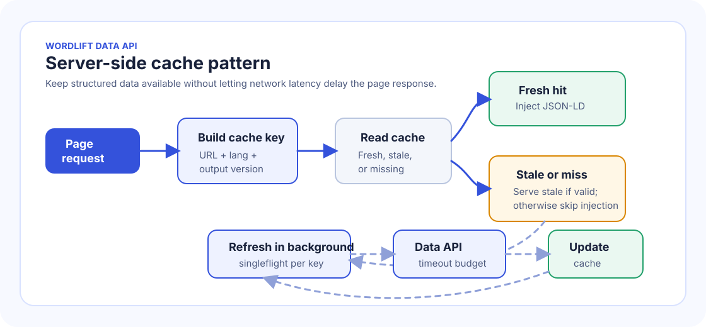

# Data API

The Data API returns the structured data for a web page from your WordLift Knowledge Graph, as JSON-LD.

Use it when you need the JSON-LD that WordLift has generated for a URL so you can inject it into the page HTML. The response is standard JSON-LD, compatible with RDF tooling and schema.org consumers.

If you already use the client-side WordLift Cloud API and want to move JSON-LD injection to your rendering layer, see [Migrate from client-side API to server-side API](/apis-and-sdks/data-api/migrate/).

## Ways to inject structured data {#ways-to-inject-structured-data}

You can inject structured data in two places: in the browser (client-side) or on your server (server-side). Server-side integrations refresh their cache either during a page request or through an out-of-band process.

### Client-side with WordLift Cloud {#client-side-with-wordlift-cloud}

WordLift Cloud loads `bootstrap.js` in the browser. The script detects the current page URL, fetches the structured data from the Data API, and injects it into the page as JSON-LD.

Use this option when you can add a script to the page but do not control the server-side rendering pipeline. See [Install WordLift Cloud](/platform/knowledge-graph/schema-publishing/wordlift-cloud/) for the full setup.

### Server-side rendering {#server-side-rendering}

With server-side rendering, your server, static-site generator, edge function or application framework fetches the Data API response before it returns the HTML to the browser.

Use this option when you control the page rendering pipeline and want the JSON-LD in the initial HTML response. For a Cloudflare edge example, see [Cloudflare integration](/apis-and-sdks/data-api/cloudflare-integration/).

The server-side flow is:

1. Determine the canonical URL of the page being rendered.
2. Build the Data API URL for that page.
3. Fetch the Data API response.
4. Serialize the response as JSON.
5. Inject it into the page inside a `script` tag with `type="application/ld+json"`.

```html
<script type="application/ld+json">
{
  "@context": "https://schema.org",
  "@type": "WebPage",
  "@id": "https://data.example.org/entity/page",
  "url": "https://example.org/page.html",
  "name": "Example page"
}
</script>
```

Do not build JSON-LD with string concatenation. Parse the Data API response as JSON, then serialize it with the JSON tools your runtime provides.

#### Next.js server-side example {#nextjs-server-side-example}

In Next.js, fetch the Data API response during server rendering and render it in the page as an `application/ld+json` script.

:::warning Example only

The following snippet shows where JSON-LD injection happens in a Next.js page. It is not production-ready: it does not implement the caching, fallback, background refresh, cache stampede protection or observability described in [Performance and caching](#performance-and-caching).

Do not make production page rendering depend directly on an uncached Data API request.

:::

```tsx
function toWordLiftDataApiUrl(pageUrl: string) {
  const url = new URL(pageUrl);
  return `https://api.wordlift.io/data/${url.protocol.replace(":", "")}/${url.host}${url.pathname}${url.search}`;
}

async function getJsonLd(pageUrl: string) {
  const response = await fetch(toWordLiftDataApiUrl(pageUrl), {
    next: { revalidate: 3600 },
    signal: AbortSignal.timeout(1500),
  });

  if (!response.ok) {
    return null;
  }

  return response.json();
}

function serializeJsonLd(jsonLd: unknown) {
  return JSON.stringify(jsonLd).replace(/</g, "\\u003c");
}

export default async function Page() {
  const pageUrl = "https://www.example.com/example-page";
  const jsonLd = await getJsonLd(pageUrl);

  return (
    <>
      {jsonLd ? (
        <script
          type="application/ld+json"
          dangerouslySetInnerHTML={{ __html: serializeJsonLd(jsonLd) }}
        />
      ) : null}
      <main>{/* Page content */}</main>
    </>
  );
}
```

The serializer escapes `<` as `<` so values in the JSON-LD cannot close the script element. Adapt the canonical URL construction to your routing model, locale handling and canonical URL policy. If the site is multilingual, append `__wl_lang` as described in [Multilingual requests](#multilingual-requests).

### Server-side with out-of-band cache prefill {#server-side-with-out-of-band-cache-prefill}

When canonical URLs are known and daily freshness is acceptable, a scheduled process can fetch and validate Data API responses before they are needed. The renderer then reads JSON-LD only from a shared application cache, which keeps Data API requests out of the page-rendering path.

See [Out-of-band Data API cache prefill](/apis-and-sdks/data-api/out-of-band-cache-prefill/) for the recommended 24-hour refresh schedule, 30-hour cache TTL, Next.js use case and failure behavior.

### Choosing client-side or server-side injection {#choosing-client-side-or-server-side-injection}

With the client-side WordLift Cloud integration, JSON-LD is added to the rendered DOM after the browser executes `bootstrap.js`. It is not present in the initial server-rendered HTML response.

This works for crawlers that render JavaScript, including Googlebot. AI crawlers, LLM-based retrieval systems and agentic tools do not all process pages the same way. Some render JavaScript, some rely on search engine indexes, some consume APIs or structured endpoints, and some inspect only the raw HTML response.

Prefer server-side rendering when AI search visibility, answer engine optimization (AEO), generative engine optimization (GEO) or access by non-JavaScript crawlers is a primary requirement. Server-side rendering puts the JSON-LD in the HTML returned by the server, so the consumer does not need to execute JavaScript.

Client-side injection remains useful when implementation speed and minimal application changes are the priority, or when the main consumer is known to render JavaScript. For broad machine discovery, server-side injection plus the machine-readable Knowledge Graph exposed through the Data API is the stronger default.

| Option | JSON-LD in initial HTML | Data API call happens | Follow |
| --- | --- | --- | --- |
| Client-side with WordLift Cloud | No | In the browser, after `bootstrap.js` runs | [Install WordLift Cloud](/platform/knowledge-graph/schema-publishing/wordlift-cloud/) |
| Server-side rendering | Yes | On your server or edge, with a request-time cache | [Performance and caching](#performance-and-caching), [Cloudflare integration](/apis-and-sdks/data-api/cloudflare-integration/) |
| Out-of-band cache prefill | Yes | In a scheduled job, never during rendering | [Out-of-band Data API cache prefill](/apis-and-sdks/data-api/out-of-band-cache-prefill/) |

## API URL format {#api-url-format}

The Data API endpoint is:

```text
https://api.wordlift.io/data/{page-url}
```

The `{page-url}` part is the full page URL rewritten as a path after `/data/`. Replace `https://` with `https/` and `http://` with `http/`.

For example, this page URL:

```text
https://example.org/page.html
```

becomes:

```text
https://api.wordlift.io/data/https/example.org/page.html
```

Include the complete path and query string when they are part of the canonical page URL.

If the page URL contains spaces, non-ASCII characters or reserved characters inside query values, encode those parts as a valid URL before you append the URL to the Data API path.

## Multilingual requests {#multilingual-requests}

Use the `__wl_lang` query parameter to request structured data for a specific language.

```text
https://api.wordlift.io/data/https/example.org/page.html?__wl_lang=en
```

The value is the ISO 639-1 two-letter language code, such as `en` for English or `it` for Italian.

When you pass `__wl_lang`, the Data API uses it to select the graph that is authoritative for that language and URL. See [Multilingual](/platform/knowledge-graph/multilingual/) for multilingual graph routing details.

## Output format {#output-format}

The Data API returns JSON-LD (JSON for Linked Data). Search engines can consume it directly as structured data, and tools that support JSON-LD can parse it as RDF.

Typical output includes:

- **Context.** A `@context`, usually schema.org.
- **Entities.** One or more schema.org entities.
- **Identifiers.** Stable entity identifiers in `@id`.
- **Page-level properties.** Properties such as `url`, `name`, `headline` or `description`, or relationships to related entities.

For HTML pages, inject the response inside:

```html
<script type="application/ld+json">
...
</script>
```

### Sample response {#sample-response}

```json
{
  "@context": "https://schema.org",
  "@graph": [
    {
      "@type": "WebPage",
      "@id": "https://data.example.org/entity/page",
      "url": "https://example.org/page.html",
      "name": "Example page",
      "about": {
        "@id": "https://data.example.org/entity/example-topic"
      },
      "publisher": {
        "@id": "https://data.example.org/entity/example-organization"
      }
    },
    {
      "@type": "Thing",
      "@id": "https://data.example.org/entity/example-topic",
      "name": "Example topic",
      "sameAs": [
        "https://www.wikidata.org/wiki/Q1492"
      ]
    },
    {
      "@type": "Organization",
      "@id": "https://data.example.org/entity/example-organization",
      "name": "Example Organization",
      "url": "https://example.org/"
    }
  ]
}
```

The exact entities and properties depend on the data available in the Knowledge Graph for the requested URL.

## Performance and caching {#performance-and-caching}

The Data API targets a response time under 200 ms. This is a target, not a guaranteed response time: network conditions, cache state, routing and other runtime factors can still affect latency.

:::warning

Do not make the page response depend on an uncached Data API call with no timeout or fallback. If the Data API response is delayed and no acceptable cached data exists, return the page without JSON-LD rather than delaying the response.

:::

For server-side integrations that refresh during page requests, use a stale-while-revalidate pattern. If the application instead refreshes a bounded URL inventory on a schedule, use [Out-of-band Data API cache prefill](/apis-and-sdks/data-api/out-of-band-cache-prefill/).



1. Build a cache key from the normalized canonical URL, `__wl_lang` when present, and the expected output format or version. A typical normalization policy lowercases the host, removes fragments, applies one trailing-slash rule, and sorts or removes non-canonical tracking query parameters.
2. Read structured data from the cache before calling the Data API.
3. If fresh cached data exists, inject it immediately.
4. If only stale cached data exists, inject it only when it is still within your maximum accepted stale age.
5. If there is no acceptable cached data and the Data API does not return within the page budget, skip JSON-LD injection for that response and log the miss.
6. Refresh the Data API data outside the critical rendering path when the platform supports it, for example in a worker, background task, asynchronous job or detached refresh.
7. Run one refresh per cache key at a time, and throttle refresh attempts to avoid repeated API calls during traffic spikes.
8. Update the cache when the Data API response returns, so future requests can use fresh data.

Set separate limits for:

- **Render wait.** The maximum time the page renderer may wait for structured data.
- **Fetch timeout.** The Data API fetch timeout.
- **Fresh TTL.** How long cached data counts as fresh.
- **Maximum stale age.** The age after which cached data must no longer be injected.

Track cache hit rate, stale response usage, cache misses, timeout rate, refresh failures, refresh latency and the age of cached data served. These metrics let you tune the thresholds without affecting page performance.

## Authentication, errors and limits {#authentication-errors-and-limits}

The examples on this page send no key. When you fetch from your server or edge, do not forward cookies, authorization headers or other viewer request metadata to the Data API.

Treat any response other than a successful JSON or JSON-LD response as a cache miss: keep the previous valid cache entry if you have one, or render the page without WordLift JSON-LD.

:::warning[Review needed]
TODO [SME]: confirm that the Data API is a public endpoint and how access is controlled per graph.
:::

:::warning[Review needed]
TODO [SME]: give the status code and body returned for a URL with no data, any rate limit, and the cache headers returned (for example `Cache-Control` or `ETag`).
:::

For conventions shared across WordLift APIs, see [APIs and SDKs](/apis-and-sdks/#errors).

## Parsing JSON-LD and RDF {#parsing-json-ld-and-rdf}

Treat the response as structured JSON-LD, not as text to modify with regular expressions or string replacement.

Use a JSON-LD or RDF library when you need to compact, expand, validate, transform or query the response, convert it to RDF triples, or merge it with other linked data. Use the standard JSON-LD or RDF parsing APIs of your runtime library to convert the response to RDF datasets, triples or another RDF serialization.

Useful references:

- [JSON-LD](https://json-ld.org/)
- [jsonld.js](https://github.com/digitalbazaar/jsonld.js) for JavaScript and Node.js
- [RDFLib.js](https://github.com/linkeddata/rdflib.js) for JavaScript RDF workflows
- [RDFLib](https://rdflib.readthedocs.io/) for Python
- [Apache Jena](https://jena.apache.org/) for Java and JVM applications

## Related {#related}

- [Migrate from client-side API to server-side API](/apis-and-sdks/data-api/migrate/)
- [Out-of-band Data API cache prefill](/apis-and-sdks/data-api/out-of-band-cache-prefill/)
- [Cloudflare integration](/apis-and-sdks/data-api/cloudflare-integration/)
- [Install WordLift Cloud](/platform/knowledge-graph/schema-publishing/wordlift-cloud/)
- [Multilingual](/platform/knowledge-graph/multilingual/)
- [Concepts](/concepts/), for definitions of JSON-LD and linked data
