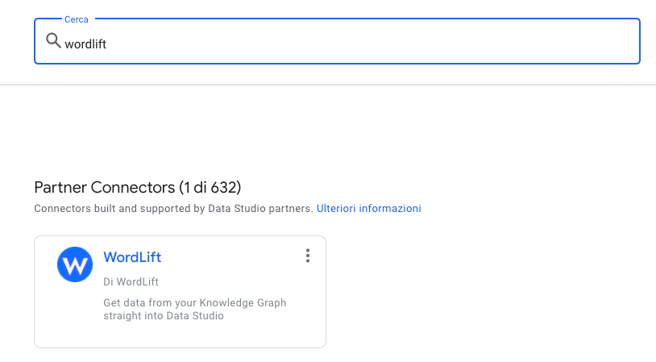
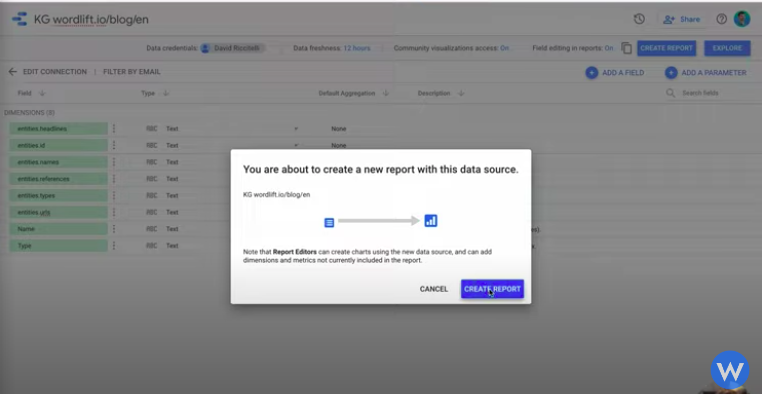
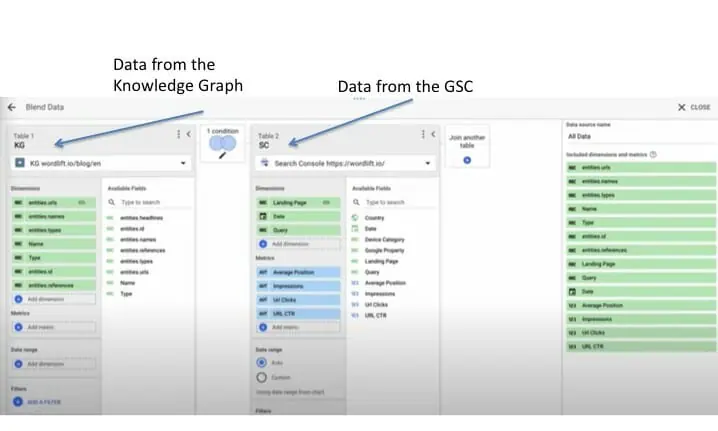

# WordLift Looker Studio connector

With the [WordLift Looker Studio connector](https://wordlift.io/blog/en/wordlift-data-studio-connector/), you can **create semantic SEO reports** by loading data from your Knowledge Graph directly into Looker Studio and merging it with Search Console or any other web analytics platform.

## Get started

### 1. Search for it

To start creating your semantic SEO report, search for WordLift on the [Google Looker Studio connectors page](https://datastudio.google.com/datasources).

:::warning[Review needed]
TODO [SME]: confirm whether to embed the video at https://wordlift.io/blog/en/wp-content/uploads/sites/3/2022/08/semantic-seo-report.mp4 here; the legacy embed did not render.
:::

Select it and **enter your WordLift key**.

A GraphQL query is ready for you, so you don't need to change anything to get started. If you already know the query you want to run, you can use it instead. For example, an e-commerce website might query product attributes or prices. Keep the **use report template for new report** box checked to get a prebuilt report.

Select **Connect**. The fields that come from the report appear. Then select **Create Report**.

### 2. Add GSC as a data source and check the blend

Two more steps complete your report:

1. Go to the managed data sources and add your Google Search Console (GSC) data source: choose your website, choose **URL Impressions**, choose **Web Type**, and select **Create**.
2. Check the blends to verify that the data from the Knowledge Graph and GSC is merged.

You can filter the data by EntityType and choose the time period you prefer.

:::info Note
Watch this video to learn how to [create your semantic SEO reports](https://youtu.be/mWMEbx3qIVI) in 3 steps.
:::

<iframe src="https://www.youtube-nocookie.com/embed/mWMEbx3qIVI" width="100%" height="540" frameborder="0" scrolling="auto"></iframe>
