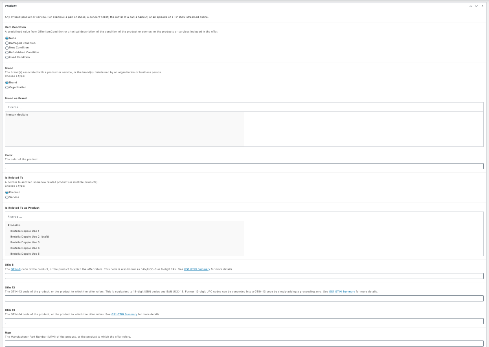
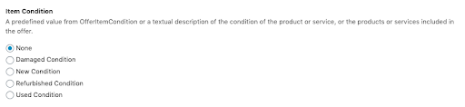
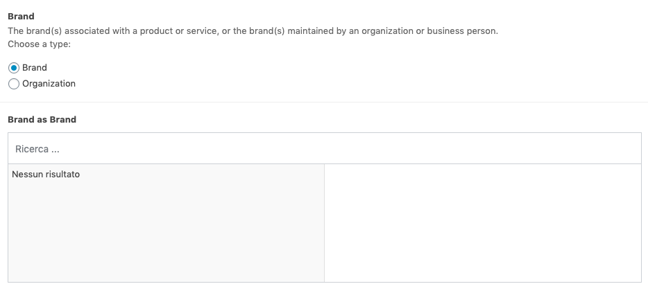
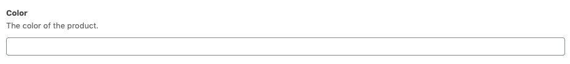
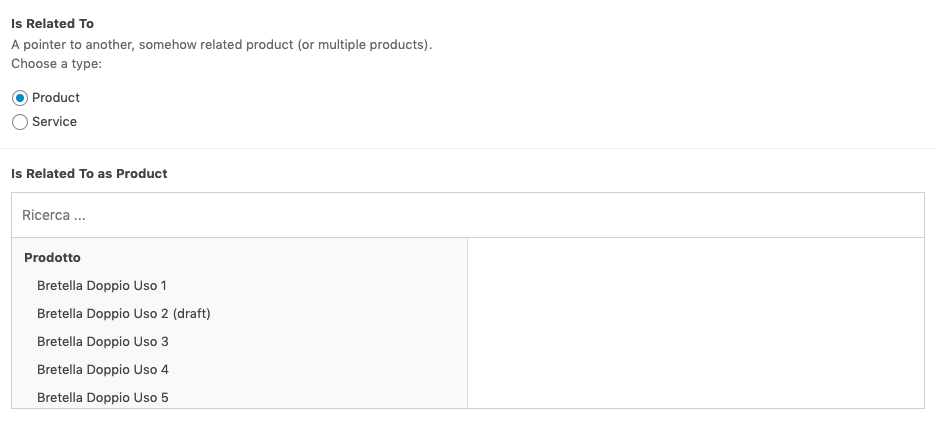
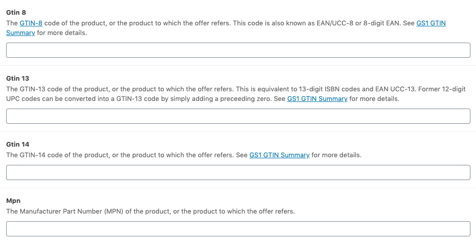
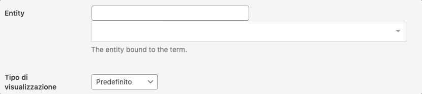
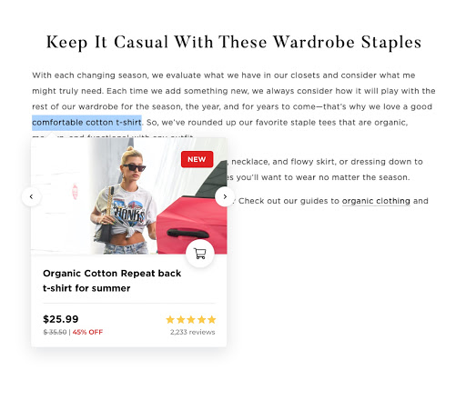

# WooCommerce SEO by WordLift

[WooCommerce SEO by WordLift](https://woocommerce.com/products/e-commerce-seo-by-wordlift/) is built for e-commerce websites that run on WordPress with WooCommerce. It adds structured data and extended product markup to your products, so search engines like Google get a fuller description of each item.

It also connects your products, brands, product categories and features in a [Product Knowledge Graph](/platform/knowledge-graph/product-knowledge-graph/). You can use these connections to improve internal linking and product recommendations.

## Overview

WooCommerce SEO by WordLift adds these features to your WordPress site:

1. **Structured data:** schema.org linked data for your products.
2. **Extended markup:** support for additional product markup properties.
3. **Category markup:** structured data on your category pages.
4. **Product Knowledge Graph:** connections between products, brands, categories and features.
5. **Product widgets:** the Product Navigator and Product Faceted Search connect blog posts with products and product categories.
6. **Image sizes:** images sized to Google's requirements.

This video shows how to add schema markup to your WooCommerce store with WooCommerce SEO by WordLift.

<iframe src="https://www.youtube-nocookie.com/embed/om8wgy7IXfk" width="100%" height="540" frameborder="0" scrolling="auto"></iframe>

## Editors

The WooCommerce extension adds fields to the product editor in WordPress. Use them to describe your products in more detail. As you fill in the fields, WordLift adds extended product markup to the product.



You can add:

1. The product condition, chosen from a list of options.



2. The manufacturer, which can be a brand or an organization.



3. The color of the product, where relevant.



4. Related products or services.



5. Product codes that identify your products unambiguously, where relevant.



## Categories

Turn a category page into an entity by linking it to an entity from your vocabulary. This adds a layer of structured data to the category page.

To link a category to an existing entity:

1. Type the first few letters of the entity name.
2. Select the entity from the suggestions.
3. Select **Save**.



## Widgets

### Products Navigator

The Product Navigator suggests other products that your customers might be interested in.

To add it to a product or article template, use this shortcode:

```text
[wl_products_navigator]
```

The Product Navigator widget supports the same parameters as the [Navigator](/integrations/wordpress-plugin/widgets/#navigator).


*The Product Navigator of WordLift for WooCommerce on Oakley.com USA*

### Product Card

The Product Card shows customers a preview of a product when they hover over a link to it. To activate the link and the Product Card, annotate the product in your articles and pages. To learn how, see [annotating content with the WordLift Edit Post Widget](/integrations/wordpress-plugin/analysis/#wordlift-edit-post-widget).



*The WordLift Product Card on an article*

:::info Note
Read [how to improve your WooCommerce product pages](https://wordlift.io/blog/en/woocommerce-product-pages/) on the WordLift blog.
:::
