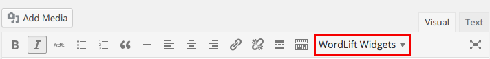
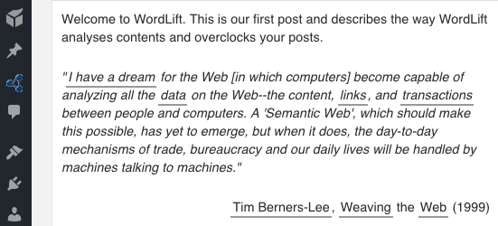
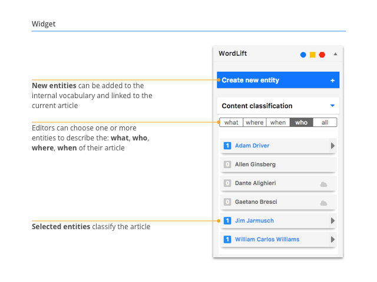
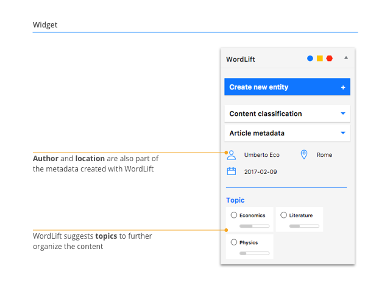
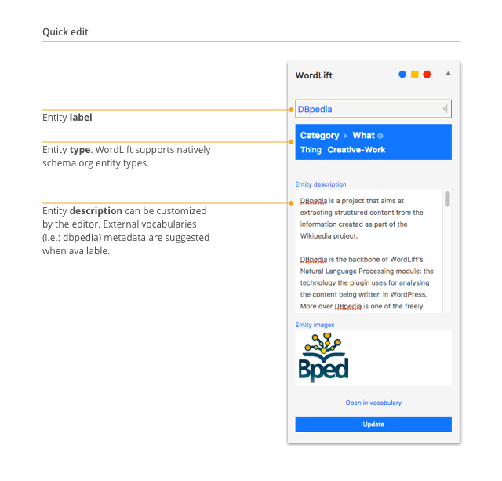
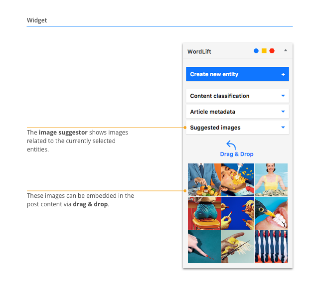

# Analysis

:::note
This page supports existing installs of the classic WordPress plugin; new customers start with [WordLift Cloud](/platform/knowledge-graph/schema-publishing/wordlift-cloud/).
:::

WordLift suggests relevant facts, images and links that help you organize and enrich your content.

WordLift analyzes articles with Named Entity Recognition (NER) and Named Entity Disambiguation (NED) to extract [named entities](/concepts/#entity) from posts and pages.

The entities you use to annotate content come from [knowledge graphs](/concepts/#knowledge-graph) or [custom vocabularies](/concepts/#vocabulary), such as DBpedia and GeoNames.

WordLift creates and publishes annotations as [Linked Open Data](/concepts/#linked-open-data).

## Content writing

Once the plugin is [installed](/integrations/wordpress-plugin/getting-started/#installation) and [configured](/integrations/wordpress-plugin/getting-started/#configuration), start writing a post in the [standard WordPress visual editor](https://en.support.wordpress.com/visual-editor).

WordLift adds a widgets menu to the visual editor, which you use to embed [widgets](/concepts/#widget) in the page.

:::caution Warning
WordLift is designed for the standard **WordPress visual editor**. It also offers experimental support for visual builders. To test your specific install, contact [support@wordlift.io](mailto:support@wordlift.io).
:::

:::info Note
To switch the WordLift analysis on or off, select the *open|close* arrow in the top right corner of the WordLift Edit widget.
:::

## WordLift widgets menu

The menu lets you add five [widgets](/concepts/#widget) to your post. Widgets present the entities in the post visually and help readers find more relevant content.

:::info Note
As the site grows with new articles, entities and annotations, the widgets update automatically. You don't need to change anything in the post.
:::

The five widgets are:

- **Chord:** visualizes the relationships between all entities, starting from the entities mentioned in the post.
- **Timeline:** displays a chronological, navigable list of the *Event* entities mentioned in the post.
- **GeoMap:** displays on a map all the *Place* entities mentioned in the post.
- **Navigator:** recommends content with relevant **internal** links to other posts on the same website.
- **Faceted Search Widget:** provides a faceted search interface that helps readers find relevant articles through the network of entities.

Each widget has a matching shortcode. To learn how shortcodes work, see [widget shortcodes](/integrations/wordpress-plugin/widgets/#widget-shortcodes).

## Analyzing the text {#analysing-the-text}

WordLift starts analyzing the post as you write.

When you select **Save Draft** for the first time, WordLift extracts the [entities](/concepts/#entity) and underlines them.

Select an entity to [reconcile](/concepts/#reconciliation) it with the same entity in DBpedia, using the [WordLift Edit Post Widget](#wordlift-edit-post-widget). The entities you choose annotate the post.

:::info Note
Text annotation in WordLift is semi-automatic. You must validate the [entities](/concepts/#entity) that WordLift extracts before WordLift records them.
:::

WordLift helps you identify the basic *who*, *what*, *when* and *where* of an article. To add more context, create new entities in the [custom vocabulary](/concepts/#vocabulary). You add annotations to posts and pages with the **WordLift Edit Post Widget**.

### WordLift Edit Post Widget

You can annotate articles in two ways:

- **Top down:** you organize entities in the *who*, *what*, *when* and *where* categories, **regardless of where each entity appears in the text**. When you choose an entity this way, **WordLift annotates every occurrence of that entity**.
- **Bottom up:** you annotate and organize entities in the *who*, *what*, *when* and *where* categories, **starting from a specific occurrence of the entity in the text**. When you choose an entity this way, **WordLift annotates only the occurrence you chose**.

#### Top down annotation

From the list of entities detected in the text, choose the entities that describe your post, without selecting a specific occurrence in the text. The entities you select describe the whole post, not a single occurrence.

#### Bottom up annotation

In this example, the editor selects the "Expo 2015" occurrence in the text. WordLift annotates this specific occurrence with the entity "Expo 2015".

#### Edit entity properties

In this example, the editor edits the main properties of the entity "Expo 2015" while writing the post. To edit the complete list of properties, select the "open in vocabulary" link (see [Edit entity](/integrations/wordpress-plugin/edit-entity/)).

#### Image suggestor

Images for each entity appear in the WordLift Edit Post Widget, and you can embed them in the visual editor.

## Reconciling entities

In this example, choose *\[Web\]* as a relevant entity, because the post refers to the World Wide Web. The entity type for *\[Web\]* is `Thing`, so the entity appears under the *what* category.

:::info Note
[Reconciling](/concepts/#reconciliation) entities means **linking** the entity in your text with its equivalent in other sources, such as DBpedia.
:::

The [WordLift Edit Post Widget](#wordlift-edit-post-widget) now shows these parameters:

- **Entity Title:** the name of the entity.
- **Entity Category:** the type of entity, according to the `schema.org` vocabulary.
- **Entity Description:** the description of the entity.

You can edit every parameter except the title directly in the [WordLift Edit Post Widget](#wordlift-edit-post-widget).

:::info Note
The data used for enrichment comes from openly available sources, such as DBpedia, which can contain misleading information. You can always edit it.

You can also edit entity properties from the "open in vocabulary" link (see [Edit entity](/integrations/wordpress-plugin/edit-entity/)).
:::

When you select **Save**, you annotate the post, which adds a [semantic fingerprint](/concepts/#semantic-fingerprint) to this piece of content.

Another important entity in this post is the creator of the World Wide Web, Tim Berners-Lee. WordLift identifies the entity as a `Person`. All `Person` and `Organization` types appear under the *who* category.

:::info Note
WordLift saves annotations when you publish a post or page. Annotations and the data for each annotated entity stay in *draft* until you publish the post.
:::

:::caution Warning
If you edit or remove the text in the visual editor, you lose the annotations saved on it. WordLift stores your selection of entities in the content of the visual editor.
:::

## Creating a new entity

You use WordLift to:

1. Categorize your content.
2. Help people find content that interests them.
3. Describe your content in a machine-readable format that other computers can reuse.

Sometimes WordLift doesn't detect a key concept that matters for these goals. In that case, teach it to WordLift by creating a new entity.

:::info Note
As a basic guideline, apply entities the way a librarian would use tags to classify your content if it were a book. For more detail, see the [guidelines for creating new entities](/support/faq/#what-are-the-guidelines-for-creating-new-entities-to-annotate-a-blog-post-or-a-page).
:::

New entities become part of the [WordLift vocabulary](/concepts/#vocabulary).

Once you add an entity to the vocabulary, WordLift detects it automatically every time you mention it in your content.

In this example, WordLift didn't detect one significant entity, so it is worth teaching it to WordLift.

The entity is *\[WordLift\]* itself. To create it:

1. Highlight the text `WordLift`.
2. Select **Create New Entity** at the top of the [WordLift Edit Post Widget](#wordlift-edit-post-widget).
3. Edit the properties of the new entity.

Choose the category *Creative Work* (it also applies to *Software*), add a description and select **Save**. The new entity now appears among the [related entities](/concepts/#related-entities) of the post, along with *\[Web\]* and *\[Tim Berners-Lee\]*.

:::caution Warning
To create a new entity over **an existing annotation**, first remove the annotated entity, then rewrite the entity, then create a new one as described above. The animation below shows the steps.
:::

Next, see [Edit entity](/integrations/wordpress-plugin/edit-entity/).
