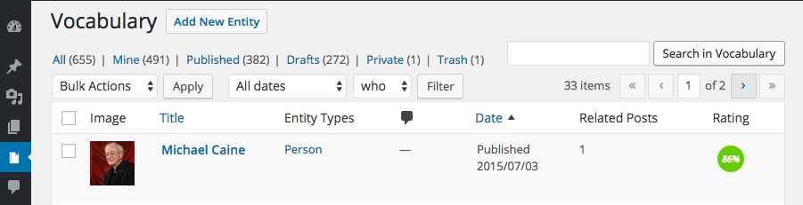
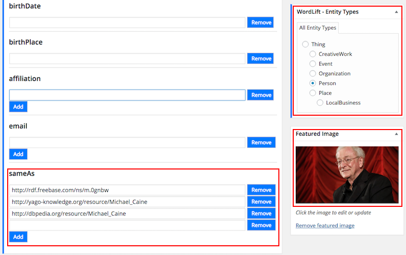
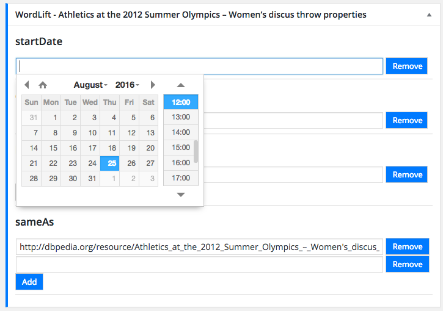
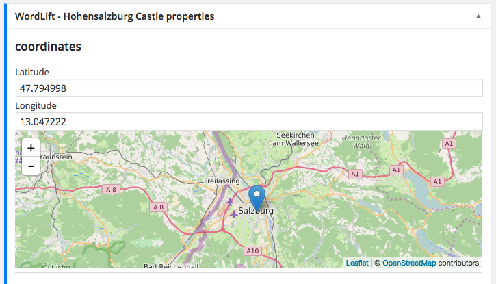
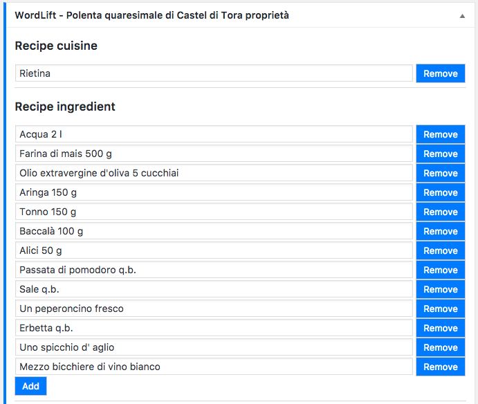
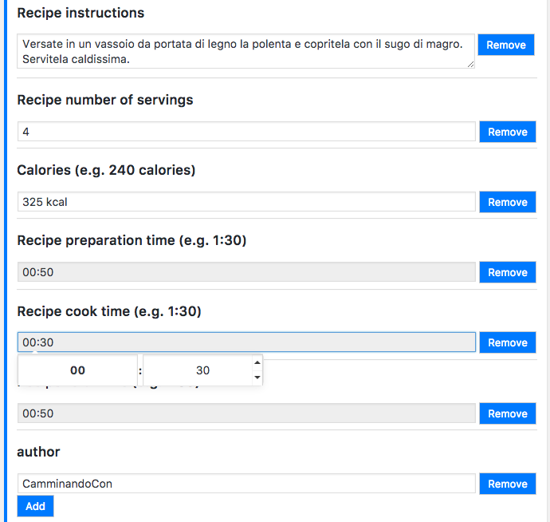
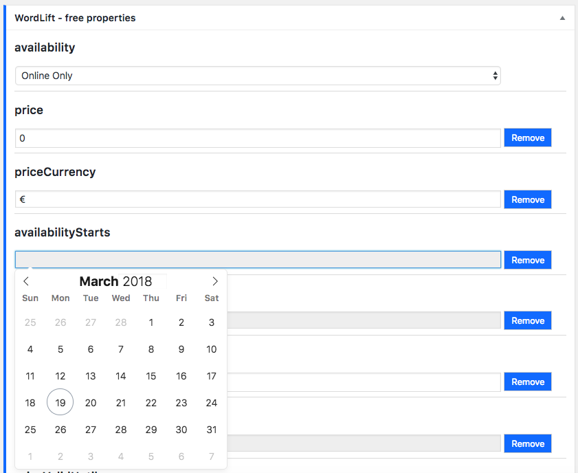
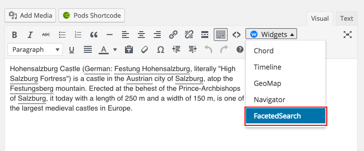
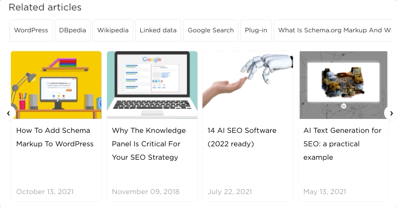

# Edit entity

**WordLift** uses [entities](/concepts/#entity) to annotate and organize blog posts and pages.
All entities can be edited using the [WordLift Edit Post widget](/integrations/wordpress-plugin/analysis/#wordlift-edit-post-widget) or from the **Entity Page** itself. To access all entities or add a new entity, select the **Vocabulary** icon in the dashboard menu.

When you annotate a post with an entity, WordLift adds a link to the **entity page**.
These links are useful for three reasons:

1. They allow users to navigate the website
2. They help establish information hierarchy using the network of entities
3. They could help spread link juice (ranking power) around the websites for better SEO.

Curating **entity pages** with WordLift is similar to writing an article on [Wikipedia](http://wikipedia.org). These *entity posts* are useful for:

- Providing contextual information to articles
- Aggregating all content that refers to the same entity

## Edit entity properties

You can edit these properties of the entity page from the corresponding *meta box*:

> - **Name:** the title of the article
> - **Description:** the body of the article
> - **Image:** the featured image of the article
> - **Entity Types:** the corresponding type (such as *Thing*, *Person*, *Place*, *Event*, *Organization*, *Creative Work*, ...) that can be managed via the *WordLift - Entity Type* box in the editing window
> - **Permalink:** the URL describing the entity
> - **Same-As:** the URLs of same entity on the different sources

### Entity types and properties table

This table lists the properties you can edit with WordLift for each entity type.

| Type           | Description                                            | Properties                                                                                                                                                                            | Schema.org      |
| -------------- | ------------------------------------------------------ | ------------------------------------------------------------------------------------------------------------------------------------------------------------------------------------- | --------------- |
| Thing          | The most generic type of entity.                       | name,description,image, type,URL,sameAs, additionalType.                                                                                                                              | [Thing]         |
| Person         | A person.                                              | name,description,image, type,URL,sameAs, additionalType.                                                                                                                              | [Person]        |
| Place          | Entities with a physical extension.                    | name,description,image, type,URL,sameAs, additionalType,geo.                                                                                                                          | [Place]         |
| Event          | An event happening in a specific time and location.    | name,description,image, type,URL,sameAs, additionalType,location, startDate,endDate,performer, offers.                                                                                | [Event]         |
| Offer          | An offer.                                              | name,description,image, availability,price,URL, priceCurrency, availabilityStarts, availabilityEnds, inventoryLevel,validFrom, priceValidUntil,itemOffered.                           | [Offer]         |
| Organization   | An organization.                                       | name,description,image, type,URL,sameAs, additionalType,founder.                                                                                                                      | [Organization]  |
| Local business | A physical business or branch of an organization.      | name,description,image, type,URL,sameAs,address founder,geo.                                                                                                                          | [LocalBusiness] |
| Creative Work  | The most generic kind of Creative Work(i.e. Software). | name,description,image, type,URL,sameAs, additionalType.                                                                                                                              | [CreativeWork]  |
| Recipe         | A food recipe.                                         | name,description,image, type,URL,sameAs, additionalType, cookTime, prepTime, totalTime, recipeCuisine, recipeIngredient, recipeInstructions, recipeYield, author, nutrition.calories. | [Recipe]        |

### Edit an event

Events, which occur at a specific time, are also entities. To personalize the *startDate*, *endDate* and *location* of an event, use the **Event Properties** box.

You can also link an event with the *performer* (a presenter, a musician, or a group of speakers) by adding a reference to either a Person or an Organization.

You can also link an event with an Offer (an entity type), which defines, for example, the ticket price for the event.

### Edit a place

Places are also entities. To personalize the *geo coordinates* (longitude and latitude) of a place, use the **Coordinates** box: either edit the *Latitude* and *Longitude* fields or place the pin on the map.

### Edit a recipe

Recipes are also entities. To personalize *ingredients*, *cuisine*, *preparation time*, *cooking time*, *total time*, *number of portions*, *author* and *calories*, edit the data in the Recipe meta boxes. Choose the entity type *Recipe* to see these additional fields.

### Edit an offer {#edit-a-offer}

You can link an offer from an event to define, for example, the pricing of the event.

## Updating the description

When you have something meaningful to say about a specific concept, **curate the information and edit the data that WordLift fetched automatically** (*this creates your own version of Wikipedia*).

## Linking other entities

You can annotate entity pages just like blog posts.

After you save the new description, WordLift analyzes the text and suggests related entities. You can now *link* an entity with other entities. WordLift stores these relationships between entities in the [graph](/concepts/#knowledge-graph) using the Dublin Core property `dct:related`. WordLift uses this information to infer new connections between the content of the site. For more on *entity linking*, see the FAQ on [when to link one entity to another](/support/faq/#when-should-i-link-one-entity-to-another).

## The Faceted Search widget

Use **entity pages** to help readers browse the content of your website, with the **Faceted Search Widget**.
To add the widget to the entity page, use the **Faceted Search** option in the [widgets dropdown menu](/integrations/wordpress-plugin/analysis/#wordlift-widgets-menu).

You can also use the `[wl_faceted_search]` shortcode.

- **Faceted Search:** provides a faceted search interface that helps readers discover relevant articles through the network of entities.

The example above shows the widget on the front end. Readers can select multiple concepts to highlight the list of articles related to them.

## Save data

To save the entity, select **Publish**.
When you change an existing entity, select **Update**. In both cases, WordLift stores the data on the WordPress site and in the [graph](/concepts/#knowledge-graph) at the same time.

Next, see [Publishing](/integrations/wordpress-plugin/publishing/).

[creativework]: http://schema.org/CreativeWork
[event]: http://schema.org/Event
[localbusiness]: http://schema.org/LocalBusiness
[offer]: http://schema.org/Offer
[organization]: http://schema.org/Organization
[person]: http://schema.org/Person
[place]: http://schema.org/Place
[recipe]: http://schema.org/Recipe
[thing]: http://schema.org/Thing
