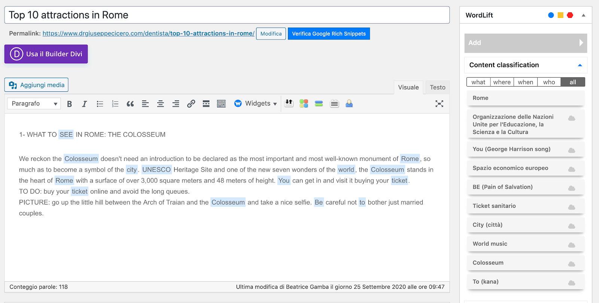
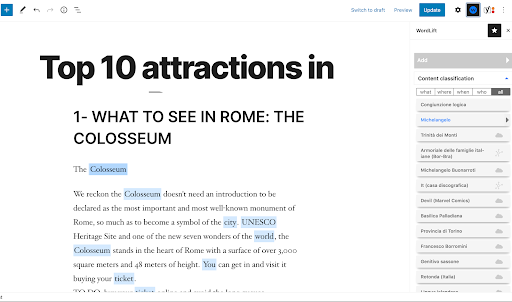
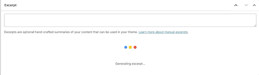

# Editors

## Classic editors

WordLift works in the Classic Editor in WordPress.
**Attention:** the WordLift plugin works only in Visual mode.

**New post**

Create a new post, add its title, start writing content.

Once the article is finished, save the draft.

Go back to the article draft. To annotate your article with an entity, select its tile in the WordLift sidebar on the right.

When you finish annotating and curating the article's metadata, publish the article.

## Block editors

WordLift works in the Block Editor in WordPress.
**Attention:** the WordLift plugin works only in Visual mode.

**New post**

Create a new post, add its title, start writing content.

Once the article is finished, save the draft.

Go back to the article draft and select the **W** icon.

The WordLift sidebar opens. To annotate your article with an entity, select its tile.

When you finish annotating and curating the article's metadata, publish the article.

## Automatic summarization

WordLift uses [Natural Language Processing](https://wordlift.io/blog/en/entity/natural-language-processing/) to summarize the content that you write. You can use the summary to write the meta description, to promote your article on social networks, and more.

:::info Note
Automatic text summarization is available on Business+ and Enterprise. To upgrade your subscription, [contact our sales team](https://wordlift.io/contact-us/).
:::

WordLift uses the summarized content for the schema description property [(schema:description)](https://schema.org/description). [WordLift's context cards](https://wordlift.io/blog/en/entity/context-card/) also use it.

To use it, first make sure that excerpts are visible in your WordPress installation. WordPress uses excerpts for summaries of your content. WordLift generates the summary when you select **Refresh**. Select **Use** to edit the summary and save it as the excerpt for your post.

To learn more about text summarization for SEO, watch the video tutorial on [how to use content summarization to create meta descriptions](https://wordlift.io/academy-entries/generating-meta-descriptions-bert/).
