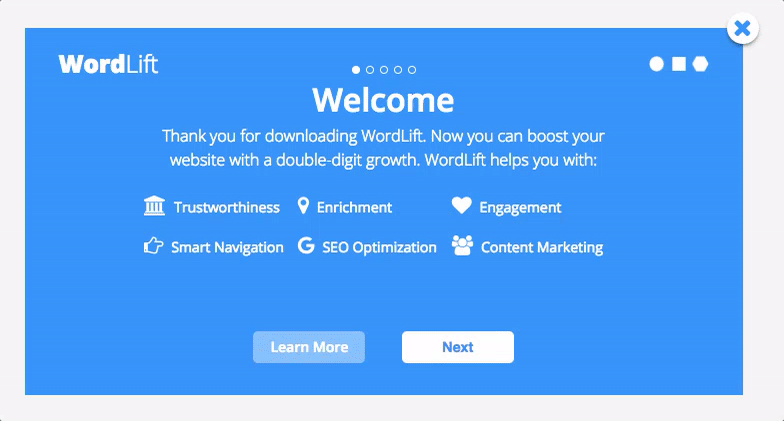
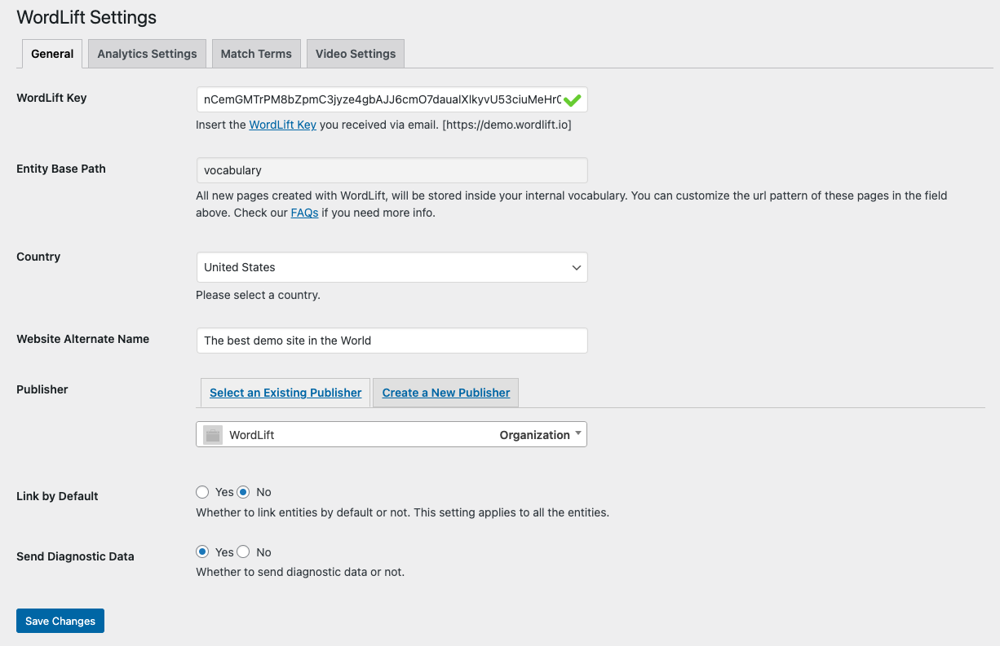

# Get started with the WordPress plugin

Install, activate and configure the classic WordLift plugin once per site, for example when you add WordLift to a new environment, a rebuilt site or an additional site on your account. This guide is for existing customers who already use the classic plugin. New customers start with [Install WordLift Cloud](/platform/knowledge-graph/schema-publishing/wordlift-cloud/).

## Before you begin {#requirements}

- **WordPress 5.3 or higher.**
- **PHP 7.4 or higher** on your server.
- **Your WordLift key.** Use the [WordLift key](/concepts/#wordlift-key) your account already has. If you cannot find it, contact [support@wordlift.io](mailto:support@wordlift.io).
- **Administrator access** to the WordPress dashboard.
- **A full backup** of your website files and database. Take it before you install the plugin.

## Install the plugin {#installation}

Install WordLift from the WordPress plugin directory, or upload the plugin files to your server yourself.

### Install from the WordPress plugin directory

1. Sign in to your WordPress dashboard.
2. Open **Plugins** and select the option to add a new plugin.
3. Search for `WordLift`.
4. Find the WordLift plugin in the results and select **Install Now**.
5. Select **Activate**.

### Upload the plugin manually

1. Download the plugin zip file from the [WordPress plugin directory](https://wordpress.org/plugins/wordlift/).
2. Upload the zip file to the `wp-content/plugins` directory of your WordPress installation, for example with an FTP client.
3. Unzip the file. From the command line, run:

   ```bash
   unzip wordlift.zip
   ```

4. In the WordPress dashboard, go to **Plugins > Installed Plugins** and activate WordLift.

For more on manual installs, see [Manage plugins](https://wordpress.org/documentation/article/manage-plugins/) in the WordPress documentation.

## Activate with the setup wizard {#activation}

The setup wizard opens when you first start the plugin. Use it to activate WordLift and set the basics.



1. Enter your WordLift key.
2. Set the entity base path, the URL pattern for the entity pages in your vocabulary.
3. Set the language or country for your site.
4. Choose the publisher of the website, a person or an organization.

You can change all of these later on the **Settings** screen.

## Review the settings {#configuration}

Open **Settings** in either of two ways:

- Hover over the WordLift logo in the WordPress dashboard menu, then select **Settings**.
- Go to **Plugins > Installed Plugins** and select **Settings** under WordLift.



The settings available depend on your license type.

| Setting | What it does | Default |
| --- | --- | --- |
| WordLift Key | Activates the plugin and connects it to your WordLift account. | None. You enter it in the wizard. |
| Entity Base Path | Sets the URL segment between your domain and each entity page, as in `www.domain.com/vocabulary/name-of-the-entity-page`. Remove the word to place entity pages at the root (`www.domain.com/name-of-the-entity-page`), or replace it with keywords of your choice. | `vocabulary` |
| Country | Sets the country you target for SEO. WordLift uses the language in your WordPress settings as the site's primary language. | Not documented |
| Website Alternate Name | Gives Google an alternate version of your site name, such as an acronym or a shorter name, for the site's `WebSite` structured data. | Your site tagline |
| Publisher | Sets the person or organization that publishes the site's content. WordLift uses this entity to enrich your metadata. You can create the entity directly on this screen. | None |
| Link by Default | Controls whether WordLift adds links to the entities you create automatically. | Not documented |
| Send Diagnostic Data | Controls whether the plugin sends diagnostic data to WordLift. WordLift uses it to improve the plugin and to support you faster. | Not documented |

:::warning[Review needed]
TODO [SME]: Confirm whether the current settings screen shows "Country" or "Site Language" (older docs say one key per language), whether Website Alternate Name is still there, and the defaults marked "Not documented".
:::

WordLift supports one language per site. For the list of supported languages, see [What are the languages supported by WordLift](/support/faq/#what-are-the-languages-supported-by-wordlift) in the FAQ.

## Check that it works

Open a draft post in the editor and confirm that WordLift analyzes the text and suggests entities. To learn what the analysis shows, see [Analysis](/integrations/wordpress-plugin/analysis/).

:::warning[Review needed]
TODO [SME]: Confirm the quickest check that a fresh install is working (for example, running analysis on a draft post) and what the reader should see.
:::

## Next steps

- **[Editors](/integrations/wordpress-plugin/editors/):** Use WordLift in the Classic Editor and the Block Editor.
- **[Sidebar](/integrations/wordpress-plugin/sidebar/):** Review and select the entities WordLift suggests.
- **[Analysis](/integrations/wordpress-plugin/analysis/):** Annotate posts with entities.
- **[Mappings](/integrations/wordpress-plugin/mappings/):** Map your content to schema.org types.
- **[Publish and check structured data](/integrations/wordpress-plugin/publishing/):** Check what a post publishes.
