# Mappings

Mappings help you organize and structure content while improving the SEO of your website.

**The markup in schema.org adds meaning to your content** for search engines but the real benefits come when you **use structured data as the basis for your content model.**

This approach is the **entity-based content model**. To learn more, watch these webinars:

- [Content Modeling for Search Optimization](https://wordlift.io/academy-entries/content-modeling/)
- [Get Started with Structured Content and Schema.org](https://wordlift.io/academy-entries/structure-your-content/)

You can also [book a call with the WordLift SEO team](https://wordlift.io/book-a-demo).

WordLift mappings are an integration for the [Advanced Custom Fields](https://www.advancedcustomfields.com/) (ACF) plugin. They let you either:

- Reuse fields that you already configured with ACF on your CMS.
- Create new fields based on the schema.org taxonomy.

## Supported schema types

WordLift **automatically loads the latest version of the schema.org vocabulary**, supports **all the available schema types**, and lets you personalize your content model while it injects the JSON-LD into your pages.

## Advanced schema types

### HowTo

HowTo schema lets you give exact instructions to achieve a result through a sequence of steps, for example a guide on how to start your own business or a simple DIY recipe.

### Recipe

Recipe schema lets you specify the steps in your recipe, including nutritional information and the cooking method. This can all be done by choosing specific keywords under the properties. Learn [how to add schema markup for recipes](https://wordlift.io/academy-entries/schema-markup-for-recipe/).

### Course

Course schema markup is the specific entity type for web pages that describe an educational course that may be offered online or in person by public and private schools, colleges, and universities. Learn [how to add course schema markup to your content](https://wordlift.io/academy-entries/course-schema-markup/).

### FAQ

FAQ stands for "Frequently Asked Questions", where the questions that most people ask you about your activities can be listed on this webpage. Some properties include breadcrumbs and lastReviewed, which is the date on which the content on this web page was last reviewed for accuracy and/or completeness.
Learn more on [how to use the FAQPage Schema type](https://wordlift.io/academy-entries/how-to-use-faq-schema-type/).

### Review

Review schema shows you the opinions and feedback regarding an item, a movie or a service.

### Product

Product markup communicates to Google a series of essential data for your customers such as product description, image, price, availability, conditions, and user ratings.
With WordLift you can create a [Product Knowledge Graph](https://wordlift.io/blog/en/product-knowledge-graph/) and help Google discover more about the brand, the color, the condition (new, used, reconditioned), the shipping details and more.
If you are using WooCommerce here is [all you need to know about the product schema](https://wordlift.io/blog/en/schema-markup-woocommerce/).

### Event

Event schema is a type of structured data markup that informs search engines that a particular web page is an event that takes place offline or online, such as concerts, seminars/webinars, meetings and more. Learn [how to add event schema markup to your website](https://wordlift.io/academy-entries/event-schema-markup/).

### Service

Service schema helps search engines understand your business and your services.
Learn more on [how to use the service markup](https://wordlift.io/academy-entries/service-markup/).

### LocalBusiness

LocalBusiness is the schema markup for a particular physical business or branch of an organization, such as a restaurant, a particular branch of a restaurant chain, a branch of a bank, a medical practice, a club or a bowling alley. Learn [how to add LocalBusiness schema to your web pages](https://wordlift.io/academy-entries/how-to-add-localbusiness-schema/).

## Advanced Custom Fields

For a step-by-step tutorial, read [how to enhance your content model using WordLift mappings](https://wordlift.io/academy-entries/wordlift-mappings-tutorial/).

### Requirements

- [Advanced Custom Fields](https://wordpress.org/plugins/advanced-custom-fields/) (ACF)

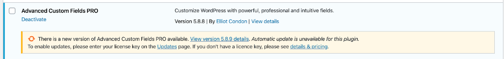

- Advanced Custom Fields for schema.org by WordLift ([Contact our SEO team to get started](https://wordlift.io/customize-your-plan/))

### Add custom fields

First, create a **new custom field**: select **Field Group** and choose a title.

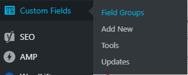

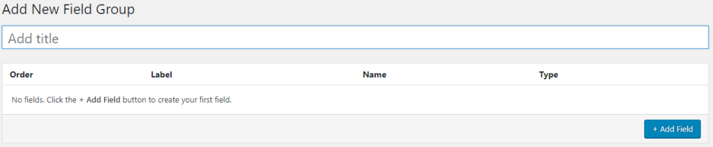

Then add your first **field**.

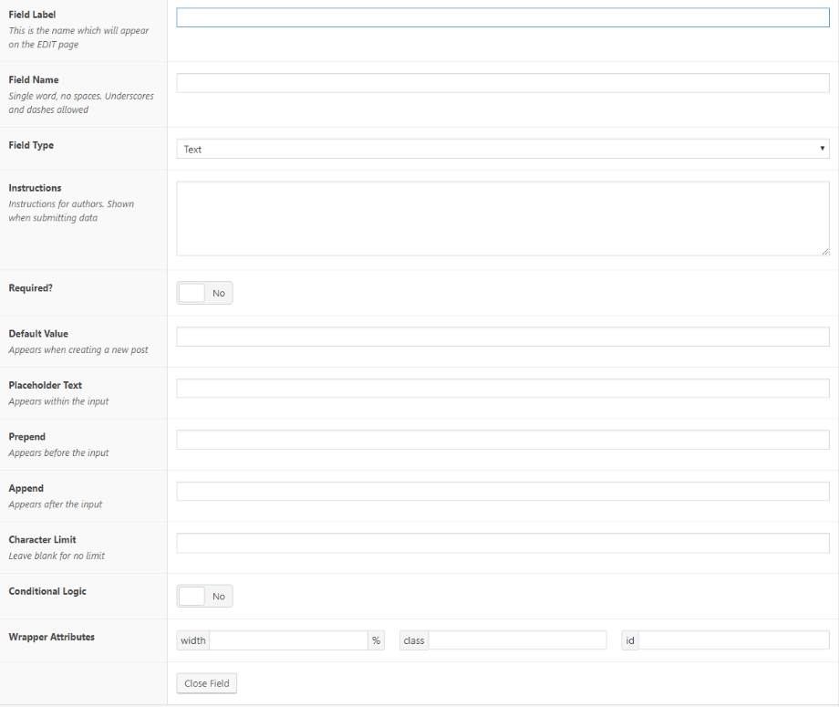

- **Field Label** is what authors see when they edit a post.
- **Field Name** comes from schema.org (for example, endDate).
- **Field Type** is "Date time picker" in the case of endDate.

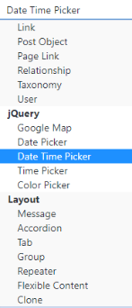

- **Instructions** for authors, shown when they submit data.
- **Required?** sets whether authors must fill in this field to publish a post.

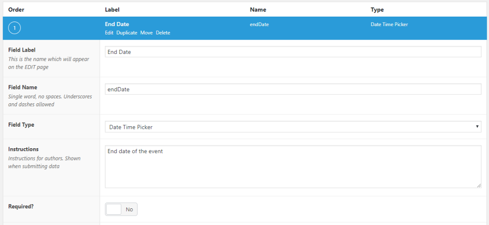

- **Default Value** sets default data for new posts.
- **Placeholder Text** appears within the input.
- **Prepend** appears before the input.
- **Append** appears after the input.
- **Character Limit**
- **Conditional Logic**
- **Wrapper Attributes**

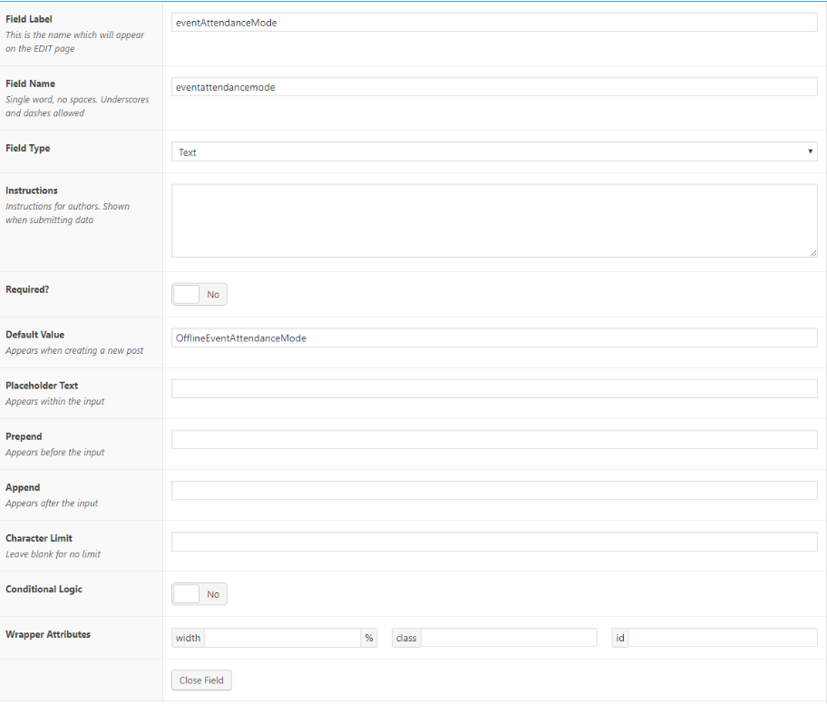

- **Location:** under **Rules**, you can choose to use this ACF if, for example, your post type is equal or not equal to one of your post types.

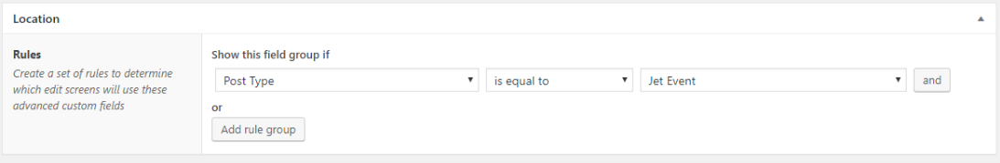

This is how it looks for authors while creating or editing a post:

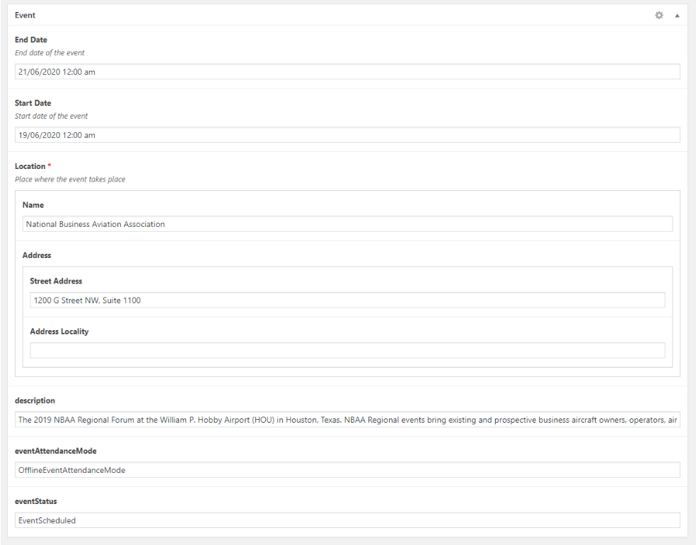

### Add new mapping

First, go to **Schema.org Types** and select **Sync Schema.org classes**.

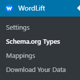

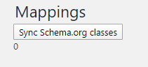

Then go to **Mappings** and add a new one.

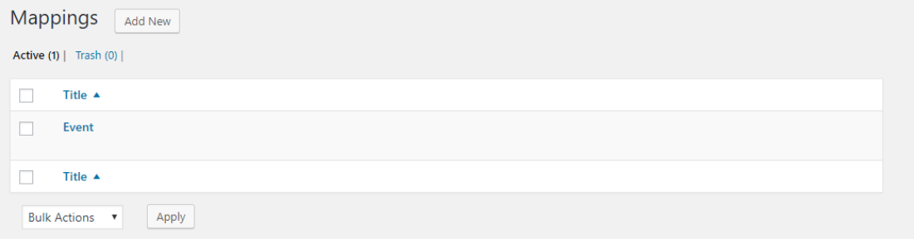

Choose a **title** and at least one **Rule**.

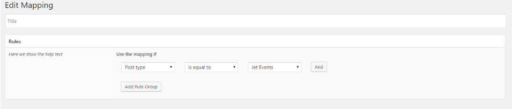

Add at least one **Property**:

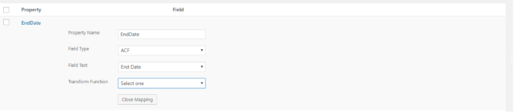

- **Property name**: give your property a name.
- **Field Type**: select ACF to use custom fields.
- **Field Text**: choose which *custom field* to use for that property.
- **Transform Function**
