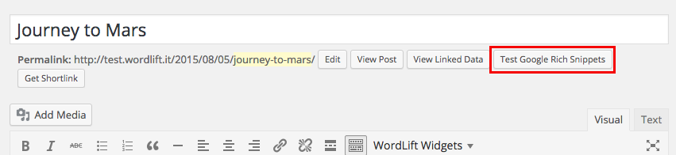
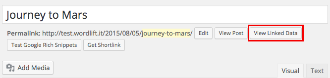
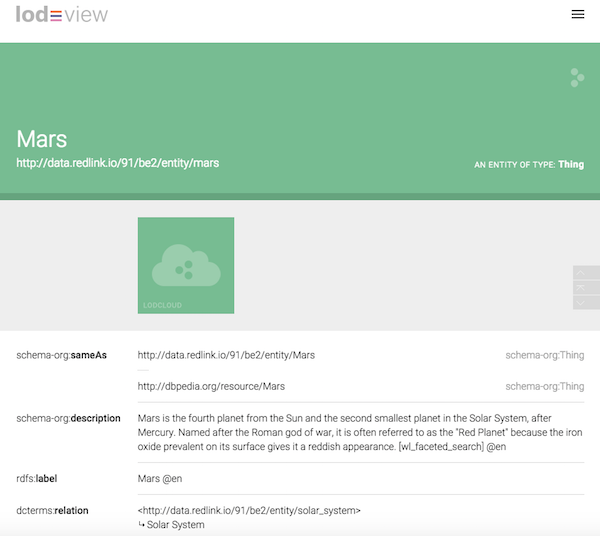
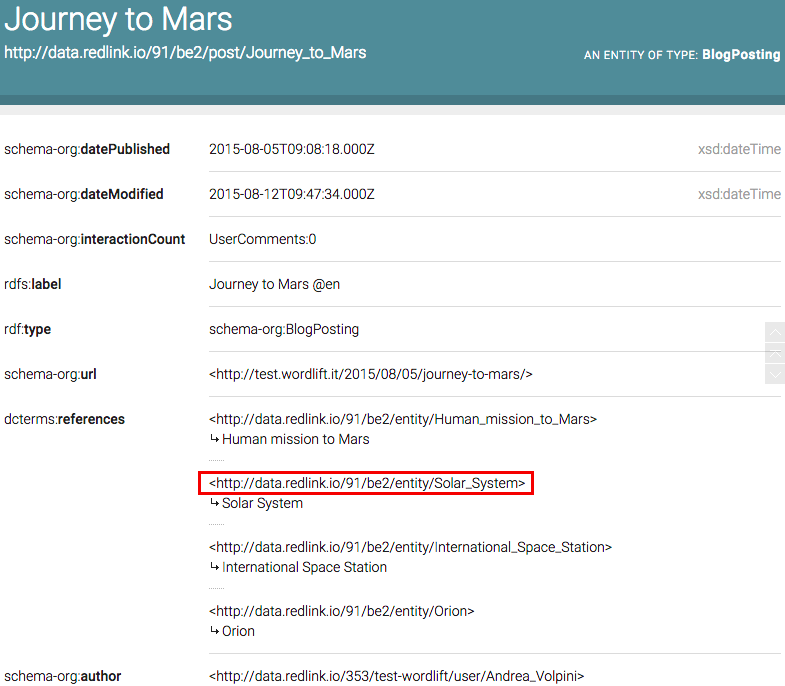

# Publish and check structured data

When you publish a post, a page or an entity with the classic WordLift plugin, WordLift publishes structured data that describes it and the entities it mentions. Use this page to understand that output and to check it from the editor before you move on. This guide is for existing installs of the classic plugin. New customers start with [Install WordLift Cloud](/welcome/install-wordlift-cloud/).

## What WordLift publishes {#publish-entity}

WordLift publishes two kinds of content: entities and the posts or pages that mention them.

### Entities

When you save an entity, WordLift creates it as a custom post (post type `entity`) in your WordPress installation. The entity appears in your [vocabulary](/concepts/#vocabulary) and has its own entity page with its own URL.

By default, entity page URLs include the entity base path you set in [Settings](/integrations/wordpress-plugin/getting-started/#configuration), as in `www.domain.com/vocabulary/name-of-the-entity-page`.

:::warning[Review needed]
TODO [SME]: Confirm the current entity page URL format (older docs show `http://<site>/?entity=<name>`; the settings use the `/vocabulary/` base path).
:::

### Posts and pages

WordLift annotates posts and pages with the schema.org vocabulary. This schema markup tells search engines which entities the content is about, so they can return more informative results.

## Check rich results for a post {#rich-snippets}

The post editor shows a **Test Google Rich Snippets** button next to the permalink.

1. Open the post in the editor.
2. Select **Test Google Rich Snippets**.
3. Check that the entities you annotated appear in the structured data for the post.

:::warning[Review needed]
TODO [SME]: Confirm that the "Test Google Rich Snippets" button still exists and what it opens now that Google's Structured Data Testing Tool is retired.
:::

## View the Linked Data for a post or entity {#linked-data}

The editor shows a **View Linked Data** button next to the permalink of a post or an entity. Select it to see the RDF representation of the post or entity.

For an entity, the RDF shows its relations to other entities and its `sameAs` links. In this example, the description of the entity Mars was annotated with the entity Solar System on the [entity page](/integrations/wordpress-plugin/edit-entity/#linking-other-entities). That annotation creates a `dcterms:relation` between the two entities.

The related entities in the RDF are links. Select one to read the data WordLift publishes for that entity.

:::warning[Review needed]
TODO [SME]: Confirm that the "View Linked Data" button still exists and which viewer it opens (older docs name LodView and LodLive).
:::

## Properties published for posts and pages

The RDF representation of each post or page includes these properties.

| Property | What it holds |
| --- | --- |
| `schema:datePublished` | The date the post was published. |
| `schema:dateModified` | The date the post was last modified. |
| `schema:interactionCount` | The interaction count for the post. |
| `rdfs:label` | The post's label. |
| `rdf:type` | The post's type. |
| `schema:url` | The post's URL. |
| `dcterms:references` | The entities related to the post. |
| `schema:author` | The post's author. |

To find every entity related to a post or page, look at its `dcterms:references` property.

:::warning[Review needed]
TODO [SME]: Confirm that this property list matches what the current plugin publishes.
:::

## Widgets and shortcodes {#widgets-and-shortcodes}

To add entity-driven widgets such as the Navigator or Faceted Search to your posts and pages, see [Widgets and shortcodes](/integrations/wordpress-plugin/widgets/).

## Troubleshooting

- **An entity page or a page linked by WordLift returns a 404 error.** In the WordPress dashboard, go to **Settings > Permalinks** and select **Save Changes**. WordPress regenerates the permalinks and the page loads.
- **The author's `@id` is null in the structured data.** Set a valid author on the post. See [Author's @id is null](/integrations/wordpress-plugin/troubleshooting/#authors-id-is-null).

## Related

- [JSON-LD output](/integrations/wordpress-plugin/jsonld/)
- [Mappings](/integrations/wordpress-plugin/mappings/)
- [Edit entity](/integrations/wordpress-plugin/edit-entity/)
