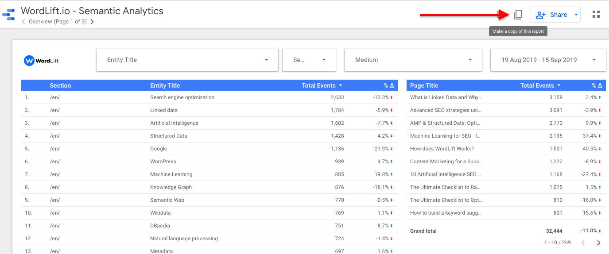
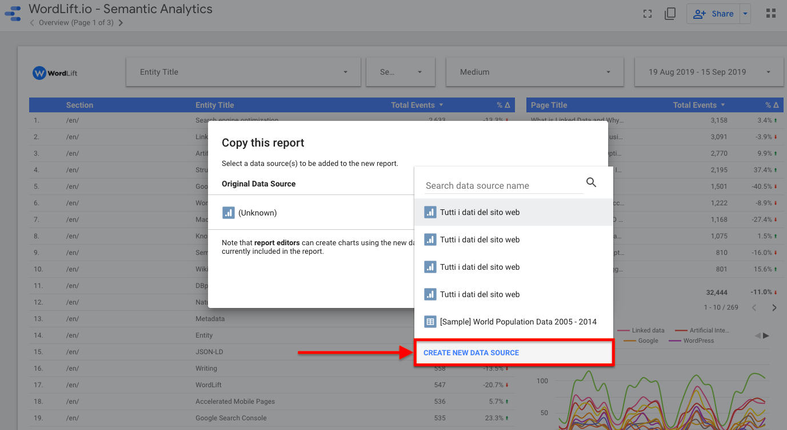
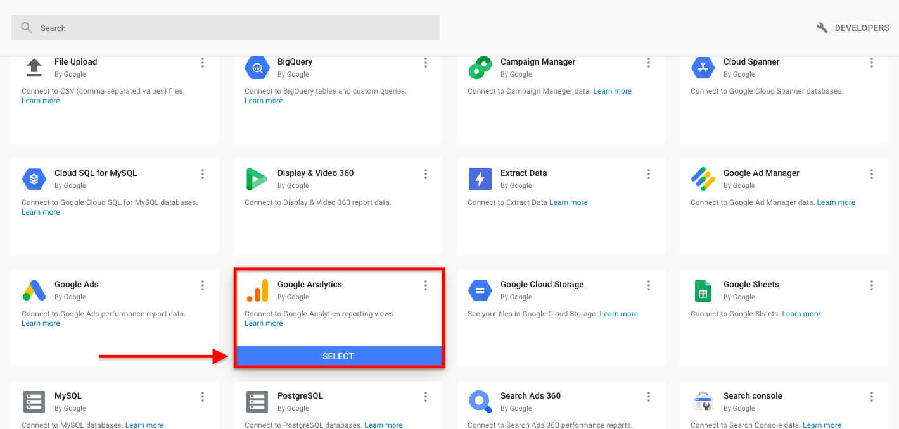
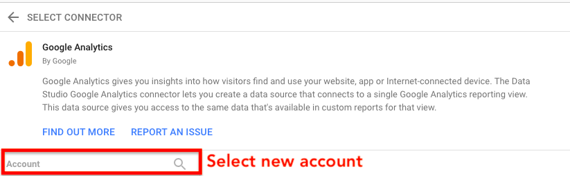
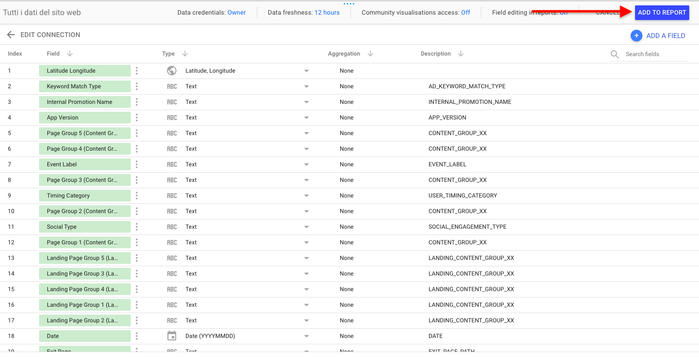
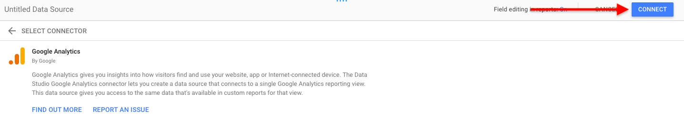
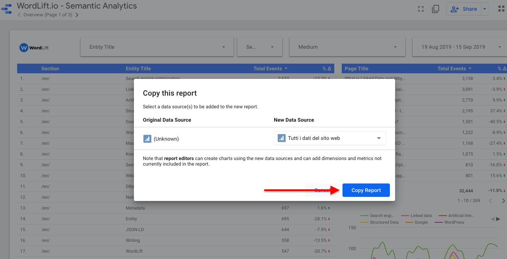

# Semantic analytics

:::note
This page supports existing installs of the classic WordPress plugin; new customers start with [WordLift Cloud](/platform/knowledge-graph/schema-publishing/wordlift-cloud/).
:::

Use WordLift to create an entity-based [web analytics dashboard](https://wordlift.io/blog/en/semantic-web-analytics/) in Looker Studio (formerly Google Data Studio), with traffic data from Google Analytics.

:::warning[Review needed]
TODO [SME]: confirm the dashboard template and these steps still work with current Google Analytics properties and the current Looker Studio interface.
:::

## Configure semantic analytics {#how-to-configure-semantics-analytics}

1. Copy the [Web Analytics Dashboard template](https://datastudio.google.com/u/0/reporting/1_Hu7hcfMhzE5EXDrZi3RTInZQcUjkiWt?s=l_0Vbo5t_bs).

   

2. In the pop-up window, select **create new data source**.

   

3. Under Google Analytics, select **select**.

   

4. From the list of sites associated with your Google Analytics account, select the one you want to connect.

   

5. In the top right, select **connect**.

   

6. In the top right, select **add to report**.

   

7. In the pop-up window, select **copy report**.

   

## Result

Your semantic analytics visualization opens, showing the semantic data that WordLift sends to it. To learn more, read [Web Analytics Dashboard](https://wordlift.io/blog/en/semantic-web-analytics/) on the WordLift blog.
