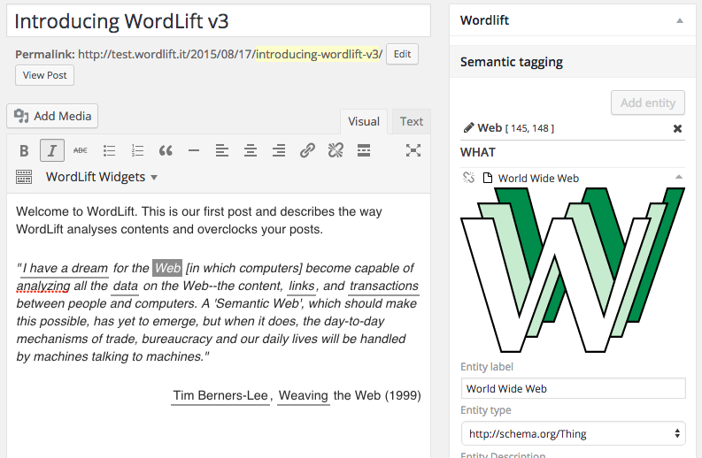
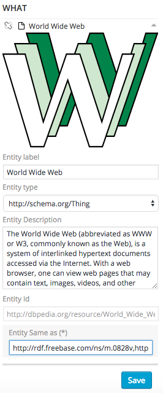
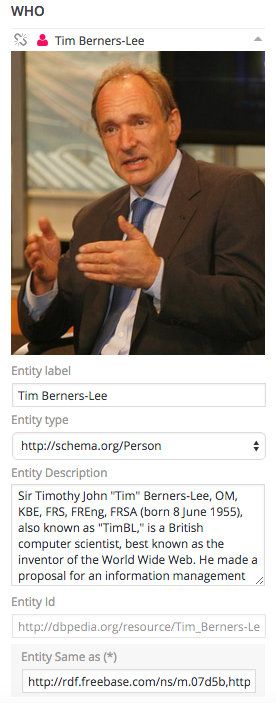
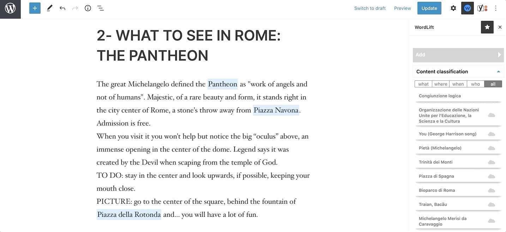
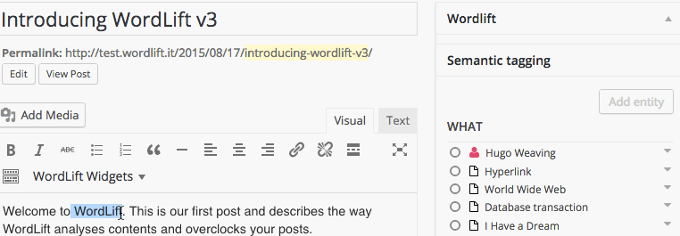
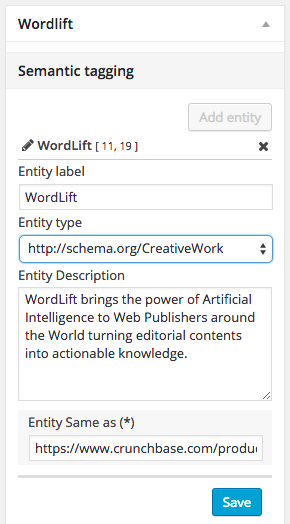
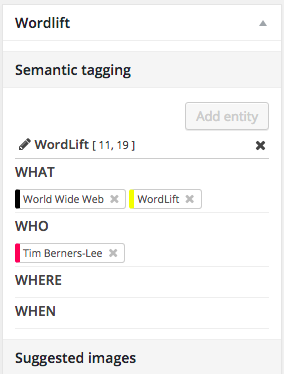
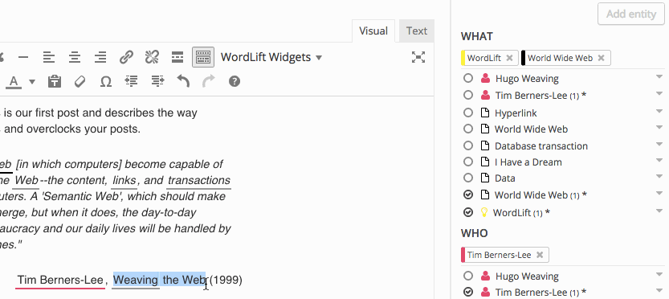

# Sidebar

## Content analysis and disambiguation

In this example, choose *\[Web\]* as a relevant entity, because the post refers to the World Wide Web. The entity type for *\[Web\]* is `Thing`, so the entity appears under the *what* category.

:::info Note
[Reconciling](/concepts/#reconciliation) entities means **linking** the entity appearing in this text with its equivalent in other sources (such as DBpedia or Freebase).
:::

The [WordLift Edit Post Widget](/integrations/wordpress-plugin/analysis/#wordlift-edit-post-widget) now shows these parameters:

- **Entity Title:** the name of the entity.
- **Entity Category:** the type of entity, according to the `schema.org` vocabulary.
- **Entity Description:** the description of the entity.

You can edit every parameter except the title directly in the [WordLift Edit Post Widget](/integrations/wordpress-plugin/analysis/#wordlift-edit-post-widget).

:::info Note
The data used for enrichment comes from openly available sources, such as DBpedia, which can contain misleading information. You can always edit it.

You can also edit entity properties from the "open in vocabulary" link (see [Edit entity](/integrations/wordpress-plugin/edit-entity/)).
:::

When you select **Save**, you annotate the post, which adds a [semantic fingerprint](/concepts/#semantic-fingerprint) to this piece of content.

Another important entity in this post is the creator of the World Wide Web, Tim Berners-Lee.
WordLift identifies the entity as a `Person`. All `Person` and `Organization` types appear under the *who* category.

:::info Note
WordLift saves annotations when you publish a post or page. Annotations and the data for each annotated entity stay in *draft* until you publish the post.
:::

:::caution Warning
If you edit or remove the text in the Visual Editor, you lose the annotations saved on it. WordLift stores your selection of entities in the content of the Visual Editor.
:::

## Manual entity selection

You can manually annotate an entity that the semantic analysis didn't suggest.

First, select the entity that you want to annotate. Then:

1. Go to the WordLift Edit Post Widget.
2. Select **Add**.
3. Choose the entities that you want to annotate from the suggested list.

## Adding entities

You use WordLift to (1) categorize your content, (2) help people find content that interests them, and (3) describe your content in a *machine-readable* format that other computers can reuse.

Sometimes WordLift doesn't detect a key concept that matters for (1), (2) and (3). In that case, teach it to WordLift by creating a new entity.

:::info Note
As a basic guideline, apply entities the way a librarian would use tags to classify your content if it were a book. For more detail, see the [guidelines for creating new entities](/support/faq/#what-are-the-guidelines-for-creating-new-entities-to-annotate-a-blog-post-or-a-page).
:::

New entities become part of the [WordLift vocabulary](/concepts/#vocabulary).

Once you add an entity to the vocabulary, WordLift detects it automatically every time you mention it in your content.

In this example, WordLift didn't detect one significant entity, so it is worth *teaching* it to WordLift.

The entity is *\[WordLift\]* itself. To create a new entity, highlight the text `WordLift`, then select **Create New Entity** at the top of the [WordLift Edit Post Widget](/integrations/wordpress-plugin/analysis/#wordlift-edit-post-widget). You can then edit the properties of the new entity.

Choose the category *Creative Work* (it also applies to *Software*), add a description and select **Save**. The new entity now appears among the [related entities](/concepts/#related-entities) of the post along with *\[Web\]* and *\[Tim Berners-Lee\]*.

:::caution Warning
To create a new entity over **an existing annotation**, first remove the annotated entity, then rewrite the entity, then create a new one as described above. The animation below shows the steps.
:::

## Updating and linking entities

### Updating the description

When you have something meaningful to say about a specific concept, **curate the information and edit the data that WordLift fetched automatically** (*this creates your own version of Wikipedia*).

### Linking other entities

You can annotate entity pages just like blog posts.

After you save the new description, WordLift analyzes the text and suggests related entities. You can now *link* an entity with other entities. WordLift stores these relationships between entities in the [graph](/concepts/#knowledge-graph) using the Dublin Core property `dct:related`. WordLift uses this information to infer new connections between the content of the site. For more on *entity linking*, see the FAQ on [when to link one entity to another](/support/faq/#when-should-i-link-one-entity-to-another).

## Synonyms

You can add synonyms in WordLift for any entity. WordLift marks up synonyms in the structured data with the schema property [alternateName](https://schema.org/alternateName). WordLift automatically adds the synonyms it knows for an entity. WordLift also uses synonyms for its content analysis: if you want WordLift to detect an entity in the future, add all the available synonyms. For example, "WWW" is a synonym for "World Wide Web". WordLift ignores capitalization, so "WWW" is the same as "www".

## Entity types

This table lists the properties you can edit with WordLift for each entity type.

| Type           | Description                                            | Properties                                                                                                                                                                            | Schema.org      |
| -------------- | ------------------------------------------------------ | ------------------------------------------------------------------------------------------------------------------------------------------------------------------------------------- | --------------- |
| Thing          | The most generic type of entity.                       | name,description,image, type,URL,sameAs, additionalType.                                                                                                                              | [Thing]         |
| Person         | A person.                                              | name,description,image, type,URL,sameAs, additionalType.                                                                                                                              | [Person]        |
| Place          | Entities with a physical extension.                    | name,description,image, type,URL,sameAs, additionalType,geo.                                                                                                                          | [Place]         |
| Event          | An event happening in a specific time and location.    | name,description,image, type,URL,sameAs, additionalType,location, startDate,endDate,performer, offers.                                                                                | [Event]         |
| Offer          | An offer.                                              | name,description,image, availability,price,URL, priceCurrency, availabilityStarts, availabilityEnds, inventoryLevel,validFrom, priceValidUntil,itemOffered.                           | [Offer]         |
| Organization   | An organization.                                       | name,description,image, type,URL,sameAs, additionalType,founder.                                                                                                                      | [Organization]  |
| Local business | A physical business or branch of an organization.      | name,description,image, type,URL,sameAs,address founder,geo.                                                                                                                          | [LocalBusiness] |
| Creative Work  | The most generic kind of Creative Work(i.e. Software). | name,description,image, type,URL,sameAs, additionalType.                                                                                                                              | [CreativeWork]  |
| Recipe         | A food recipe.                                         | name,description,image, type,URL,sameAs, additionalType, cookTime, prepTime, totalTime, recipeCuisine, recipeIngredient, recipeInstructions, recipeYield, author, nutrition.calories. | [Recipe]        |

[creativework]: http://schema.org/CreativeWork
[event]: http://schema.org/Event
[localbusiness]: http://schema.org/LocalBusiness
[offer]: http://schema.org/Offer
[organization]: http://schema.org/Organization
[person]: http://schema.org/Person
[place]: http://schema.org/Place
[recipe]: http://schema.org/Recipe
[thing]: http://schema.org/Thing
