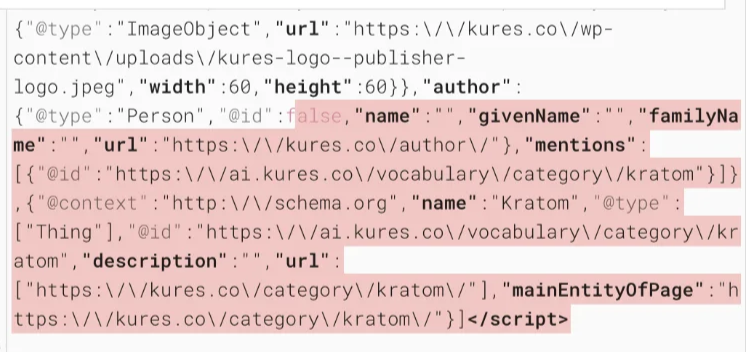
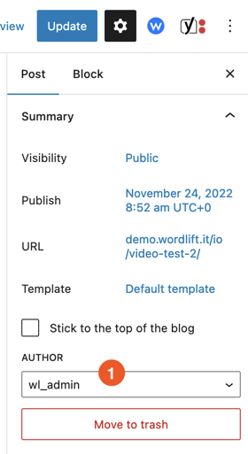
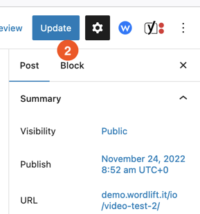

# Troubleshooting

## Author's @id is null

This is due to WordPress not updating the post's author property when an author is removed.

To fix it, follow these steps:

1. Open the Edit Post screen and look for the `author` property in the sidebar.

2. Select a valid author and update the post.

Check the structured data again to confirm the problem is solved.
