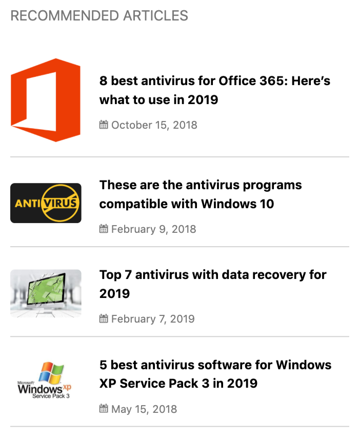
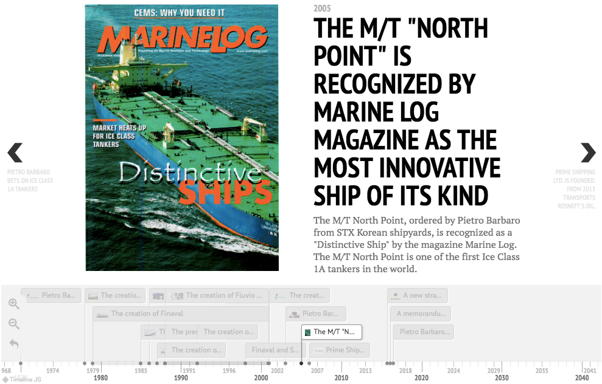
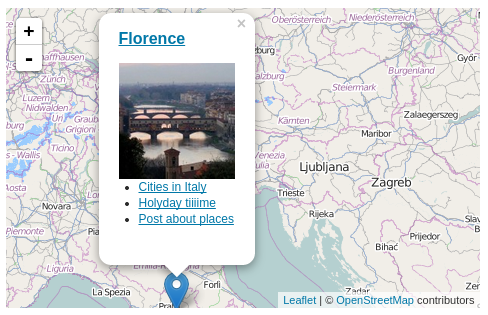
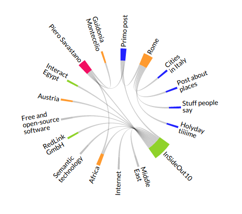
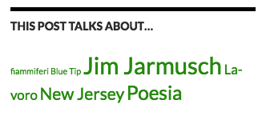
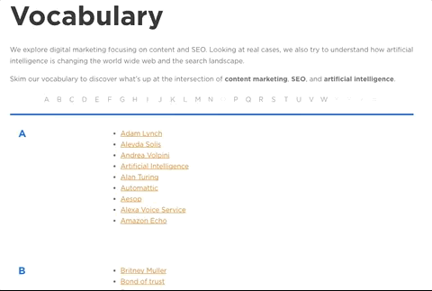

# Widgets and shortcodes

WordLift widgets help readers discover related content through the entities on your WordPress site. As you create and mention more entities, the widgets update their content without any work from the editor. Each widget on this page has a shortcode, and most also have a block. This reference is for existing installs of the classic plugin. New customers start with [Install WordLift Cloud](/platform/knowledge-graph/schema-publishing/wordlift-cloud/).

## Choose a widget {#widget-shortcodes}

| Widget | Shortcode | Block | What it shows |
| --- | --- | --- | --- |
| [Navigator](#navigator-widget) | `[wl_navigator]` | Navigator | Links to posts that mention the same entities as the current post. |
| [Faceted Search](#faceted-search) | `[wl_faceted_search]` | Faceted Search | Posts related to the current entity, filtered by the entities the reader selects. |
| [Timeline](#timeline) | `[wl_timeline]` | Timeline | A navigable, chronological list of Event entities. |
| [Geomap](#geomap) | `[wl_geomap]` | Geomap | Place entities on a map. |
| [Chord](#chord) | `[wl_chord]` | Chord | The relations between the entities in a post. |
| [Entity Cloud](#entity-cloud) | `[wl_cloud]` | Cloud | The entities related to the current post or entity, as a tag cloud. |
| [Glossary](#glossary) | `[wl_vocabulary]` | Vocabulary | All entities on the site in alphabetical order. |
| [Context Cards](#context-cards) | None | None | A preview of an entity when the reader hovers over an entity link. |

If you run [WooCommerce SEO by WordLift](/integrations/woocommerce/), it adds a Products Navigator with the `[wl_products_navigator]` shortcode and the Products Navigator block. The plugin also provides a Classification block, which this page does not cover.

To insert a widget, add its shortcode to a post, page or sidebar, or add its block in the Block Editor. In the editor you can also use the [WordLift widgets menu](/integrations/wordpress-plugin/analysis/#wordlift-widgets-menu).

:::warning[Review needed]
TODO [SME]: Confirm that all seven shortcodes, the Timeline and Entity Cloud WordPress widgets, and the block names in this table are supported in plugin version 3.54.x.
:::

## Navigator {#navigator-widget}

```html
[wl_navigator]
```

The Navigator shows links to related posts on your site. It finds the entities mentioned in the current post, then lists other posts that mention the same entities.



| Parameter | Description | Default |
| --- | --- | --- |
| `title` | Optional. The title above the Navigator. | `Related articles` |
| `limit` | Optional. The total number of posts to show. | `4` |
| `offset` | Optional. The number of posts to skip. Use it to split the list of recommended posts into blocks, for example to place advertising or calls to action between them. | See the note below |
| `template_id` | Optional. The `id` of the `script` element that holds a Mustache template. If the template is in `<script id="wordlift_navigator_sidebar_template" type="text/mustache">`, set `template_id` to `wordlift_navigator_sidebar_template`. | None |
| `post_id` | Optional. The ID of the post whose Navigator you want to show. Use it to show the Navigator of post A on post B, or to add the Navigator for a specific post to a page that is not a post. | The current post |
| `uniqid` | Optional. A unique ID for this Navigator. Use it to style one instance or to apply Navigator filters to that instance only. | None |

:::warning[Review needed]
TODO [SME]: Confirm the default for `offset` (the source states both 0 and 4).
:::

### Navigator filters

| Filter | Receives | Returns |
| --- | --- | --- |
| `wl_navigator_data_post` | Each Navigator post item, the post ID and the `uniqid`. | The customized post item. |
| `wl_navigator_data_entity` | Each entity post item, the post ID and the `uniqid`. | The customized entity item. |
| `wl_navigator_data_placeholder` | The complete result array and the `uniqid`. | The customized result array. Use it to seed the Navigator with placeholder or similar data. |

### Customize the Navigator template {#navigator}

The Navigator is wrapped in a `wl-navigator` class. Style this class and its child elements with CSS.

To style one instance with its own template, set `template_id` on that Navigator. Write the template in [Mustache](https://github.com/Mustache/Mustache), a framework-agnostic template language. You control both the template content and the CSS. Use this sample as a starting point:

```html
<script id="wordlift_navigator_sidebar_template" type="text/mustache">
{{#items}}
<div class="related-articles__item">
    <a class="related-articles__img" href="{{post.permalink}}"></a>
    <div class="related-articles__content">
        <h4 class="related-articles__title"><a href="{{post.permalink}}">{{{post.title}}}</a></h4>
    </div>
</div>
{{/items}}
</script>
```

## Faceted Search {#faceted-search}

```html
[wl_faceted_search]
```

Faceted Search helps readers browse your content from an entity page. It lists the posts related to the current entity and lets readers select other entities to narrow the list.

To add it to an entity page, select **Faceted Search** in the [WordLift widgets menu](/integrations/wordpress-plugin/analysis/#wordlift-widgets-menu) in the editor, or add the shortcode.


On the front end, readers select one or more entities to filter the list of related posts.


| Parameter | Description | Default |
| --- | --- | --- |
| `title` | Optional. The title of the widget. | `Related articles` |

```html
[wl_faceted_search title="this is my new title"]
```

## Timeline {#timeline}

```html
[wl_timeline width=... height=... global=...]
```

The Timeline shows a navigable list of Event entities in chronological order. The window at the top shows the details of the selected event. WordLift builds the Timeline with [TimelineJS](https://timeline.knightlab.com/).



The Timeline uses the [Event entities](/integrations/wordpress-plugin/edit-entity/#edit-an-event) mentioned and annotated in the post. An event appears only if it has a `startDate`. If an event is linked to a Place entity through its `location` property and the post mentions that place, the Timeline also shows the event.

| Parameter | Description | Default |
| --- | --- | --- |
| `width` | Optional. The width of the Timeline, in pixels or percent, for example `120px` or `70%`. | Not documented |
| `height` | Optional. The height of the Timeline, in pixels or percent. | Not documented |
| `global` | Optional. When `true`, the Timeline shows events mentioned in the latest posts, so the current post does not need to mention any events or places. | Events in the current post |
| `display_images_as` | Optional. When `background`, the Timeline uses each event's featured image as the background. | `media` |
| `excerpt_length` | Optional. The length of the excerpt shown for each event, taken from the entity description. | Not documented |

You can also pass any of the [TimelineJS presentation options](https://timeline.knightlab.com/docs/options.html) as shortcode parameters.

```html
[wl_timeline display_images_as='background' height='600px' excerpt_length=25 global='true']
```

The Timeline is also available as a site-wide WordPress widget that shows the events saved as entities.

:::warning[Review needed]
TODO [SME]: Confirm whether `excerpt_length` counts words or characters (the sources disagree).
:::

## Geomap {#geomap}

```html
[wl_geomap width=... height=... global=...]
```

The Geomap shows Place entities on a map. Each place has a marker with a popup that contains a thumbnail and links for the place.



| Parameter | Description | Default |
| --- | --- | --- |
| `width` | Optional. The width of the map, in pixels or percent, for example `120px` or `70%`. | Not documented |
| `height` | Optional. The height of the map, in pixels or percent. | Not documented |
| `global` | Optional. When `true`, the map shows all places mentioned on the site. | Places in the current post |

## Chord {#chord}

```html
[wl_chord width=... height=... main_color=... depth=... global=...]
```

The Chord shows the relations between entities, starting from the current post and the entities it mentions. Readers can follow a link to an entity page or to another post.



| Parameter | Description | Default |
| --- | --- | --- |
| `width` | Optional. The width of the Chord, in pixels or percent, for example `120px` or `70%`. | Not documented |
| `height` | Optional. The height of the Chord, in pixels or percent. | Not documented |
| `main_color` | Optional. The base color of the Chord. | Not documented |
| `depth` | Optional. The maximum distance to travel in the entity graph to populate the Chord. A small number limits how far the Chord explores from the main entity. | Not documented |
| `global` | Optional. When `true`, the main entity of the Chord is the most mentioned entity in the latest posts instead of the current post. | The current post |

## Entity Cloud {#entity-cloud}

```html
[wl_cloud]
```

The Entity Cloud shows the entities related to the current post or entity as a tag cloud.



The Entity Cloud is also a site-wide WordPress widget that you can add to your sidebars:

1. In the WordPress dashboard, go to **Appearance > Customize**.
2. Select **Widgets** in the Theme Customizer.
3. Add the WordLift Entity Cloud widget to a sidebar. You can change its title like any other WordPress widget.

## Glossary {#glossary}

```html
[wl_vocabulary limit=... type=... orderby=...]
```

The Glossary is a site-wide widget that shows all the entities in your vocabulary in alphabetical order. For an example, see the [Semantic SEO Glossary](https://wordlift.io/blog/en/glossary) on the WordLift blog.



By default, the Glossary shows the latest 100 entities of all types, such as Person, Place and Organization. Use these parameters to change which entities it shows.

| Parameter | Description | Default |
| --- | --- | --- |
| `limit` | Optional. The total number of entities to show. Use `-1` to remove the limit. | `100` |
| `type` | Optional. The type of entities to show. Use `type='Person'` to show only entities of type Person. | `all` |
| `orderby` | Optional. The order of the entities. Accepts the [WP_Query ordering parameters](https://developer.wordpress.org/reference/classes/WP_Query/parse_query/). | `title` (alphabetical) |
| `cat` | Optional. A WordPress category ID. The Glossary shows the entities associated with that category. See [how to find a category ID](http://www.wpbeginner.com/beginners-guide/how-to-find-post-category-tag-comments-or-user-id-in-wordpress/). | None |

## Context Cards {#context-cards}

Context Cards show a preview of an entity when a reader hovers over a link to an entity page. They appear by default when links to entity pages are enabled. Context Cards are based on [Wikipedia Context Cards](https://github.com/joakin/context-cards). They have no shortcode or block.

To turn off Context Cards, add this filter to your theme:

```php
add_filter( 'wl_context_cards_show', '__return_false' );
```

:::warning[Review needed]
TODO [SME]: Confirm this filter line. The source omits the comma between the two arguments.
:::

## Style and customize widgets

Use these CSS classes to style the widgets and entity links.

| Class | Element |
| --- | --- |
| `wl-navigator` | The wrapper around the Navigator. |
| `wl-entity-page-link` | A link to an entity page in a post. |
| `wl-context-card` | The wrapper around a Context Card. |
| `wl-context-card__image` | The image in a Context Card. |
| `wl-context-card__description` | The wrapper around the complete description. |
| `wl-context-card__description__logo` | The publisher logo image. |
| `wl-context-card__description__text` | The wrapper around the description text. |

To change how Context Cards load and which data attributes entity links carry, use these filters. The sample code for both is on [Theme development](/integrations/wordpress-plugin/theme-development/).

| Filter | Type | What it does |
| --- | --- | --- |
| `wl_context_cards_load_fn_supplier` | JavaScript | Supplies a function that replaces the default Context Card request. The function receives the Context Card endpoint (`url`) and the DOM element that triggered the card (`el`), and returns a fetch promise (or a promise from another request library). |
| `wl_anchor_data_attributes` | PHP | Adds custom data attributes to the `wl-anchor` links in a post. It receives the existing `attributes` and the `post_id`. |

For every customization route, including JSON-LD and the data model, see [Customize the WordPress plugin](/integrations/wordpress-plugin/customization/).
