# Content generation

Content Generation creates content at scale from your Knowledge Graph. You build a prompt template from the attributes of your entities, generate text for each one, and check every result against validation rules you define.

Large language models (LLMs) know a lot, but they don't know what they know, so they can produce confident text that is wrong. The data in a Knowledge Graph built with WordLift gives the model the facts to work from, reduces hallucinations and gives you a basis for validating the output.

The ontology is central to this process. Using an ontology, or a linked data vocabulary such as schema.org, you can fine-tune and prompt LLMs with structured attributes, which improves the accuracy of what they produce.

The process starts with a content idea and becomes a prompt template that works with your data. Because the template draws on the attributes stored in your Knowledge Graph, one template can produce many content variations for different entities and contexts.

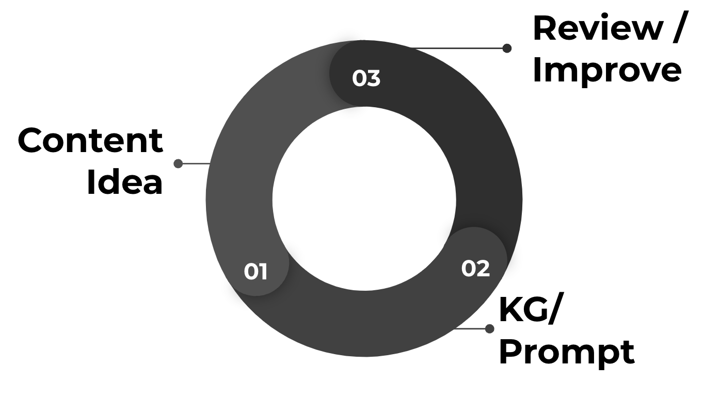
*The workflow for creating a prompt template using the attributes in your Knowledge Graph.*

A validation pipeline then checks the output. It works as a quality assurance step: you review the text the LLM generates and adjust the project until the results meet your rules.

## What is the Content Generation tool? {#what-is-the-content-generation-tool}

The Content Generation tool produces short, detailed text for many purposes, such as product descriptions, restaurant profiles and introductions for category pages. WordLift developed it with editorial teams and SEO professionals at midsize and large organizations.

The tool uses a dynamic [prompt](https://wordlift.io/blog/en/entity/prompt/) built from the data in your Knowledge Graph, and a fine-tuned model customized with your brand's own examples. This keeps the generated content consistent with your brand's tone and style.

You can verify the generated content with validation rules that you define using the data in your Knowledge Graph. The rules check that each result follows your editorial guidelines and standards.

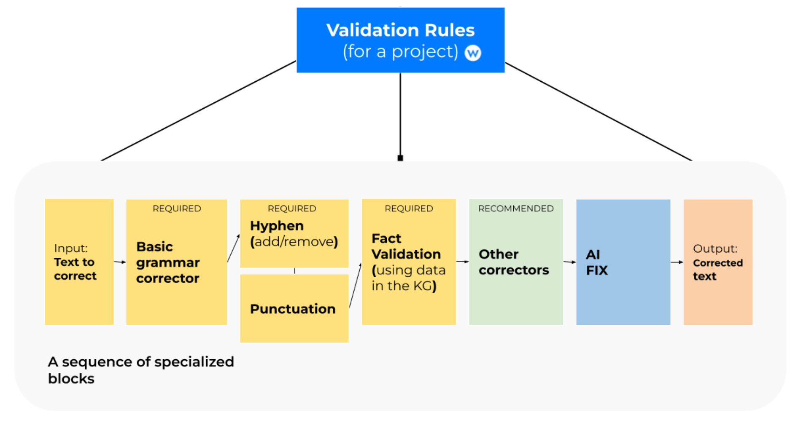
*How the validation pipeline works.*

## Get started {#get-started}

Log in to the WordLift Dashboard and select **Content Generation** in the left menu. From there you can create content at scale for your website.

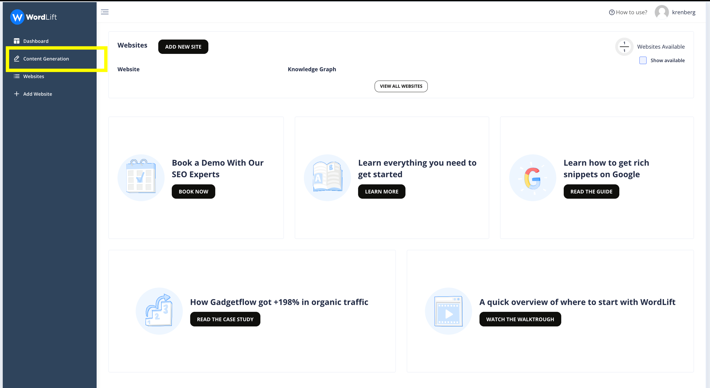

:::warning[Review needed]
TODO [SME]: The Content Generation screenshots on this page show an older Dashboard UI; confirm the menu, wizard and labels and replace the screenshots that changed.
:::

## How it works {#how-it-works}

Select **Content Generation**, then create a **New project**. The step-by-step wizard opens.

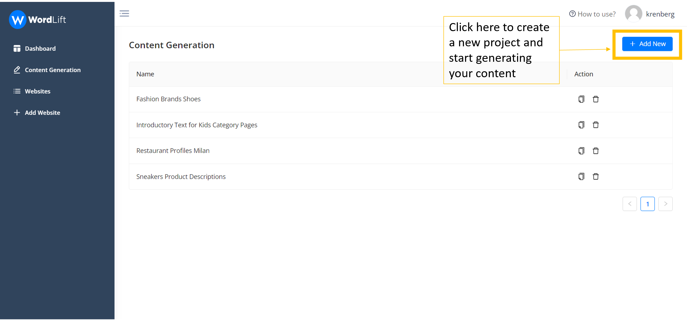

### Step 1: Select a data source {#step-1---selecting-data-source}

Give the project a name and select the Knowledge Graph you want to use. In this step you extract the data, and so the attributes, that you need for the prompt you build later.

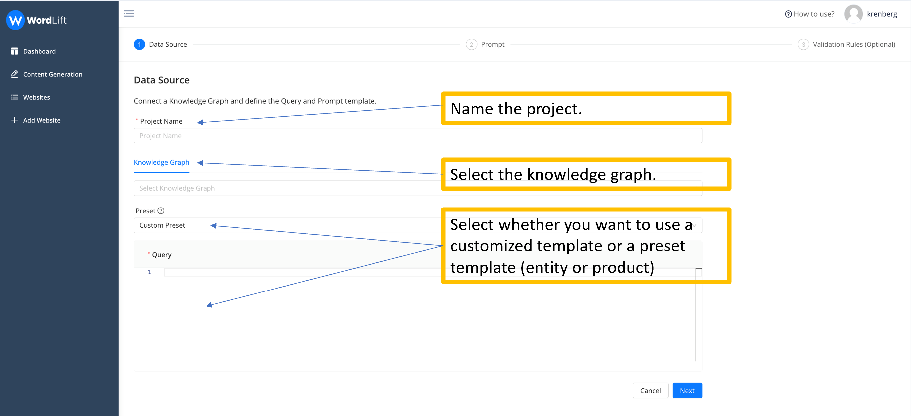

You extract the data with a GraphQL query. In the **Preset** section, select a template query that uses schema.org attributes, or choose any custom ontology your Knowledge Graph uses.

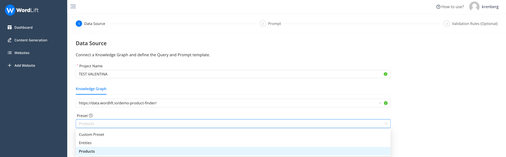

The example query below extracts these attributes from a Product Knowledge Graph:

- **id:** the unique ID of the product inside the Knowledge Graph.
- **url:** the URL of the associated web page (the product description page).
- **material:** the material of the product. The query uses strings because a product can have more than one material.
- **names:** the names of the product. A product can have more than one name.
- **description:** the existing description of the product.
- **brand:** the name of the brand. The brand is an additional node in the graph, so the query uses curly brackets to extract data from a sub-node; here it gets only the brand name.
- **price:** the price of the product.

The query returns only the first 10 products, because it limits the results with the page (0) and the number of rows (10) at the start of the query.

```graphql
query {
  products(page:0, rows:10) {
    id: iri
	url: strings(name: "schema:url")
	material: strings(name: "schema:material")
	names: strings(name:"schema:name")
    brand: resource(name:"schema:brand"){
    	brand: string(name: "schema:name")
  	}
	price: resource(name:"schema:offers"){
    	price: string(name: "schema:price")}
	}
}
```

### Step 2: Configure the prompt {#step-2---configuring-the-prompt}

Build a dynamic, flexible prompt from the data you extracted from your Knowledge Graph. To create your prompt template, use the attributes you need from the ones you selected. The templating language is [Liquid](https://shopify.github.io/liquid/), an open-source language created by Shopify. With a template you can, for example, leave out a section of the prompt when an attribute is missing from the Knowledge Graph. Here is an example:

```text
As the content writer of a luxury fashion brand write a short but catchy product description for the {{names}}  by revising the following paragraph:
{{description}}.###
```

If a description exists, the prompt takes it into account (see everything inside the `` block).

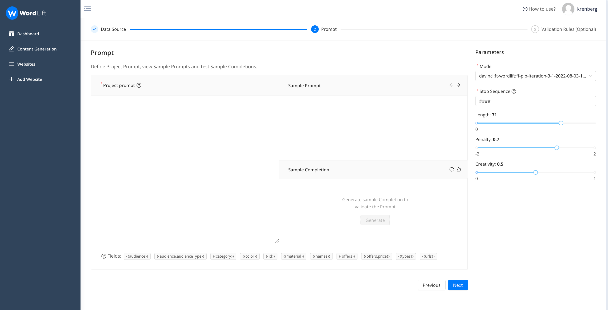

After you add the attributes, you see the sample prompt your template produces, so you can check whether it meets your needs. Then select the language model you want to use. Before you move to the next step, set the generation parameters (length, penalty, creativity) and review a sample completion. If you are not satisfied with the result, change the settings; otherwise, go to the next step.

The interface lets you test the prompt and the generation settings across several data samples. Data varies, so a prompt that works for one product does not always work for another.

Work with the WordLift team to find the best configuration for your use case. A project can scale and be reused across thousands of entities, and the right configuration parameters depend heavily on the model used for the task.

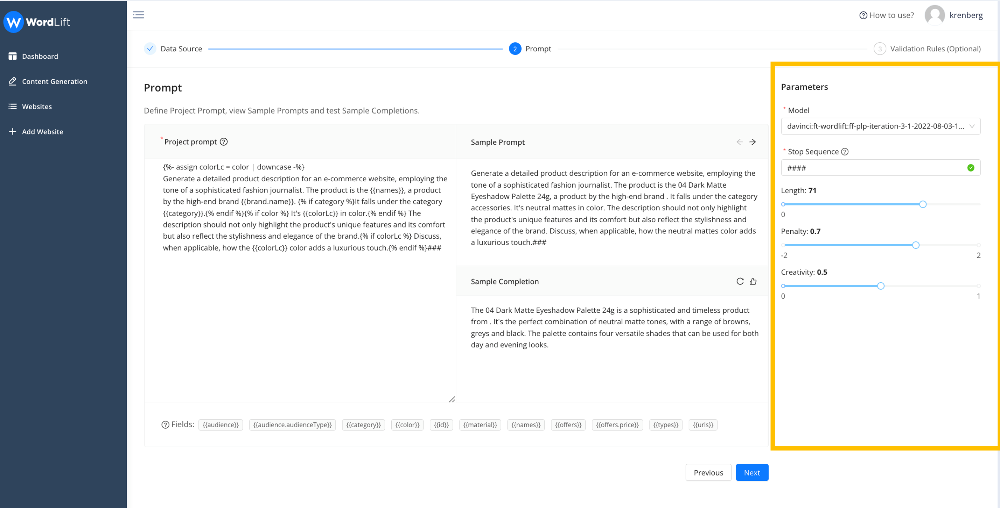

### Step 3: Define validation rules {#step-3---defining-validation-rules}

Validation rules check that the generated content meets your expectations and follows your brand's or company's editorial guidelines. You can also decide when and how AI fixes the generated content so it complies with your rules.

First, decide whether a rule is based on a data field or on a set of words. Rules tied to attributes are *Field Based*; rules tied to specific words are *Word Based*.

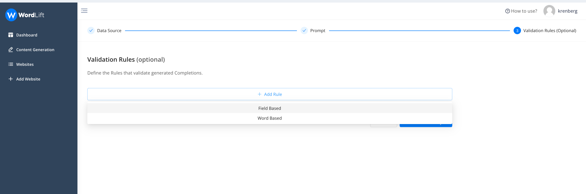

Here is a sample rule for an e-commerce website. It checks the predicted completion (the generated text) for any mention of color, and checks that the color matches the color attributes in the Knowledge Graph. The rule is required, so no content is valid unless it mentions the product's color correctly.

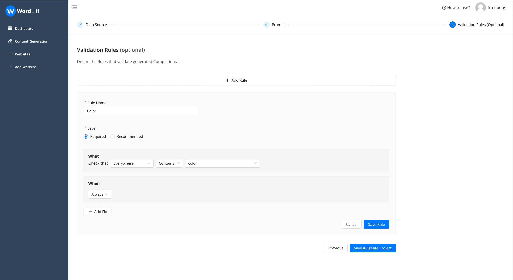

Set these options for each rule:

1. **Rule Name:** a distinctive name so you can recognize the rule.
2. **Level:** *required* or *recommended*. If a *required* rule is not met, the completion status is ERROR. If a *recommended* rule is not met, the status is WARNING.
3. **What:** the components or conditions of the rule.
4. **When:** when the rule applies, either always or only under certain conditions.

Then select **Save**.

Next, add a *Word Based* rule that makes sure no ethnic group is mentioned in the generated text.

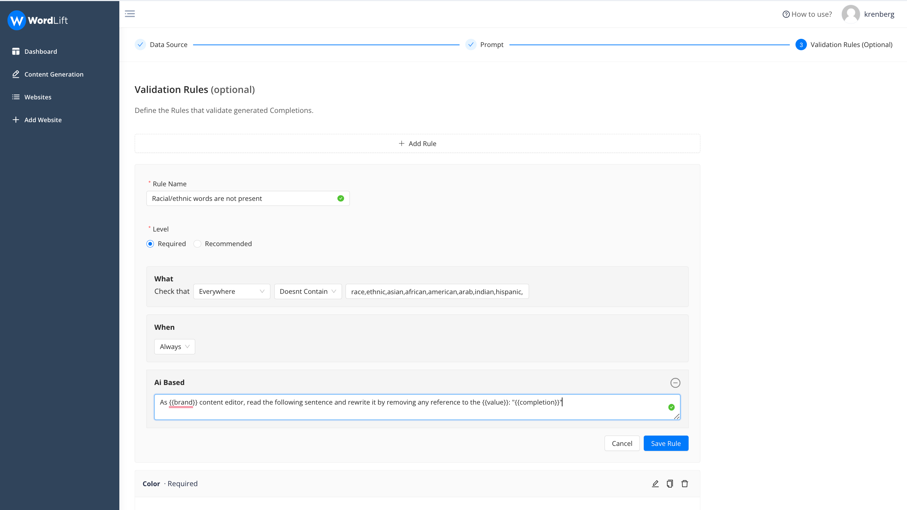

This rule checks whether any of the listed terms appears in the completion (separate multiple terms with commas) and confirms the requirement is met.

If the requirement is not met, the system tries to fix the problem with an additional prompt (*AI Based*), like this one:

```text
As {{brand}} content editor, read the following sentence and rewrite it by removing any reference to the {{value}}: "{{completion}}"
```

With this rule, the system retries three times for a recommended rule or five times for a required rule to solve the problem. When you complete all the steps, save the project and start the generation.

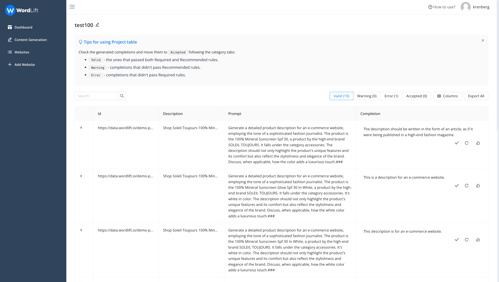

The system processes the completions and sorts them into four groups:

1. **Valid:** the completion passed validation against the rules you set.
2. **Warning:** the completion satisfied the *recommended* rules but failed the *required* ones.
3. **Error:** validation failed because words or attributes you required are missing. You can regenerate these completions automatically, or rewrite them manually and then approve them.
4. **Accepted:** you reviewed the completion and confirmed it as satisfactory.

As an editor, you can always review completions that did not pass validation and move them to the validated column. You can also regenerate any completion.

To learn more, [watch the Content Generation video](https://youtu.be/6NiG2acKyyM) or [book a demo](https://wordlift.io/book-a-demo/) with the WordLift team.

<iframe width="100%" height="500" src="https://www.youtube.com/embed/6NiG2acKyyM" frameborder="0" allow="autoplay; encrypted-media" allowfullscreen referrerpolicy="strict-origin-when-cross-origin"></iframe>

For the API, see the [Content Generation API guide](/platform/agent-wordlift/content-generation/api-guide/).
