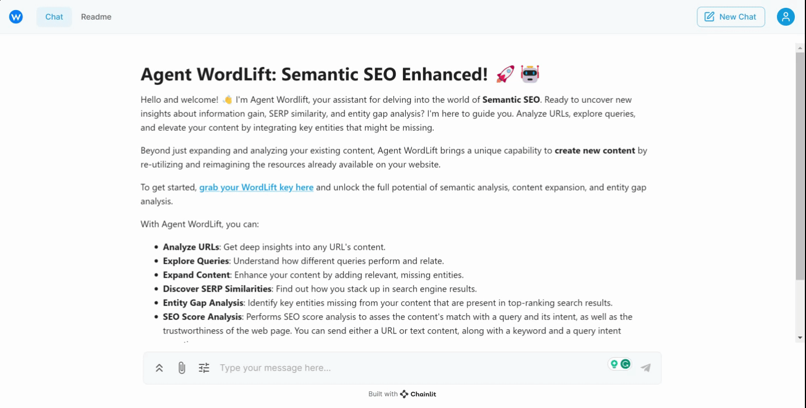

# Get started with Agent WordLift

In this tutorial you add your WordLift Key to Agent WordLift, optionally connect your search data, and run four prompts on your own site. By the end, you have analyzed a query, found an entity gap, planned a new article and expanded an existing page.

## What you need

- **Access to Agent WordLift.** Agent WordLift comes with a Business+ or Enterprise subscription. Business+ starts with a discovery session and Enterprise with an enquiry to the WordLift team. See [Plans and pricing](/plans-and-pricing/).
- **Your WordLift Key.** You can find it in the WordLift Dashboard at [my.wordlift.io](https://my.wordlift.io).
- **A Knowledge Graph (recommended).** Agent WordLift gives more useful answers when your site has a populated Knowledge Graph. GraphSync is the recommended way to build one; see [Create a Knowledge Graph](/platform/knowledge-graph/create/).
- **Google Search Console and Google Analytics (optional).** You need these only for the workflows that read your search and traffic data.

## Add your WordLift Key

You add the key in the Agent WordLift web app.

1. Go to [agent.wordlift.io](https://agent.wordlift.io).
2. Open the **Settings** panel.
3. Enter your WordLift Key.



:::warning[Review needed]
TODO [SME]: Confirm the Settings panel label and key flow at agent.wordlift.io are unchanged and the GIF is current.
:::

## Connect your search data

This step is optional. Connect Google Search Console and Google Analytics as data sources in the WordLift Dashboard so Agent WordLift can read your performance data directly. Search Console needs OAuth authorization from the Dashboard before Agent WordLift can use it.

To connect them, follow [Data sources: OAuth2 connections](/platform/data-sources/oauth2/).

With your data connected, you can run workflows such as the [Google Search Console workflow](/platform/agent-wordlift/workflows/google-search-console/), the [rankings drop audit](/platform/agent-wordlift/workflows/rankings-drop-audit/) and the [AI visibility analysis](/platform/agent-wordlift/workflows/ai-visibility-analysis/), which uses your connected Google Analytics property.

## Analyze a query

Start with a query to see how people search for a topic and which entities and keywords sit behind it. Send this prompt:

```md className=wlx-send-to-agent
Analyze the query "semantic SEO" on google.com
```

Look at the entities and keywords in the answer. They show what the top results cover and give you ideas for keywords to target. Replace the query with one that matters to your site.

## Find the entity gap on a page

Next, compare one of your pages with a query. The entity gap is the set of entities that top-ranking pages mention and your page does not.

```md className=wlx-send-to-agent
Show me the entity gap between "linked data" and https://wordlift.io/blog/en/entity/linked-data/
```

Use the missing entities as a checklist for what to add to the page. Replace the query and the URL with your own.

## Plan new content and expand a page

Agent WordLift can follow several instructions in one prompt. This prompt searches your website, analyzes the entities behind the query and turns both into an outline:

```md className=wlx-send-to-agent
Search the website for "the impact of blockchain technology on finance."
Analyze the entities associated with this query.
Generate an outline for a new, informative article based on the combined insights.
```

Agent WordLift uses your existing content on the topic and the entities behind the top-ranking results on Google to build the outline.

To improve a page you already have, ask Agent WordLift to expand it with entities you name:

```md className=wlx-send-to-agent
Expand the content on https://wordlift.io/ by integrating entities like Google and Semantic Web.
```

Agent WordLift suggests where and how to add those entities to deepen the page.

## Tips for better results

- **Give step-by-step instructions.** Talk to Agent WordLift as you would to an SEO assistant, and break a task into clear steps, as in the outline prompt above.
- **Verify the output.** Check critical facts, figures and links before you publish.
- **Check language support.** Some tasks may not support every language.

:::warning[Review needed]
TODO [SME]: Confirm whether the Chinese-language limit on some text and query analysis tasks is still current, and whether other languages are limited.
:::

## Getting help {#getting-help}

Email the WordLift team at [support@wordlift.io](mailto:support@wordlift.io), or check the [Agent WordLift FAQ](/platform/agent-wordlift/faq/).

## Next steps

- **[Agent WordLift workflows](/platform/agent-wordlift/workflows/)** give you tested recipes for specific SEO and content jobs.
- **[Prompt Library](/platform/agent-wordlift/prompt-library/)** has ready-to-use prompts for single tasks.
- **[Agent WordLift integrations](/platform/agent-wordlift/integrations/)** show how to use Agent WordLift from AI assistants, the command line, the API and automation tools.
