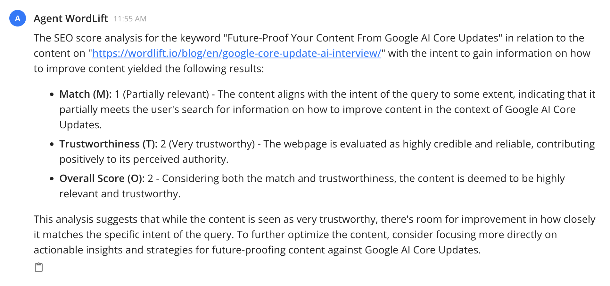
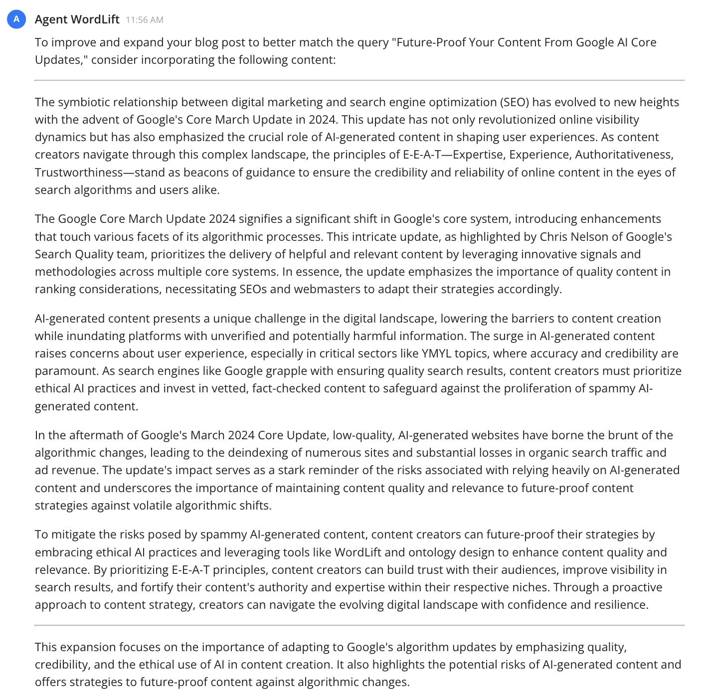
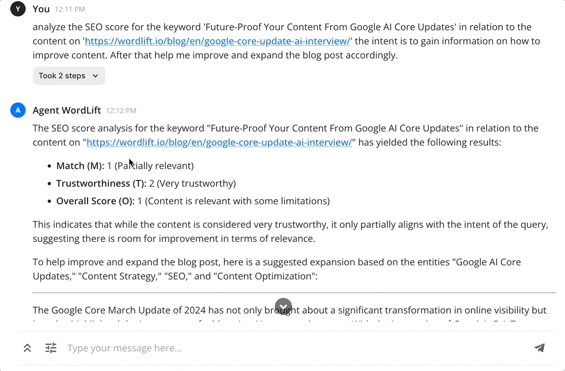

# Align content with the intended search query

This workflow helps you **align your content with the intended search query** so it stays relevant and engaging for your target audience. By understanding and [matching the search intent](https://wordlift.io/blog/en/search-intent-optimization/), you can create content that ranks well and answers the searcher's informational needs.

## Here are the steps

To ensure your webpage aligns perfectly with the intended search query, follow this streamlined workflow:

## 1. Identify the core query and intent

Start by pinpointing the exact query you aim to target. Understand the intent behind the search: is it informational, navigational, transactional, or investigational? You can try a prompt like the one below:

```md className=wlx-send-to-agent
evaluate the content quality for the keyword 'Future-Proof Your Content From Google Core Updates' in relation to the content on 'https://wordlift.io/blog/en/google-core-update-ai-interview/' the intent is to gain information on how to improve existing content.
```

With this prompt, you define the **query**, the **URL** and the narrative behind the searcher's intent.

### Here is what you get {#here-is-what-we-get}



## 2. Expand the content based on the analysis

After the first response, continue with the following prompt to get insights on how to improve the article to match the provided query and search intent:

```md className=wlx-send-to-agent
Can you help me improve and expand the blog post to match the query?
```

### Here are the suggestions



### Do it all in one step {#can-we-do-it-all-in-one-step}

You can run both steps with a single prompt:

```md className=wlx-send-to-agent
evaluate the content quality for the keyword 'Future-Proof Your Content From Google AI Core Updates' in relation to the content on 'https://wordlift.io/blog/en/google-core-update-ai-interview/' the intent is to gain information on how to improve content. After that help me improve and expand the blog post accordingly.
```

### Here is the result



:::info

The [Content Evaluations API](/apis-and-sdks/api-reference/content-evaluations/wordlift-content-evaluations-api/) powering this workflow provides a comprehensive assessment of your content quality, readability, and SEO performance. This advanced tool evaluates multiple dimensions including content purpose, accuracy, depth, readability metrics, and search optimization factors to provide actionable insights for improvement.

The tool visualizes your content's performance through a radar chart that displays scores across key metrics, making it easy to identify areas for enhancement. By focusing on these metrics, you can create more relevant, engaging, and search-optimized content that better addresses your audience's needs. Read more about [Content Quality Evaluation](./content-evaluation.md) for a comprehensive guide to this feature.

:::
