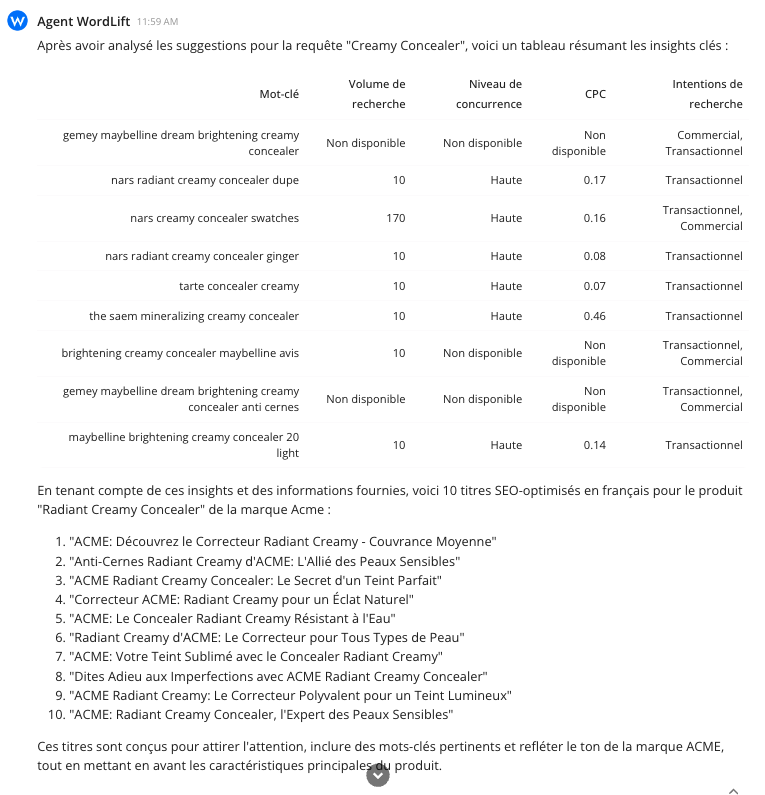

# Create product descriptions from keyword insights

Use this workflow to draft several product descriptions for one product, informed by keyword research, in the language and brand tone you choose. You get a set of variants to pick from and edit instead of writing from scratch.

## Before you start

Have these details ready for the product:

- **Product name and brand.** For example, "Creamy Concealer" by ACME.
- **Current description and category.** Agent WordLift works from the details you provide.
- **Target language.** The language you want the descriptions in.
- **Number of variants.** How many descriptions you want to compare.

## Run the prompt

Send this prompt to Agent WordLift, then adapt it for your own product.

```md className=wlx-send-to-agent
Analyze the "Creamy Concealer" by ACME using the query tool, using its description and product category to extract key insights. Suggest relevant keywords that could enhance its online visibility. Based on these insights, generate 10 SEO-optimized product descriptions in French, each incorporating:
- Brand and product name
- Relevant keywords
- A tone that matches the brand's identity
- Characteristics that highlight the product's unique selling points
```

Change these parts of the prompt:

| Part of the prompt | Example value | Replace with |
|---|---|---|
| Product | "Creamy Concealer" | Your product name |
| Brand | ACME | Your brand |
| Language | French | Your target language |
| Number of variants | 10 | The number of descriptions you want |
| Required elements | Brand and product name, keywords, brand tone, unique selling points | The elements every description must include |

:::warning[Review needed]
TODO [SME]: confirm that "query tool" is still the name Agent WordLift recognizes for the Analyze Query tool.
:::

## What Agent WordLift does

Agent WordLift works through the prompt in 3 stages:

1. **Analyzes the product.** It reads the description and category you provide to identify the product's key features and audience.
2. **Finds relevant keywords.** It uses the query tool to analyze keyword data for the product.
3. **Drafts the descriptions.** It writes the number of variants you asked for, each built from the product details and the keywords.



:::warning[Review needed]
TODO [SME]: the screenshot shows 10 titles for "Radiant Creamy Concealer", not 10 descriptions for "Creamy Concealer". Replace it with output from the prompt on this page.
:::

## Review the output

Agent WordLift drafts from the details you provide and the keyword data it finds, so check every variant before you publish:

- **Product facts and claims.** Confirm that features, ingredients, sizes and benefits match the product. Remove any claim you cannot support.
- **Brand tone.** Edit the wording to match your brand guidelines.
- **Keyword use.** Check that keywords read naturally and fit the product.

Pick the strongest variant, edit it, and publish it on your product page.

## Scale to a catalog

This workflow suits one product at a time. To produce descriptions across a catalog, use [Content Generation](/platform/agent-wordlift/content-generation/): log in to the dashboard and select **Content Generation** in the left menu.

To structure your product data in your Knowledge Graph, see [Product Knowledge Graph](/platform/knowledge-graph/product-knowledge-graph/).

## Related

- **Product highlights.** The [Prompt Library](/platform/agent-wordlift/prompt-library/) includes a Generate Product Highlights prompt for short, scannable product bullet points.
- **Social media planning.** [Create social media content buckets](/platform/agent-wordlift/workflows/create-social-media-content-buckets/) from the content you already publish.
