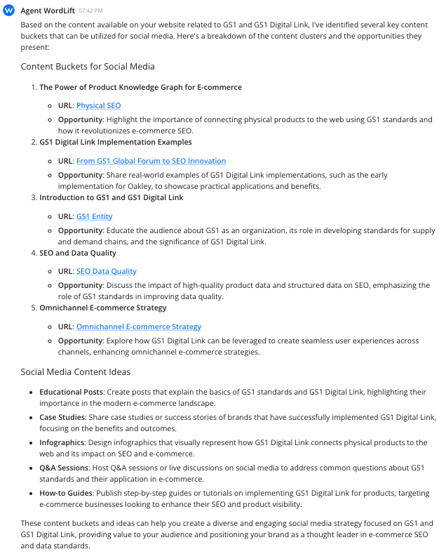

# Create social media content buckets

Content buckets are categories you use to organize your social media content. They are types of content, not topics, and each one relates back to your overall brand message. Use this workflow to have Agent WordLift group the content you already publish on a topic into buckets you can build a posting plan around.

## Before you start

You need:

- **1 to 3 topics your site covers.** The example uses "GS1" and "GS1 Digital Link".
- **Published content on those topics.** Agent WordLift builds the buckets from your existing content. The example uses posts from the WordLift blog.
- **Your target channels.** Know where you plan to post, so you can adapt the buckets for each channel.

:::warning[Review needed]
TODO [SME]: confirm what "Search for content" searches (Knowledge Graph, site search or the web) and whether the workflow needs a populated Knowledge Graph.
:::

## Run the prompt

Send this prompt to Agent WordLift. Replace 'GS1' and 'GS1 Digital Link' with your own topics.

```md className=wlx-send-to-agent
Search for content related to 'GS1', 'GS1 Digital Link' and create content buckets from Social Media.
```

## Review and refine the buckets

Agent WordLift returns a set of content buckets based on the content it finds. In the example, each bucket links to a source article and describes the opportunity it offers, followed by ideas for content types such as educational posts, case studies and how-to guides.



Check each bucket before you plan posts:

- **Type, not topic.** Each bucket describes a kind of content you can publish repeatedly, not a single subject.
- **Brand fit.** Each bucket relates back to your brand message. Drop or merge buckets that don't.
- **Channel fit.** Send a follow-up prompt in the same conversation to adapt the buckets for a specific channel, or to add or remove a bucket.

Agent WordLift suggests buckets and ideas. You decide what to post, and you publish and schedule the posts yourself.

## Turn buckets into posts

- **Write the posts.** Follow [Create social media posts](/platform/agent-wordlift/workflows/create-social-media-posts/) to draft posts and threads from your website content.
- **Plan a newsletter.** Use [Ideas for newsletters](/platform/agent-wordlift/workflows/ideas-for-newsletters/) to turn the same content into newsletter topics.
- **Reuse the prompts.** The [Prompt Library](/platform/agent-wordlift/prompt-library/) includes a Content Buckets prompt with placeholders for your topics, and a Create a Thread on X prompt.
