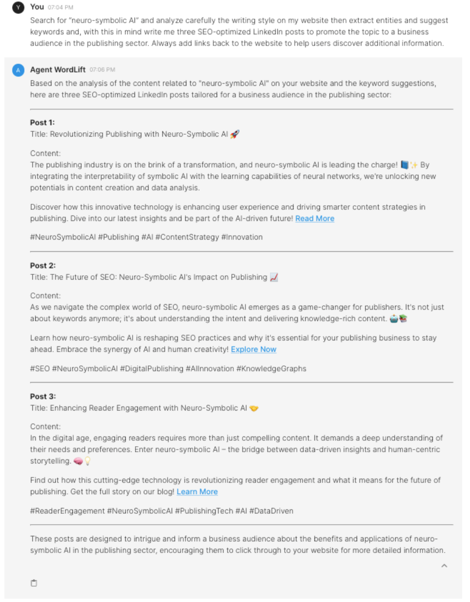
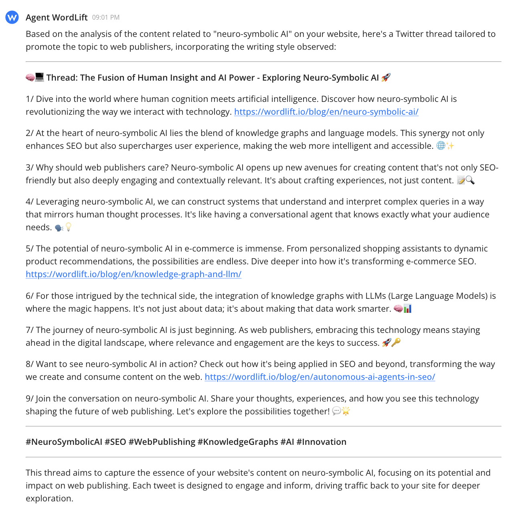
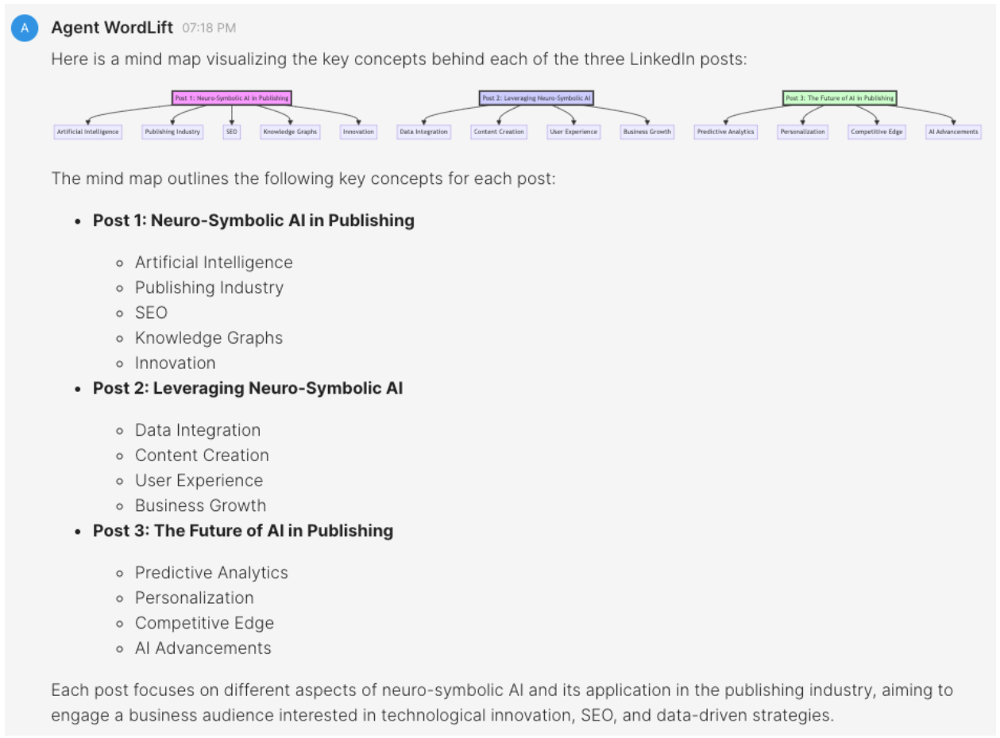

# Create social media posts using content on your website

## Introduction

This workflow shows how to **create LinkedIn posts with Agent WordLift** using the content you already have on your website. The example uses Agent WordLift's ability to **perform several tasks from a single prompt**. Agent WordLift analyzes content, extract entities, suggest keywords, and generate SEO-optimized posts for a specific audience on LinkedIn.

## Write posts for LinkedIn {#writing-posts-for-linkedin}

The first example writes content about "neuro-symbolic AI" using the WordLift website.

### Here goes the prompt

```md className=wlx-send-to-agent
Search for 'neuro-symbolic AI' and carefully analyze the writing style on my website, then extract entities and suggest keywords, and, with this in mind, write three SEO-optimized LinkedIn posts to promote the topic to a business audience in the publishing sector. Always add links back to the website to help users discover additional information.
```



## Create a thread on X {#creating-a-thread-on-x}

Now use a similar prompt to create *a Twitter thread*.

### Here goes the prompt for X

```md className=wlx-send-to-agent
Search for 'neuro-symbolic AI' and carefully analyze the writing style on my website and, with this in mind, create a Twitter thread to promote the topic to web publishers. Always add links back to the website to help users discover additional information.
```



## How it works {#how-things-work-behind-the-scenes}

With the prompt above, Agent WordLift helps you by:

- **Analyzing your website:** It searches your website for content related to "neuro-symbolic AI" to gather relevant information and understand your writing style. This ensures the generated content aligns with your existing content and voice.
- **Identifying key terms:** It analyzes keywords related to "neuro-symbolic AI" and suggests relevant search terms to enhance your LinkedIn posts (or to create a thread on X). This expands your reach by including trending and related terms.
- **Writing the content:** It uses the insights from the website analysis and keyword suggestions to create social media posts highlighting the innovative aspects of neuro-symbolic AI, its relevance to the publishing sector, and its benefits. These posts are designed to engage a business audience on LinkedIn or X and include links to your website content.

Understanding these steps helps you check that the generated content aligns with your website's content and target audience.

## Final review

Finally, review the key concepts behind the generated posts for LinkedIn with a new prompt:

```md className=wlx-send-to-agent
Draw a mind map of the key concepts behind each post.
```



By following this workflow, you can efficiently produce targeted, **SEO-optimized social media content** for your audience with Agent WordLift.
