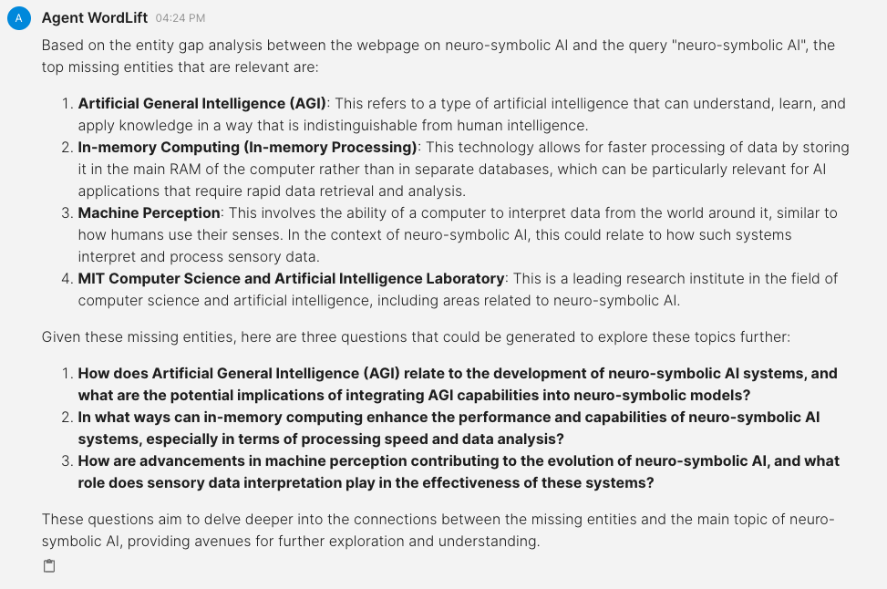
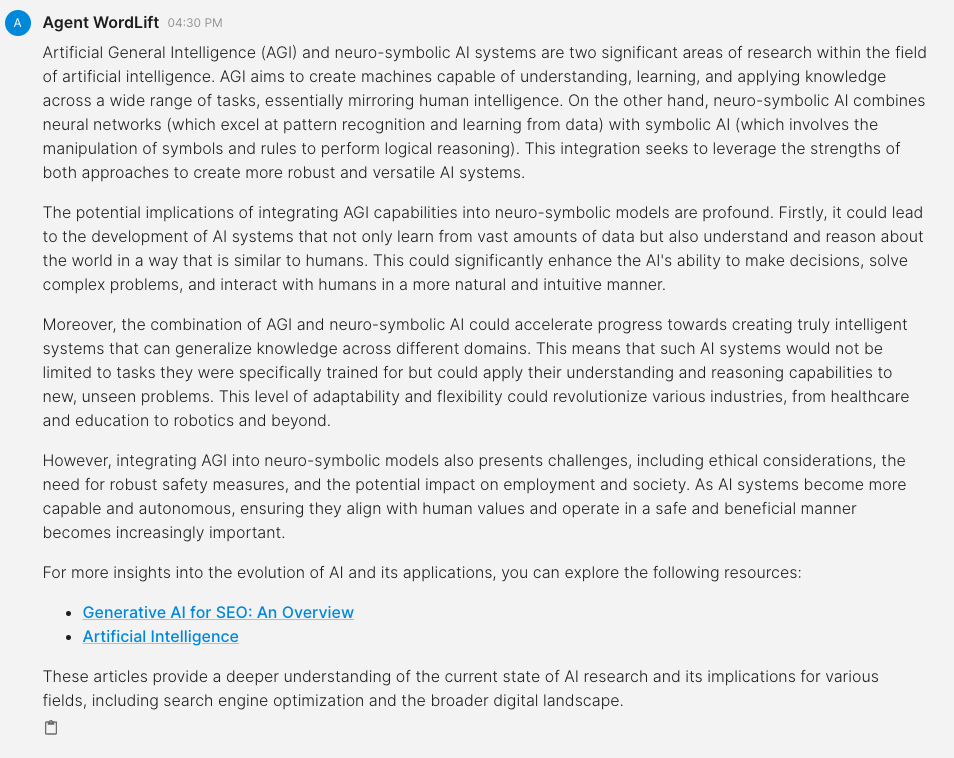

# Generate FAQs

This workflow helps you create **frequently asked questions (FAQs)** based on content from your website and insights from Agent WordLift.

## Understanding the entity gap

The first step involves analyzing the "*entity gap*" between a specific webpage and a user query. Entities are essentially keywords or concepts that define a topic.

:::info

Agent WordLift helps you understand the entity gap by:

* **Identifying key entities on a webpage:** This helps you understand what information the page covers.
* **Analyzing top search results:** The Agent looks at the entities mentioned in top-ranking pages for the same query.
* **Highlighting missing entities:** By comparing these, the Agent identifies concepts relevant to the topic but missing from your webpage.

This analysis helps you create FAQs that address potential user questions based on what your content might be missing.

:::

## Generate questions based on the entity gap analysis

For example, imagine this workflow is analyzing the entity gap between the blog post "Neuro-symbolic AI: Where Knowledge Graphs Meet LLMs" on the WordLift blog and the search query "*neuro-symbolic AI*".

**Entity gap analysis**: Agent WordLift would analyze the blog post and identify key entities related to "neuro-symbolic AI" that are not explicitly mentioned.

**Top missing entities**: Based on this analysis, Agent WordLift would determine the top three missing entities most relevant to understanding "neuro-symbolic AI" in the context of the blog post.

**Question generation**: Finally, the workflow would use these missing entities to automatically generate three relevant questions users might have about "neuro-symbolic AI".

```md className=wlx-send-to-agent
Analyze the entity gap between https://wordlift.io/blog/en/neuro-symbolic-ai/ and the query "neuro-symbolic AI", look at the top missing entities and, if they are relevant, generate three questions accordingly.
```



## Answer the questions

Once the questions are generated, give Agent WordLift a new prompt that will automatically search the website and relevant sources to find answers. It will also consider the writing style of the target webpage to ensure the answers are consistent and informative.

```md className=wlx-send-to-agent
Now, search on the website, read the writing style and prepare the answer for the first question "How does Artificial General Intelligence (AGI) relate to the development of neuro-symbolic AI systems, and what are the potential implications of integrating AGI capabilities into neuro-symbolic models?". Remember to add links back to the sources.
```

This approach allows for efficient generation of FAQs that address potential user queries based on the content of a webpage.


