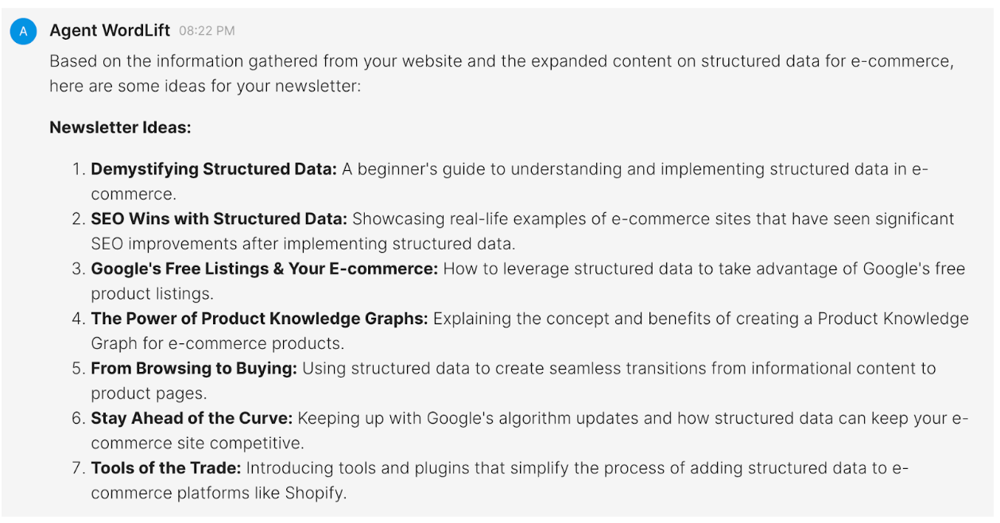
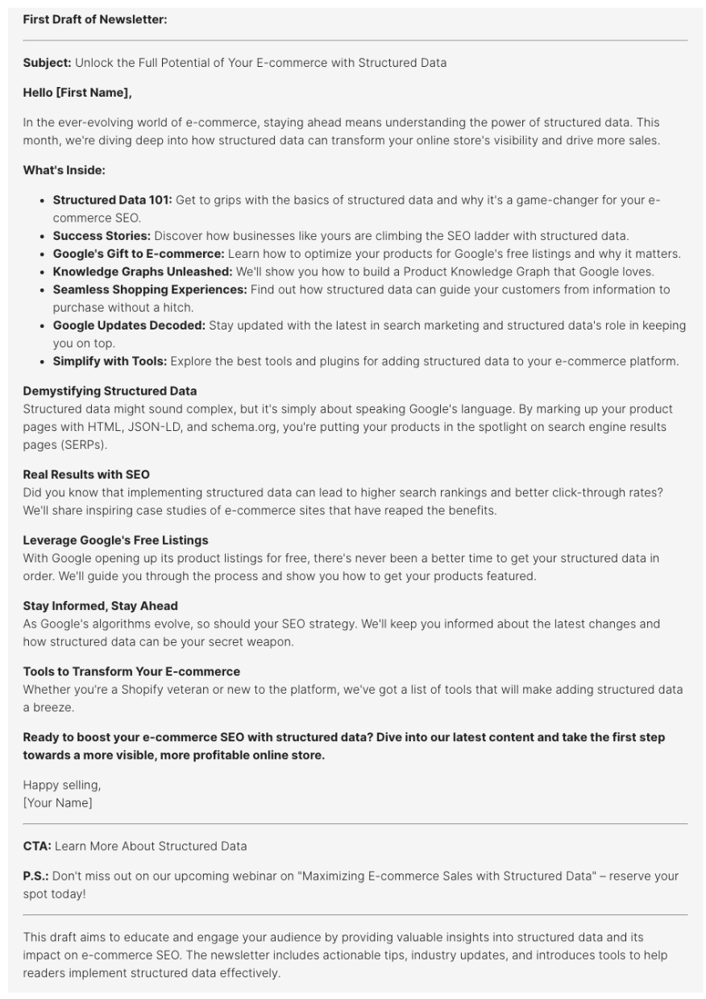

# Ideas for newsletters

This workflow helps you **create a newsletter that engages your target audience** and keeps them informed about a specific topic.

## Generate ideas and a first draft

Start with this prompt:

```md className=wlx-send-to-agent
I'm looking for ideas on how to write engaging and informative newsletters that will keep the audience in the e-commerce space informed about structured data. Search my website, gather all the information, and present the ideas and a first draft.
```

With this prompt, you define **e-commerce** as a target audience and **structured data** as the main topic.

### Here is what you get {#here-is-what-we-get}



The first response also includes the first draft:


