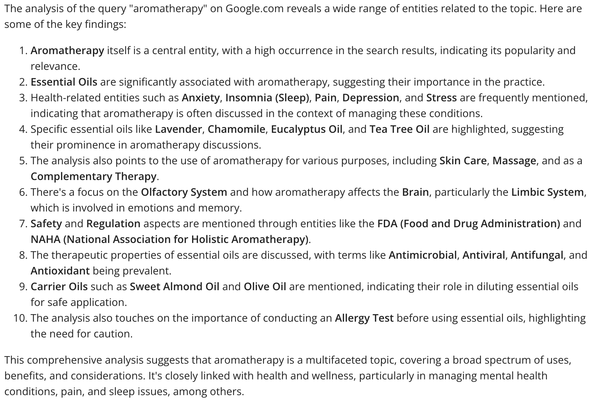
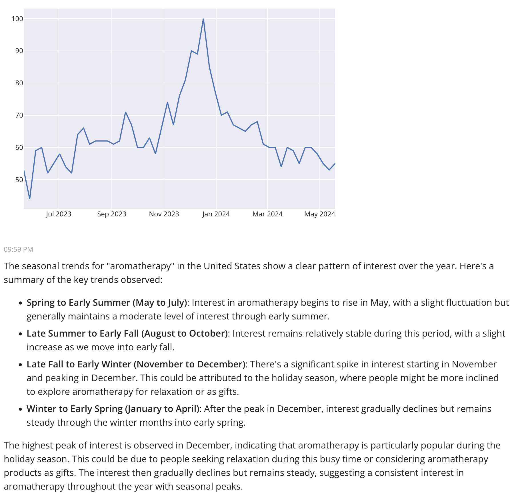
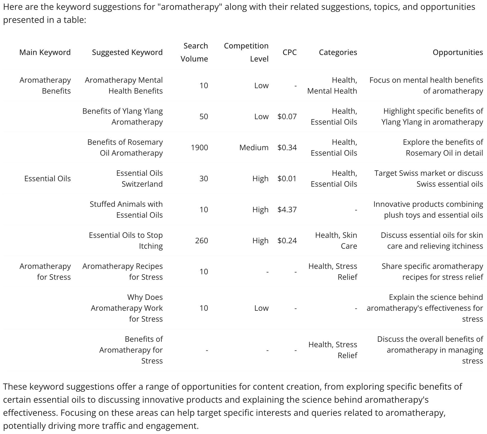
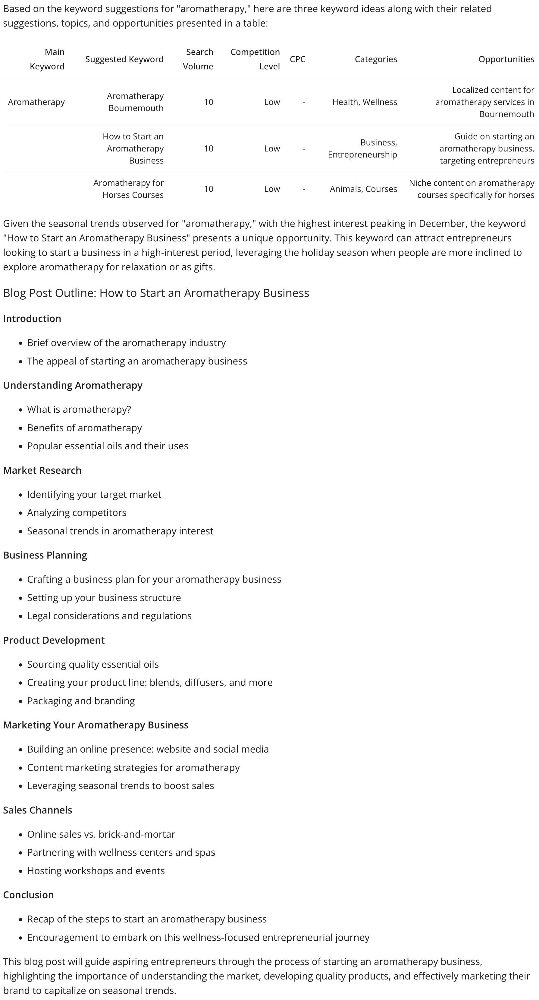

# Run keyword research

This workflow shows how to run **keyword research** with Agent WordLift. Keyword research shows **how a target audience searches on Google**. Use these insights to inform your content strategy and your day-to-day marketing.

## Query analysis for entity extraction

Combine the query analysis tool to extract the main entities behind each query with keyword suggestions to identify relevant keywords and understand the context and intent behind search queries.

### Example prompt for analyzing a query

```md className=wlx-send-to-agent
Analyze the query “aromatherapy” on google.com.
```

Agent WordLift uses WordLift Content Analysis to understand the top-ranking results on google.com. This shows the context behind the query.



To gain a deeper understanding of the interest patterns for this query, analyze the seasonal trends with the WordLift Google Trends API:

```md className=wlx-send-to-agent
Thanks, now analyze the seasonal trends in the US for "aromatherapy".
```

Seasonal trends show the peak times of interest in "aromatherapy", which helps you plan your content marketing.



## Explore keyword suggestions {#deep-dive-into-keyword-suggestions}

Next, explore the keywords (how people search on Google) with a different prompt:

```md className=wlx-send-to-agent
Now, propose three keyword ideas for "aromatherapy" for each keyword, provide suggestions, extract the topics, and present all the data in a table highlighting the opportunities.
```



This approach helps you explore the search landscape more comprehensively, find opportunities and understand searcher intent.

## Advanced prompt for a blog post outline {#sophisticated-prompt-for-blog-post-outline}

You can also use a more advanced prompt that runs the analysis and drafts the outline of a blog post:

```md className=wlx-send-to-agent
Propose three keyword ideas for "aromatherapy". For each keyword, provide suggestions, extract the topics, and present all the data in a table highlighting the opportunities. Then provide me with the outline for a blog post on the keyword that has the highest chance, keeping in mind the seasonality of the main keyword.
```



This prompt not only seeks keyword opportunities but also aims at creating actionable content strategy outputs, like drafting a blog post outline based on the keyword with the highest potential.

With **Agent WordLift for keyword discovery**, you can align your content strategy with actual search behavior and audience needs.
