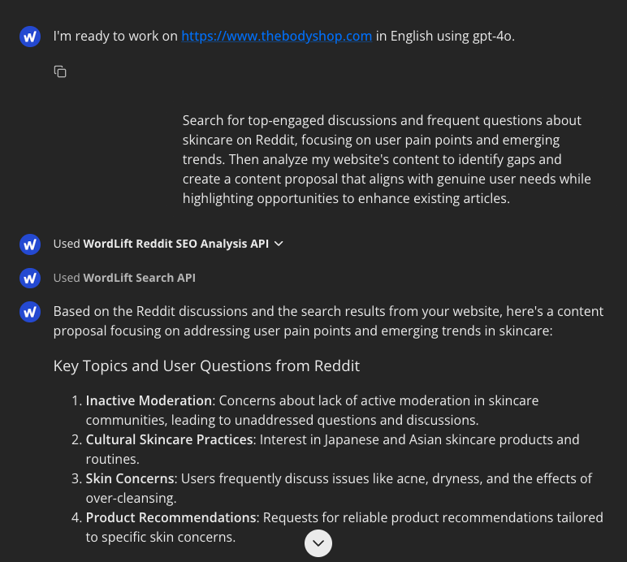

# Research content ideas using Reddit discussions

Reddit is a useful platform for SEO research and content ideation. Learn more about using Reddit for SEO in our guide: [How to use Reddit for SEO: Best Practices, Tips & Strategies](https://wordlift.io/blog/en/reddit-for-seo-best-practices/).

## Watch the workflow in action

Learn how to effectively research content ideas using Reddit discussions with Agent WordLift:

<iframe
  width="100%"
  height="500"
  src="https://www.youtube.com/embed/PApeDYvL5A8"
  frameborder="0"
  allow="autoplay; encrypted-media"
  allowfullscreen referrerpolicy="strict-origin-when-cross-origin">
</iframe>

In this video, you'll see how to:

- Search and analyze Reddit discussions for your topics
- Identify user pain points and emerging trends
- Create content proposals based on Reddit insights
- Align your content with genuine user needs

## Quick topic research

The most effective way to start is with a comprehensive analysis prompt:

```md className=wlx-send-to-agent
Search for top-engaged discussions and frequent questions about skincare routines on Reddit, focusing on user pain points and emerging trends. Then analyze my website's content to identify gaps and create a content proposal that aligns with genuine user needs while highlighting opportunities to enhance existing articles.
```

Agent WordLift analyzes:

- Popular Reddit discussions
- User pain points and questions
- Current trends in the topic
- Your existing content
- Content gaps and opportunities



The image above shows Agent WordLift analyzing both Reddit discussions and your website content using specialized APIs to gather comprehensive insights.

## Understanding the analysis

Agent WordLift provides structured analysis in several key areas:

1. Key topics and user questions from Reddit
2. Existing content on your website
3. Detailed content proposal with:
   - Introduction approach
   - Section breakdowns
   - Enhancement opportunities
   - Call to action suggestions

## Advanced research options

### Analyze specific websites

For deeper competitive analysis:

```md className=wlx-send-to-agent
Analyze these websites for "skincare routines":
https://example1.com/skincare
https://example2.com/beauty
https://example3.com/routines

Then find relevant discussions on Reddit and create a content proposal.
```

### Discover top rankings

To analyze top-ranking domains and Reddit discussions:

```md className=wlx-send-to-agent
Find the top 5 ranking domains for "skincare routines", analyze their content, and compare with Reddit discussions to create a content proposal.
```

## Next steps

Get more detailed insights with follow-up analysis:

```md className=wlx-send-to-agent
Create an outline showing how the discussed topics could be structured into a content series
```

This workflow helps you create content that genuinely addresses user needs while maintaining SEO best practices.
