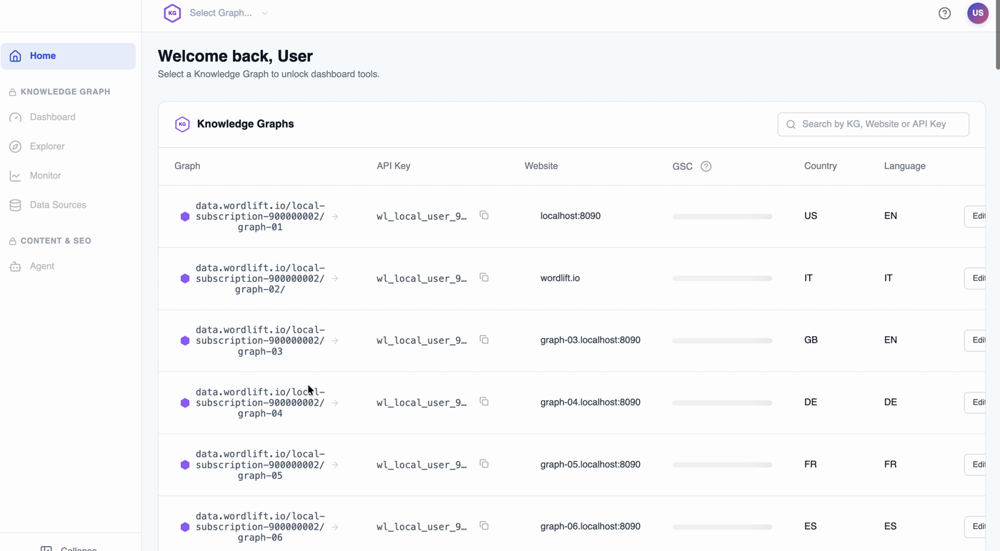
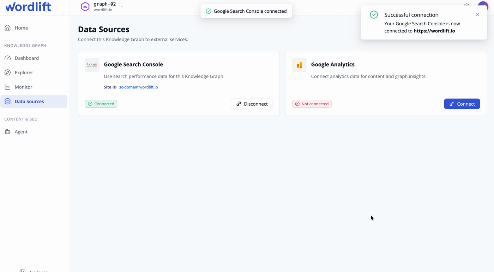

# WordLift Dashboard

The WordLift Dashboard at [my.wordlift.io](https://my.wordlift.io) is where you sign in, choose a Knowledge Graph and reach WordLift's tools and settings. Installing WordLift Cloud on your website is a separate onboarding step: see [Install WordLift Cloud](/welcome/install-wordlift-cloud/).

:::warning[Review needed]
TODO [SME]: confirm the current Dashboard navigation labels (home, websites or graphs list, Data Sources, + Add Merchant, Content Generation, Monitor, settings) and replace the screenshots below if the UI has changed.
:::

## Sign in

Open [my.wordlift.io](https://my.wordlift.io) and sign in with the credentials you received during onboarding.

Dashboard access is human access to your subscription and graph configuration. A customer admin, SEO lead or account owner usually holds it. Name a primary admin, a backup admin and a recovery path so access never depends on one person.

If you can't sign in or your access is missing, contact your WordLift account team or [support@wordlift.io](mailto:support@wordlift.io).

### Sign in with SAML SSO (Enterprise)

Enterprise customers can sign in through SAML single sign-on (SSO) with a supported identity provider, such as Okta, Microsoft Entra ID or Google Workspace. WordLift enables SSO for your account on request. See [SAML single sign-on](/plans-and-pricing/sso-saml/).

:::warning[Review needed]
TODO [SME]: confirm how SSO users reach the Dashboard (an SSO button on my.wordlift.io or a dedicated URL).
:::

## Choose a Knowledge Graph

After you sign in, select the account or Knowledge Graph you want to work on. Most settings, keys and tools apply to the graph you select.

- **Several graphs on one account:** A Business+ account can include multiple Knowledge Graph instances, each with its own dataset and key. The contracted URL allowance is shared across the account, not multiplied by the number of graphs.
- **One graph per language:** Each website is linked to a graph, and each graph has one language and, optionally, a country. A multilingual website uses one graph per language. See [Multilingual](/platform/knowledge-graph/multilingual/).

## What you can do here

- **Find your WordLift Key.** Your available keys appear on the Dashboard home page. To find the key for a specific website, scroll through the list of websites. You use the key for the APIs (`Authorization: Key ...`), the MCP Server, the Agent WordLift Settings panel, Zapier and Power Automate. Store it in an approved secret manager and never put it in client-side code.
- **Connect Data Sources.** Open **Data Sources** to authorize Google Search Console, Google Analytics and other OAuth2 sources, check their status, configure them or disconnect them. You never see raw provider tokens. See [Data Sources](/platform/data-sources/).
- **Set up a Product Knowledge Graph.** Select **+ Add Merchant** in the left navigation and follow the wizard to import a Google Merchant Center feed. Start and monitor import synchronization from the Dashboard. See [Product Knowledge Graph](/platform/knowledge-graph/product-knowledge-graph/).
- **Generate content at scale.** Select **Content Generation** in the left navigation, then **New project** to open the step-by-step wizard. See [Content Generation](/platform/agent-wordlift/content-generation/).
- **Check your site's readiness (Early Access).** Select **Monitor** in the sidebar to see AI readiness, bot readiness and structured data quality for the selected graph. See [Monitor](/platform/monitor/).

## Account and settings

To buy more credits, contact your account manager.

:::warning[Review needed]
TODO [SME]: list which account settings an admin can change in the Dashboard (users and roles, keys, billing) and whether a graph switcher exists for multi-graph accounts.
:::

## Open the tools

- **[Agent WordLift](/platform/agent-wordlift/getting-started/):** Opens at [agent.wordlift.io](https://agent.wordlift.io). Enter your WordLift Key in the Settings panel to connect it to your graph.
- **[Interfaces and tools](/tools/):** Work with your graph from an AI assistant through the MCP Server, or from the command line.
- **[API keys and authentication](/apis-and-sdks/#authentication):** Use your WordLift Key with the WordLift APIs.

## Next steps

[Connect your Data Sources](/platform/data-sources/oauth2/) so WordLift can use your search and analytics data. Then continue with the [onboarding overview](/welcome/#onboarding-overview).
