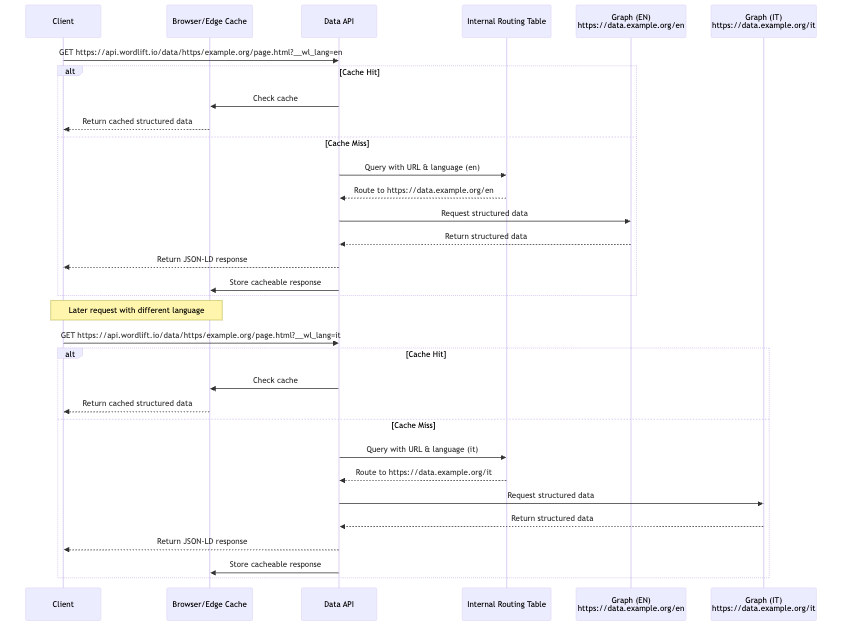

# Multilingual

Each website is linked to a graph, and every graph is configured with one language and, optionally, a country.

A multilingual website can therefore be linked to multiple graphs, each configured with a specific language.

## Structured data publishing

Graphs provide the structured data conformant to schema.org, search engine and AI requirements.

Structured data is stored in the form of linked data entities in the graph. An entity can have a `schema:url` property, which determines which entities (and connected ones) are published for a specific URL.

### Data API

The [Data API](../../apis-and-sdks/data-api/index.md) selects and aggregates this data. When you call the Data API, WordLift returns the structured data for the requested URL as JSON-LD.

On a multilingual website, the same path context may refer to a different graph based on the client language. The Data API uses the `__wl_lang` query parameter to select the correct source graph for structured data.

For example, the internal routing can have the following configuration, where example.org is served by:

1. graph `https://data.example.org/en`, which is also the default, when language is English
1. graph `https://data.example.org/it`, when language is Italian

A request to `https://api.wordlift.io/data/https/example.org/page.html?__wl_lang=en` routes to the `https://data.example.org/en` graph, while a request to `https://api.wordlift.io/data/https/example.org/page.html?__wl_lang=it` routes to the `https://data.example.org/it` graph.

See [Data API](../../apis-and-sdks/data-api/index.md) for URL formatting, output format, and client-side or server-side injection options.

## WordLift Cloud script {#cloud-script}

The [WordLift Cloud](/platform/knowledge-graph/schema-publishing/wordlift-cloud/) script (`bootstrap.js`) selects the correct language automatically by parsing the `html` element's `lang` attribute. For example, the `<html lang="en">` tag tells `bootstrap.js` to request the structured data for English, and the script appends `__wl_lang=en` to the request.

## WordLift Data API multilingual request flow

