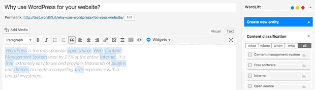
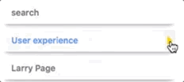
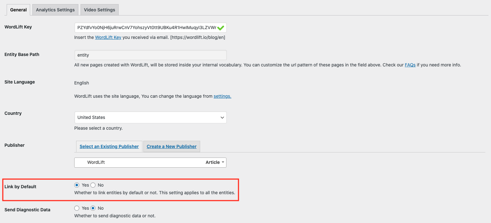
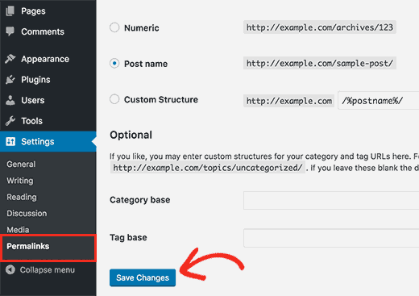

# Frequently asked questions

Answers are grouped by product. Each question has a stable link you can share.

## About WordLift {#general}

### What is WordLift? {#what-is-wordlift}

WordLift is a knowledge graph platform. It builds a [Knowledge Graph](/platform/knowledge-graph/) from your content and data, publishes it as structured data, and powers Agent WordLift and the WordLift APIs on top of it. AI Search and SEO are one application of the graph. Start with the [Welcome page](/welcome/).

### Which plans are available? {#which-plans-are-available}

There are two plans, Business+ and Enterprise. Enterprise includes everything in Business+, and Agent WordLift is included in both. See [Plans and pricing](/plans-and-pricing/) and the [Feature Matrix](/plans-and-pricing/feature-matrix/).

### How do I get access to WordLift? {#is-there-a-free-trial}

Business+ and Enterprise start with a conversation with the WordLift team: [book a Business+ discovery session](https://wordlift.io/business-plus-get-started/) or [send an Enterprise enquiry](https://wordlift.io/enterprise-enquiry/). The Resolve API is the exception: developers can get access directly, without a sales conversation. See [Get access](/apis-and-sdks/#get-access).

### Where do I find billing and credit information? {#billing}

[Billing](/plans-and-pricing/billing/) covers billing cycles, Smart Credits, usage allowances and closing an account.

## Data ownership, export and security {#data-and-security}

### Who owns the structured metadata created with WordLift? {#who-owns-the-structured-metadata-created-with-wordlift}

You do. Customers own the structured metadata they create with WordLift. See [Data ownership and portability](/platform/knowledge-graph/#data-ownership-and-portability) for access, export, migration and identifier-continuity guidance.

### What happens if I stop using WordLift? {#what-happens-if-i-stop-using-wordlift}

Content created through the WordPress plugin remains in the website's WordPress database. Knowledge Graph hosting, publishing, synchronization and other managed capabilities depend on an active WordLift service.

The graph data remains portable. See [Data ownership and portability](/platform/knowledge-graph/#data-ownership-and-portability) for the general policy, and [download your Knowledge Graph data](#how-can-i-download-my-knowledge-graph-data) before you change or end the integration.

### How can I download my Knowledge Graph data? {#how-can-i-download-my-knowledge-graph-data}

Export your entire Knowledge Graph dataset with the [Dataset Export API endpoint](/apis-and-sdks/kg-rest/#export). The API supports RDF/XML, JSON-LD, Turtle and N3.

For example, with wget:

```bash
wget 'https://api.wordlift.io/dataset/export' \
  --header="Authorization: Key <WORDLIFT_API_KEY>" \
  --header="Accept: application/ld+json" \
  -O "export.jsonld"
```

Replace `<WORDLIFT_API_KEY>` with your WordLift API key. For more formats and examples, see the [Export section of the KG-REST documentation](/apis-and-sdks/kg-rest/#export).

### Is WordLift secure? {#is-wordlift-secure}

See [Data ownership and portability](/platform/knowledge-graph/#data-ownership-and-portability) for how your graph data is owned and exported, and [Agent WordLift data privacy](/platform/agent-wordlift/data-privacy/) for how Agent WordLift handles your data. For a security question about your account, [contact WordLift](/support/contact/).

:::warning[Review needed]
TODO [Jason]: confirm which legacy security statements can stay in this answer (SSL for the plugin and front end, a dedicated database, keys encrypted on receipt, no sharing with other services, regular security reviews).
:::

### How do I ask WordLift to delete my account data? {#delete-account-data}

Send a deletion request through the privacy route on [Contact WordLift](/support/contact/#privacy-and-data-requests).

## Knowledge Graph and structured data {#knowledge-graph}

### Which schema types does WordLift support? {#which-schema-types-does-wordlift-support}

WordLift describes entities with the [Schema.org](https://schema.org/) vocabulary. For the types the classic WordPress plugin supports, see the [entity types and properties table](/integrations/wordpress-plugin/edit-entity/#entity-types-and-properties-table) and the [schema types supported by Mappings](/integrations/wordpress-plugin/mappings/#supported-schema-types).

:::warning[Review needed]
TODO [SME]: confirm which schema.org types WordLift supports today (the old answer said "all schema types") and whether support differs by plan or product.
:::

### What is the advantage of using a custom domain for publishing the Knowledge Graph? {#what-is-the-advantage-of-using-a-custom-domain-for-publishing-the-knowledge-graph}

With a custom domain, you publish the Knowledge Graph under a domain you own, such as `https://data.example.org`. Custom domains are available on Enterprise. For setup options and DNS requirements, see [Custom domain configuration](/plans-and-pricing/custom-domain/).

### What is a triple? {#what-is-a-triple}

A triple is a set of three elements: a subject, a predicate and an object. Triples link together to form a [graph](/concepts/#knowledge-graph) that has no hierarchy, is machine readable and can be used to infer new facts. In WordLift, triples describe facts as metadata about an article or an entity. See also [RDF](/concepts/#rdf).

### How can I find the equivalent entity in the web of data? {#how-can-i-search-for-the-equivalent-entity-in-the-web-of-data}

A published dataset, such as the Knowledge Graph you build with WordLift, links to equivalent entities in other datasets with the OWL `owl:sameAs` property. This property states that two nodes in an RDF graph describe the same thing. It applies the fourth [linked data](/concepts/#linked-open-data) principle: refer to other things by their HTTP URIs, so that datasets connect instead of standing alone.

When you create an entity from scratch, find its equivalent in one of these ways:

1. **Use the sameAs search box.** In the WordPress plugin, the sameAs search box looks for the equivalent entity in Wikidata, DBpedia and the datasets configured for your WordLift key.
2. **Search Wikidata.** Use the search bar on [wikidata.org](https://www.wikidata.org). For example, the Wikidata URL for Apache Marmotta is `https://www.wikidata.org/wiki/Q16928009`.

### Are there any integrations with Neo4j? {#are-there-any-integrations-with-neo4j}

Neo4j is a graph database. WordLift exposes your Knowledge Graph for live queries through the [GraphQL API](/apis-and-sdks/graphql-api/), and you can [export the full dataset](#how-can-i-download-my-knowledge-graph-data) in RDF formats.

:::warning[Review needed]
TODO [SME]: confirm whether WordLift still stores data in a Linked Data store (Apache Marmotta) with SPARQL endpoints that a Neo4j connector could use.
:::

## Agent WordLift {#agent-wordlift}

Agent WordLift has its own FAQ. Go straight to the topic you need:

- **[About Agent WordLift](/platform/agent-wordlift/faq/#about-agent-wordlift).** What it is, how it uses your Knowledge Graph and what you can do with it.
- **[Plans and usage](/platform/agent-wordlift/faq/#plans-and-usage).** Which plans include it, how interactions and Smart Credits are counted, and what happens at the limit.
- **[Working with output](/platform/agent-wordlift/faq/#working-with-output).** How to export answers to Google Docs and generate FAQs for your pages.
- **[Languages](/platform/agent-wordlift/faq/#languages).** Supported languages and known limits.
- **[Data and privacy](/platform/agent-wordlift/faq/#data-and-privacy).** Whether your data is used for training and what is stored.

## WordPress plugin {#wordpress-plugin}

These answers apply to existing installs of the classic WordPress plugin. New customers start with [WordLift Cloud](/platform/knowledge-graph/schema-publishing/wordlift-cloud/).

### What are the languages supported by WordLift? {#what-are-the-languages-supported-by-wordlift}

The WordPress plugin supports 32 languages: Albanian, Belarusian, Bulgarian, Catalan, Chinese, Croatian, Czech, Danish, Dutch, English, Estonian, Finnish, French, German, Hungarian, Icelandic, Indonesian, Italian, Latvian, Lithuanian, Norwegian, Polish, Portuguese, Romanian, Russian, Serbian, Slovak, Slovenian, Spanish, Swedish, Turkish and Ukrainian.

The plugin supports one language at a time. Set the main language of the website in the WordLift settings. See [Review the settings](/integrations/wordpress-plugin/getting-started/#configuration).

:::warning[Review needed]
TODO [SME]: confirm that this language list is current for the WordPress plugin.
:::

### Do I need administrator rights to configure the plugin? {#do-i-need-to-be-administrator-to-configure-it}

Yes. You need admin privileges to configure WordLift.

### Why and how should I customize the URL of entity pages? {#why-and-how-should-i-customize-the-url-of-the-entity-pages-created-in-my-vocabulary}

When you select or create entities with WordLift, you [build your internal vocabulary](https://wordlift.io/8-rules-create-vocabulary-wordpress-website/) and add pages to your website. Choose a URL pattern for these entity pages, as you did for the rest of the site:

1. **Keep the default.** WordLift adds the word `vocabulary` between your root domain and the page name: `www.domain.com/vocabulary/name-of-the-entity-page`.
2. **Remove the base.** Delete `vocabulary` to place entity pages in your root folder: `www.domain.com/name-of-the-entity-page`.
3. **Replace the base.** Use another keyword for SEO or branding: `www.domain.com/seo-keyword/name-of-the-entity-page`.

Decide before you finish setup. The entity base becomes read-only after setup.

### Can I stop the analysis from running? {#can-i-prevent-the-analysis-to-run}

Yes. Switch the WordLift analysis on and off with the open and close arrow in the top right corner of the WordLift Edit widget.



### Can I prevent WordLift from loading Wikimedia images? {#can-i-prevent-wordlift-from-loading-wikimedia-images}

Yes. To stop WordLift from loading images from Wikipedia, add this line to your `wp-config.php`:

```php
define( 'WL_EXCLUDE_IMAGES_REGEX', 'https?://[^.]*\.wikimedia\.org/.*' );
```

Add it before the comment line that begins `/* That's all, stop editing`.

### How do I combine my existing JSON-LD with WordLift's JSON-LD? {#i-have-already-published-a-json-ld-on-the-page-how-can-i-integrate-it-with-the-json-ld-that-wordlift-creates}

If a page already has JSON-LD, choose one of these options:

1. **Disable WordLift's JSON-LD.** Add `add_filter( 'wl_jsonld_enabled', '__return_false' );` to your theme.
2. **Edit WordLift's JSON-LD with WordPress filters.** This requires PHP development skills. See the [NewsArticle example below](#how-can-i-change-the-json-ld-type-from-article-to-newsarticle-in-wordlift) and [this answer on Stack Overflow](https://stackoverflow.com/questions/52925820/how-do-i-change-the-json-ld-type-from-article-to-newsarticle-in-wordlift).
3. **Use Mappings.** Customize the JSON-LD in the plugin UI at **Dashboard > WordLift > Mappings**. See [Mappings](/integrations/wordpress-plugin/mappings/).
4. **Add your own JSON-LD with the same `@id`.** Google merges the data from WordLift's JSON-LD and yours.

### How can I change the JSON-LD @type from Article to NewsArticle? {#how-can-i-change-the-json-ld-type-from-article-to-newsarticle-in-wordlift}

Filter the JSON-LD output before WordLift sends it to the browser. The `wl_post_jsonld` filter lets you change any part of it. This example changes `Article` to `NewsArticle`:

```php
add_filter( 'wl_post_jsonld',  function( $jsonld ) {

// Bail out if `@type` isn't set or isn't `Article`.
if ( ! isset( $jsonld['@type'] ) || 'Article' !== $jsonld['@type'] ) {
        return $jsonld;
}

$jsonld['@type'] = 'NewsArticle';

return $jsonld;
} );
```

### What entity types are supported and how do they map to Schema.org? {#what-entity-types-are-supported-and-how-they-map-to-schemaorg}

See the [entity types and properties table](/integrations/wordpress-plugin/edit-entity/#entity-types-and-properties-table) on the Edit Entity page.

### When should I create a new entity? {#when-should-i-create-a-new-entity}

Create a new entity when it is directly relevant to the content you are writing and it does not exist yet. When WordLift already recognizes the entity, edit it instead of creating a new one.

You can add as many entities as you like.

### What are the guidelines for creating new entities to annotate a blog post or a page? {#what-are-the-guidelines-for-creating-new-entities-to-annotate-a-blog-post-or-a-page}

A basic guideline: create the entities a librarian would use to classify your content if it were a book.

You use WordLift to:

1. Categorize your content.
2. Help people find content that interests them.
3. Describe your content in a machine-readable format that other computers can reuse.

WordLift does not detect every key concept automatically. To teach WordLift a new concept, create a new entity.

:::info Note
When a post or page on your website already covers the concept, turn that post or page into an entity instead of creating a new one. [See how](https://wordlift.io/blog/en/wordlift-3-15/).
:::

Follow these rules:

- **Stay accurate and relevant.** Add entities that are accurate and directly relevant to the content.
- **Avoid broad entities.** Do not add excessively broad entities.
- **Do not overload content.** Do not add entities only to increase distribution. As a general guideline, 6 to 8 entities are adequate for most blog posts, depending on the length of the article. If an article has too many entities, replace some of them with a single broader entity.
- **Match the language.** Match every entity to the language of the content.

For more, read [8 rules to create a vocabulary for your WordPress website](https://wordlift.io/blog/en/8-rules-create-vocabulary-wordpress-website/) and [Entity-based SEO: how to optimize your entity vocabulary](https://wordlift.io/blog/en/use-vocabulary/).

### How can I prevent WordLift from creating new entity pages? {#how-can-i-prevent-wordlift-from-creating-new-entity-pages}

Convert existing posts, pages and taxonomy terms into entities that become part of your Knowledge Graph. You then re-link existing pages on your website instead of creating new ones.

### What factors determine WordLift's rating of an entity? {#what-factors-determine-wordlifts-rating-of-an-entity}

The entity rating takes these factors into account:

- **Related posts.** The entity is linked to one or more related posts.
- **Description.** The entity has its own description.
- **Links to other entities.** The entity links to other entities. Each link creates a relationship in the site's [Knowledge Graph](/concepts/#knowledge-graph).
- **Published status.** The entity is published. Like any WordPress post, an entity can stay in draft, but only published entities are available in the analysis.
- **Featured image.** The entity has a featured image, which adds the `schema-org:image` attribute.
- **sameAs links.** Unless the entity is new to the web, it links to the same entity in at least one other dataset with the `sameAs` attribute. This is called data interlinking.
- **Completed properties.** Every entity has a type, such as Person, Place or Organization, and each type has its own properties. Completing them makes the entity more visible and useful.

### Should I link every occurrence of a vocabulary term in a page? {#i-have-a-vocabulary-term-appearing-several-times-in-a-page-should-i-link-all-of-the-occurrences-to-the-term-or-just-once-per-page}

You do not have to. There is no limit on the number of internal links that point to the same entity page, but keep the number of different entities per article limited.

Too many links to the same entity become irrelevant to readers. In a long article, 2 or 3 links to the same entity page can help readers who miss the first one.

### When should I link one entity to another? {#when-should-i-link-one-entity-to-another}

Run the analysis on an entity's description to link it to other entities. WordLift stores these relationships in the [graph](/concepts/#knowledge-graph) with the Dublin Core property `dct:related`, and uses them to suggest new connections between the content on your site.

Linking entities is optional, but it gives your content more structure. Link entities that help readers discover relevant content. For example, link the entity *Berners-Lee* to the entity *Web*, because the two concepts are closely related.

### How can I enable or disable links to entities? {#how-can-i-enable-or-disable-links-to-entities}

To enable or disable the link for one annotation, toggle its **Link** option.



To enable or disable links site-wide, use the **General** tab of the WordLift Settings screen.



### Why do I get a 404 error on pages linked by WordLift? {#why-do-i-get-404-error-on-pages-linked-by-wordlift}

New WordPress posts or pages, including pages WordLift creates, sometimes return a 404 error. This is a known WordPress issue. To fix it, open **Settings > Permalinks** in your WordPress dashboard and select **Save Changes**. WordPress regenerates all permalinks.



To learn more about this issue, read [how to fix WordPress posts returning a 404 error](http://www.wpbeginner.com/wp-tutorials/how-to-fix-wordpress-posts-returning-404-error/) on WPBeginner.

### What are the datasets WordLift uses for named entity recognition? {#what-are-the-datasets-wordlift-uses-for-named-entity-recognition}

:::warning[Review needed]
TODO [SME]: confirm which datasets entity recognition uses today (the old answer named DBpedia, Freebase and Redlink; Freebase no longer exists).
:::

## Still need help? {#still-need-help}

- **[Troubleshooting](/support/troubleshooting/).** Find your symptom and the fix.
- **[Contact WordLift](/support/contact/).** Reach technical support, sales or the privacy team.
