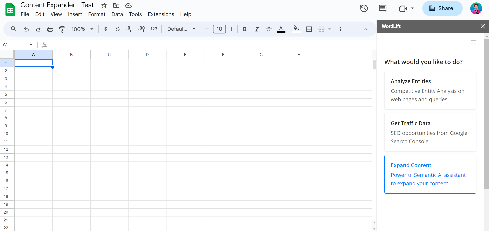
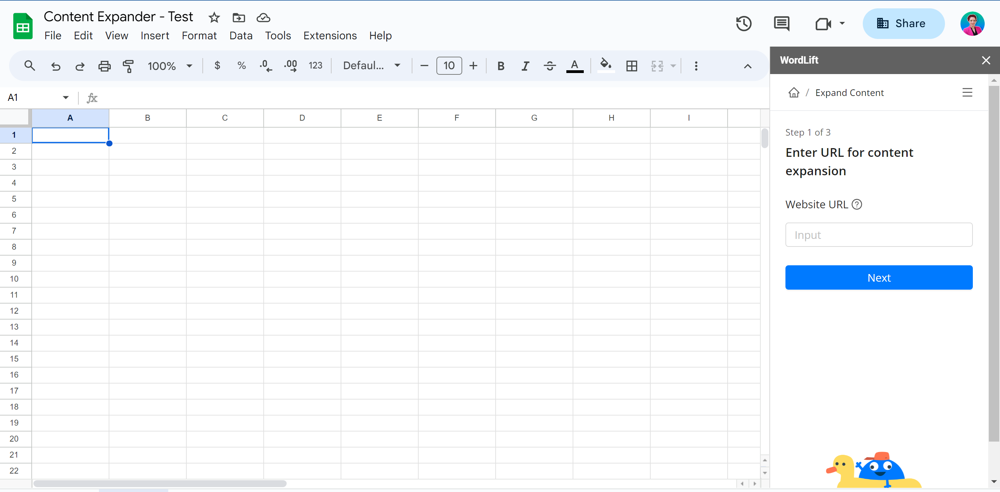
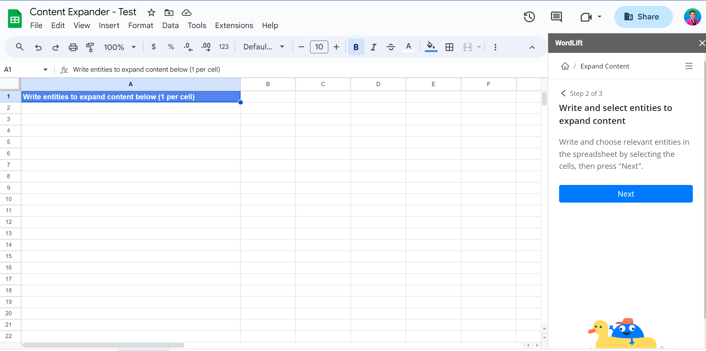
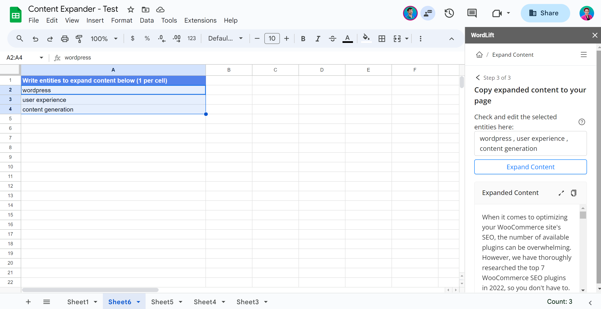
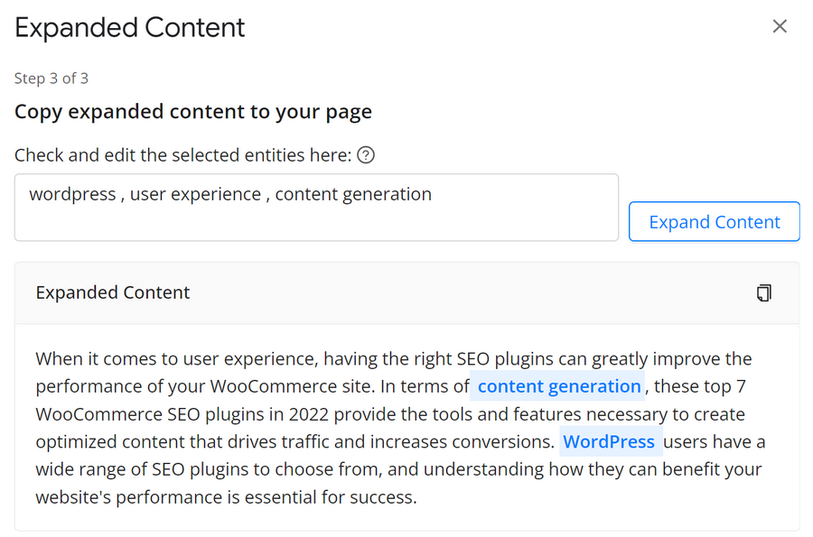

# SEO add-on for Google Sheets

The [**SEO Add-on for Google Sheets™ by WordLift**](https://wordlift.io/blog/en/seo-add-on-for-google-sheets/) lets you run **semantic keyword research** and **entity analysis**, and create the JSON-LD that helps Google understand what your content is about.

Install the add-on, then analyze the entities behind a search query and the entities behind a web page (yours or a competitor's). Use the results to build a semantic content strategy that shows which entities can enrich your content and help you beat the competition.

The entity analysis supports hundreds of languages and many different alphabets (any language natively supported by Wikidata).

In this video, you learn what the SEO add-on for Google Sheets is and how it can help you improve your SEO strategy.

<iframe width="100%" height="500" src="https://www.youtube.com/embed/Fxb9tugJMe8" frameborder="0" allow="autoplay; encrypted-media" allowfullscreen referrerpolicy="strict-origin-when-cross-origin"></iframe>

## How it works

### 1. Installation

To install the SEO add-on, open [WordLift in the Google Workspace Marketplace](https://workspace.google.com/marketplace/app/wordlift/785668802292).

Click the *Install* button, then the *Continue* button, and then click *Allow* when requested.

### 2. Create Google Sheets

Once the SEO add-on is installed, create a new Google Sheets™ document at [sheets.new](http://sheets.new).

In Google Sheets, open the SEO add-on from the *Extensions* menu: select *WordLift*, then *Open*. The sidebar opens.

### 3. Configure settings

Next, configure the **SEO add-on settings**. Click the Next button in the sidebar.

The SEO add-on needs a key to work. WordLift normally prefills the key based on your email address. If you use a different email address with Google, you need to enter the key yourself.

You can also configure your **target geo market**, **language** and the **Google domain** to use for SERP analysis.

### 4. Run the entity analysis

Once you have set up the SEO add-on, click **Entity Analysis** and follow the steps: select up to 5 queries or URLs you want to analyze and run the analysis.

The result includes:

- The **list of entities**, with links to DBpedia or Wikidata.
- The **confidence level** of each entity (a value from 0 to 1 that takes into account factors such as thematic relevance and contextual ambiguity).
- The **ranking** of the entities in the SERP (this data comes from the analysis of the entities a query refers to).
- The **number of occurrences** in the text (how often the entity appears in the content).

Select the most relevant entities, and the SEO add-on creates the JSON-LD for you to copy and paste into your website.

### 5. Expand your content

With the **Content Expander**, you can enrich your content by adding relevant entities. It takes a few steps.

First, from the main screen, click **"Expand Content"**. You need an OpenAI key to configure this feature. To find out how to get one, see [Where do I find my OpenAI API key?](https://help.openai.com/en/articles/4936850-where-do-i-find-my-secret-api-key)

:::warning[Review needed]
TODO [SME]: the Content Expander asks customers for their own OpenAI key, which names a vendor (decision 4). Decide whether to keep this requirement on the page, describe it generically, or retire the feature.
:::

#### Step 1: Choose a URL

Select the URL of the page you're working on. This can be a blog post, an article or any web page you want to improve. The Content Expander analyzes this page to understand its context and existing content.

#### Step 2: Write entities

Next, write the **list of entities that you want to add to your content**. These entities can be essential keywords, concepts or topics related to your content. This step makes sure the generated content fits with your existing material.

#### Step 3: Expand the content

With the URL and entities in place, **let the Content Expander do its job**. With a single click, the add-on generates text that weaves these entities into your content, ready to improve your page's relevance and search engine visibility.

You can **expand the window to read the text more easily**. You can add entities to the list or remove them. Click "Expand Content" again to **regenerate the text**.

#### Step 4: Copy and paste into your page

Once the content is generated, **copy and paste it directly into your website**. The expanded content adds depth and relevance to your page.

With these steps, you can **improve your content's performance on search engines**.

### 6. Get traffic data

To know which search queries to boost, connect the SEO add-on to your Google Search Console and sort the analysis by your traffic data. You also get an **Opportunity Score** column, which suggests which search queries to target so you can choose the best ones for your content.

Then **select the relevant entities**. If you use WordPress with the WordLift plugin, WordLift can import the entities straight into your Knowledge Graph. Otherwise, copy the JSON-LD from the sidebar into your own CMS or web page.

Watch this demo to learn how to use the SEO add-on for Google Sheets:

<iframe width="100%" height="500" src="https://www.youtube.com/embed/bhxiRj7_ZKs" frameborder="0" allow="autoplay; encrypted-media" allowfullscreen referrerpolicy="strict-origin-when-cross-origin"></iframe>

:::info Note
The **SEO add-on for Google Sheets™ is included in the [Business+ plan](https://wordlift.io/pricing/)**, and in Enterprise, which includes everything in Business+. You can use the Content Expander only on these plans. Alternatively, you can buy the [SEO Add-On for Google Sheets](https://deals.thenextweb.com/sales/lifetime-subscription-wordlift-standard?aid=&utm_campaign=feed&utm_medium=RSS&utm_source=thenextweb) from the TNW website (in this case, the Content Expander is not included).
:::

:::warning[Review needed]
TODO [SME]: the TNW lifetime subscription conflicts with sales-led access. Confirm whether the offer still exists; if not, remove the sentence.
:::

## Why the add-on asks for a country {#why-is-it-asking-for-the-country-to-be-added}

Google's SERP differs from country to country, and the top-ranking results can be different. Local versions of Google results look different depending on where you search from.

## How location affects the analysis {#how-can-the-location-affect-the-analysis}

Google's SERP changes depending on the location. Enter it before you start the search: only then are the results of the analysis reliable for the market and audience your company is interested in.
