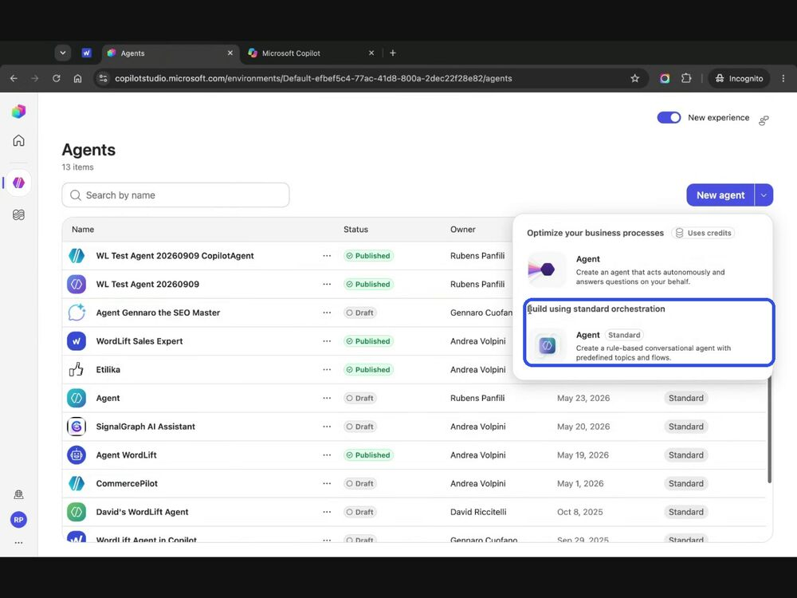
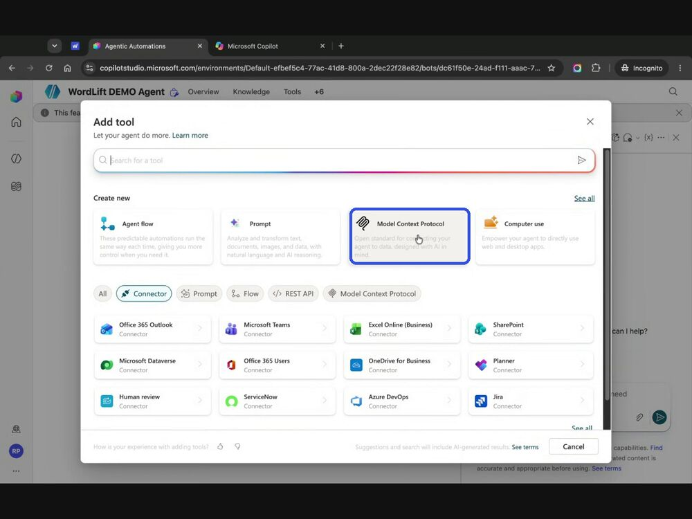
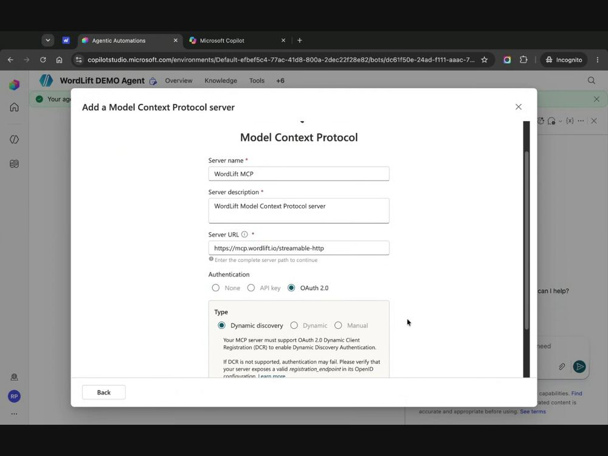
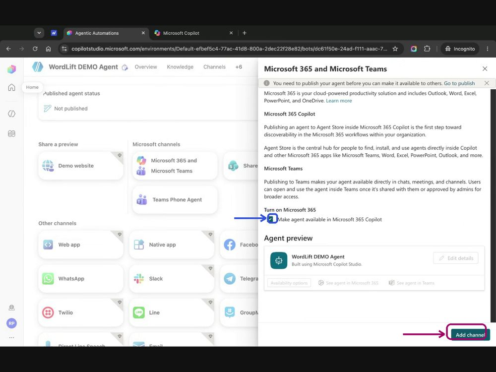
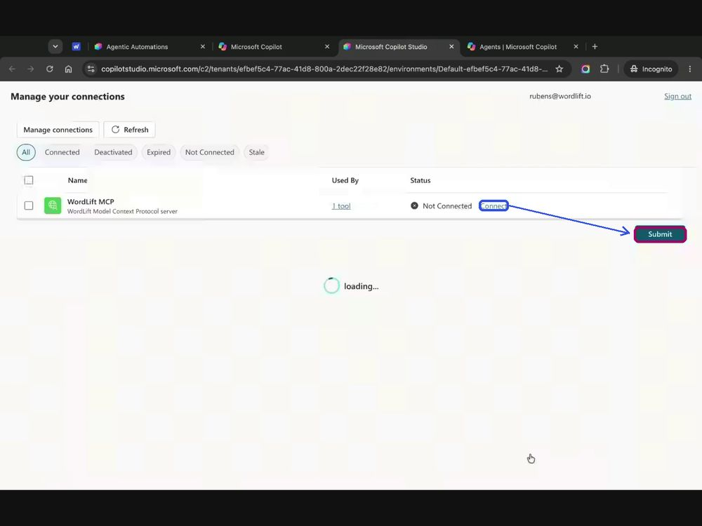
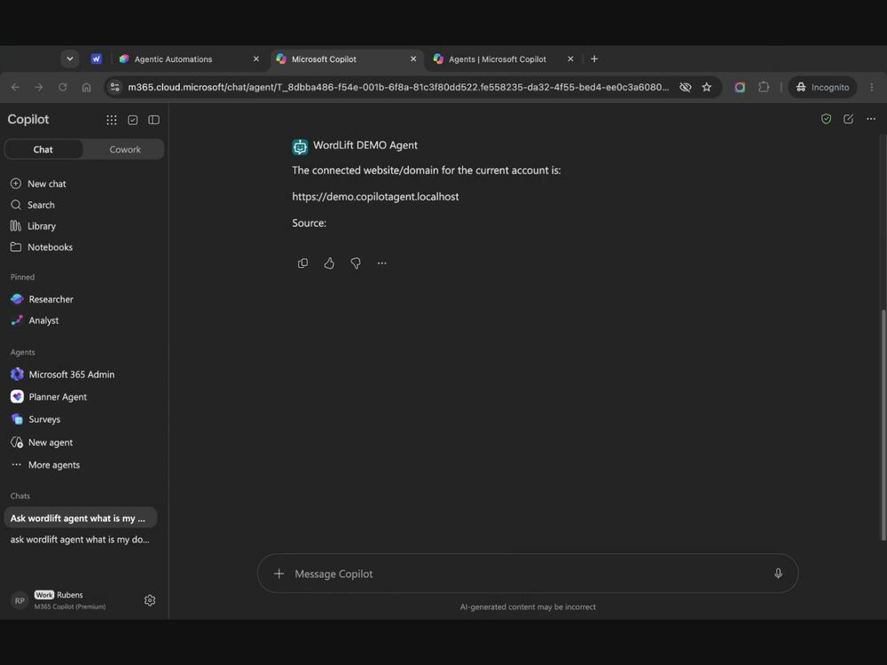

# Connect Microsoft 365 Copilot to WordLift

Give your team WordLift's tools inside Microsoft 365 Copilot chat. You build an agent in Copilot Studio, connect it to WordLift's Model Context Protocol (MCP) Server, and publish it to Microsoft 365 Copilot. Colleagues can then ask the agent about your site and Knowledge Graph without leaving Copilot.

The setup has three stages: build the agent, publish it, then use it in Copilot chat.

## Before you begin

- **Microsoft 365 account:** You need a Microsoft 365 account with access to [Copilot Studio](https://copilotstudio.microsoft.com).
- **WordLift API key:** Find it on your user dashboard at [my.wordlift.io](https://my.wordlift.io).
- **MCP Server basics:** For the server URL and the other supported clients, see [Connect AI assistants with the MCP Server](/tools/mcp-server/).

:::warning[Review needed]
TODO [SME]: state which Microsoft licenses are required and whether publishing to the Agent Store needs tenant admin approval.
:::

## Build the agent in Copilot Studio

1. Go to `https://copilotstudio.microsoft.com` and sign in with your Microsoft 365 account.
2. Open **Agents** in the left menu. Select the arrow next to **New agent**, then choose **Build using standard orchestration**.

   

3. Give the agent a name and continue.
4. In the agent's header menu, select **Tools**, then select **Add a tool**.
5. In the **Add tool** panel, under **Create new**, select **Model Context Protocol**.

   

6. Enter the server details:
   - **Server URL:** `https://mcp.wordlift.io/streamable-http`
   - **Authentication:** **OAuth 2.0**, type **Dynamic discovery**

   

7. Copilot Studio opens a WordLift sign-in popup. Paste your **WordLift API Key** and select **Authenticate & Approve**.

   

The agent now has WordLift as a tool.

## Publish to Microsoft 365 Copilot

8. In the header menu, select **Channels**. Under **Microsoft channels**, open the **Microsoft 365 and Microsoft Teams** tile.
9. Check **Make agent available in Microsoft 365 Copilot** and select **Add channel**. Then select **Publish** at the top of the page.

   

10. In the same channel panel, select **See agent in Microsoft 365**. The agent opens in Microsoft 365 Copilot.
11. Microsoft 365 Copilot shows the agent's card in the Agent Store. Select **Add**.

## Use it in Copilot chat

12. Optional: pin the agent. Hover over the agent under **Agents** in the left sidebar and select the pin icon. The agent now stays under **Pinned**.
13. Ask the agent a question. The first time you use a WordLift tool in a chat, or after a connection expires, Copilot may ask you to connect first. Select **Open connection manager**.
14. Find **WordLift MCP** in the list. Select **Connect**, then **Submit**. Back in the chat, select **Retry** to run your question again.

    

## Check that it works

Ask the agent a question about your WordLift account, for example:

```text
Ask wordlift agent what is my domain url
```

The agent calls WordLift's tools over the MCP connection and replies with the domain connected to your WordLift account. It cites its source beneath the answer.



## Update the agent

Any change you make to the agent later, such as its tools, instructions or knowledge, stays local until you select **Publish** again. If people are already using the agent, for example in Microsoft Teams conversations, also check **Force newest version** in the publish dialog. People then get the update right away instead of finishing their current session on the old version.


## Related

- [Connect AI assistants with the MCP Server](/tools/mcp-server/)
- [Agent WordLift Skill](/tools/agent-wordlift-skill/)
- [Prompt Library](/platform/agent-wordlift/prompt-library/)
